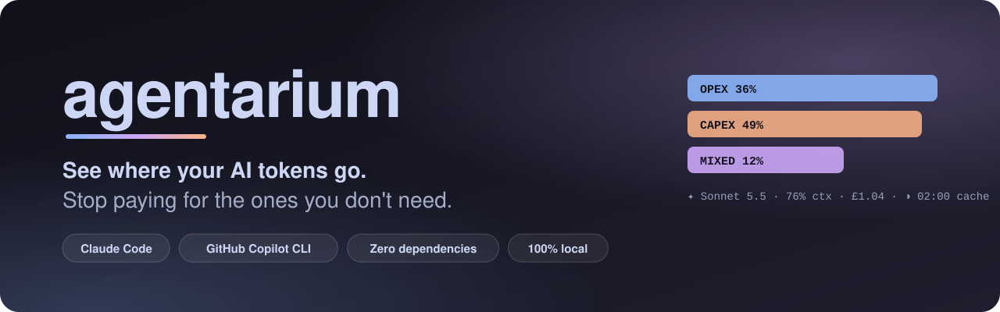
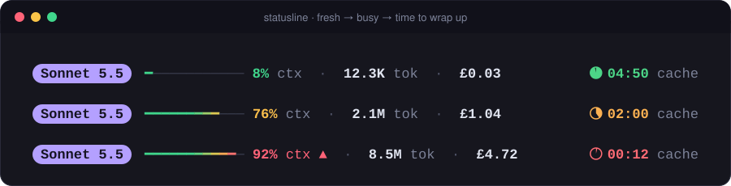
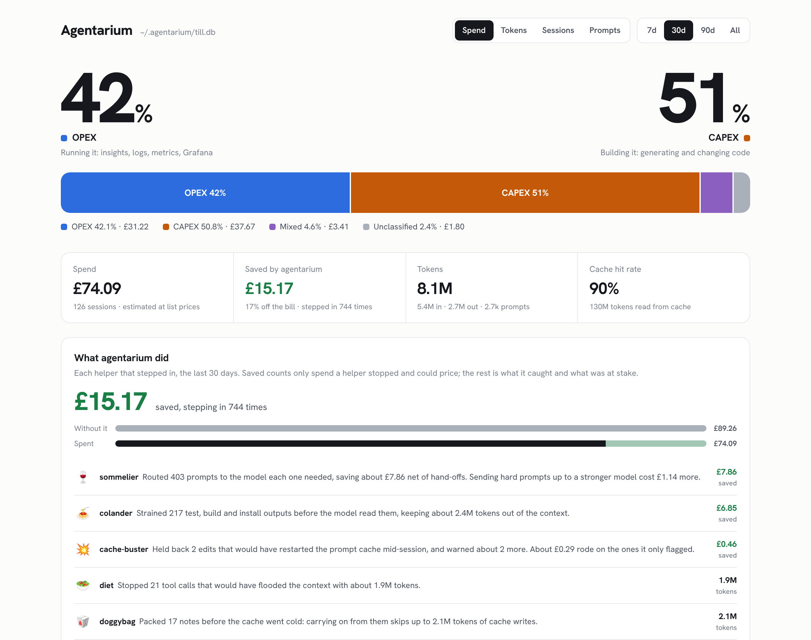
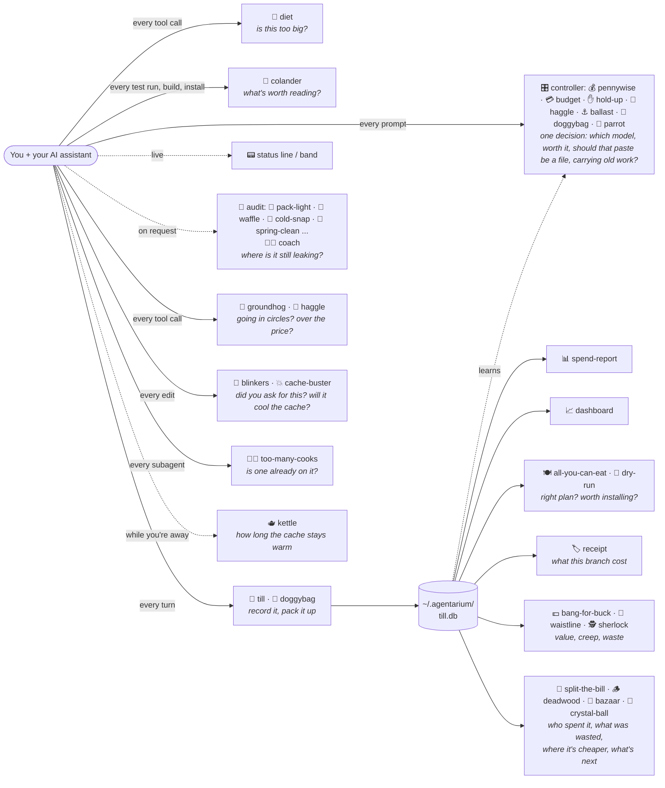

<p align="center">
  
</p>

<p align="center">
  <a href="#-install"></a>
  <a href="docs/installation.md#github-copilot-cli"></a>
  
  
  <a href="#-dependencies"></a>
  <br>
  <a href="https://github.com/andrew44/agentarium/releases/latest"></a>
  <a href="https://github.com/andrew44/agentarium/actions/workflows/tests.yml"></a>
  <a href="LICENSE"></a>
</p>

<h2 align="center">The AI agent utility ecosystem.</h2>
<h3 align="center">Make every AI token earn its keep: stop the spend before it happens.<br>Automated prevention for the whole AI coding session, in Claude Code and GitHub Copilot CLI: the right model for every prompt, a forecast of what's coming, and the one change that saves most, before you pay for it.</h3>

<p align="center">
  <a href="#-install"><b>Install</b></a> ·
  <a href="#-whats-in-the-box"><b>What you get</b></a> ·
  <a href="#-see-it-in-action"><b>See it in action</b></a> ·
  <a href="#-turn-things-on-and-off"><b>Switches</b></a> ·
  <a href="docs/README.md"><b>Docs</b></a>
</p>

---

Every message you send re-sends the **whole conversation**. Long chats, pasted logs, a 2 MB lockfile, the top-tier model for a one-line fix, a coffee break that lets the prompt cache expire: each one quietly multiplies the bill, and you never see it happen.

Most cost tools are receipts: they tell you what you already paid. **agentarium works on what you're about to pay.** It steps in automatically before the prompt, before the tool call and before the cache goes cold, and it says what each step will save. ([Why prevention, not reporting →](docs/strategy.md))

<p align="center">
  
</p>

- 💰 **The right model for every prompt: [pennywise](#-the-flagship-pennywise).** Routes each prompt down to Haiku or up to Opus by what it needs, and routes down harder as your budget runs out, so it lasts.
- 🔭 **See what's coming, not just what's gone.** agentarium's row in the band, above the prompt box, forecasts the next steps, shows the budget left (in steps), prices a cold cache before it happens, and names the one change that saves most. The terminal status line shows context fill, tokens, cost in £/$/€ and the cache countdown, with the same forecast row under it.
- 🛡️ **Stop waste automatically.** Guard-rails that catch context floods, loops, scope creep and runaway spend *before* they cost you, each with a one-step override.
- 🍝 **Read the result, not the noise: [colander](#colander-drains-the-test-run).** A green test run reaches the model as its summary, not 353 passing tests: every successful test run, build, lint and install is strained first, warnings and failures kept, the full output one grep away.
- 🧑‍🏫 **Get better at it.** A coach that reviews your prompts, a weekly spend report with three fixes tied to your own numbers, and audits of what every request carries before you type and of what the agent writes back.
- 🦜 **Say it once.** Spots the instructions you repeat every session and writes them into CLAUDE.md or a slash command, finds what keeps breaking the prompt cache, and checks you're on the plan that fits your usage.
- 💷 **Know what you're getting for it.** Cost per feature shipped and bug fixed, a price agreed before a task starts, a forensic audit of wasted steps, cost-regression checks (in CI too), and proof that a cheaper setup didn't cost you quality.
- 🧾 **Explain it to finance.** Spend by project, developer, agent, model and provider; what produced nothing this month; the cheapest provider for the same work; and a forecast before you roll AI out to a team.
- 🔒 **Stays on your machine.** One local SQLite file. No account, no telemetry, no packages to install: it's TypeScript that Node.js runs directly.

---

## 💰 The flagship: pennywise

*Penny wise, pound foolish.* pennywise is the decision every prompt goes through: **which model should do this?** It scores each prompt and sends it to the tier it needs, down to Haiku for a rename, up to Opus for an architecture question, with nothing to set up.

- **Down to save, up to succeed.** A hello-world never runs on the priciest model; a hard problem never gets stuck on the cheapest.
- **Only when it pays.** Handing a prompt to a cheaper model isn't free: your model still reads the conversation to pass it on. pennywise prices that hand-off and only routes down when the saving is bigger, then shows what it saved, net, on the status line, the band and the weekly report. It also reads what the routed model really used from the transcript, shows estimated against measured in `agentarium router status`, and prices later routes on your own tasks' shape and your session's cache (a hand-off that outlasts a warm cache costs the relay a re-write).
- **Spends to your budget.** Once a daily or session budget passes 80%, pennywise routes down harder and stops routing up, so the budget lasts the task instead of running out halfway. Forced models (`opus:`) still win.
- **Backs off when it got it wrong, and learns.** "That didn't work" after a routed answer sends the next prompt back to your model, and so does the evidence when you don't say it: the routed work ended on a failing test, was reverted or tripped groundhog. Those misses, and your `keep-model:` overrides, tune its thresholds at the end of every session, within bounds, per project once a repository has enough routes of its own. `agentarium router eval` scores it on a labelled set of prompts (90% on the right tier today), `--mine` on your own misses (hashes only unless you opt in to the wording), and CI fails if a change to the scorer routes the set worse.
- **Two ways to run.** As a hook (the default, nothing to set up), or as a per-request routing proxy, which skips the hand-off entirely: `agentarium router on` starts it in the background and points Claude Code at it (`off` undoes it).
- **Always your call.** `keep-model:` keeps your model for one prompt; `AGENTARIUM_PENNYWISE=warn` only suggests; `agentarium profile frugal` or `quality` moves the whole dial.

```text
pennywise: routing down to Haiku (SIMPLE, score -0.25, saves ~£0.07 after the hand-off) instead of Opus.
Start a prompt with 'keep-model:' to keep it on Opus.
```

Every prompt gets **one decision and one message**: pennywise, budget, haggle and the guard-rails run together, in order, in one process, and the first one that needs to pause the prompt decides alone.

[How pennywise scores and routes →](docs/reference.md#pennywise)

## 🔭 The band: what's coming, and what to do about it

The band is the strip Claude Code keeps directly above the prompt box, where each mod draws a row. agentarium's row, in the desktop app and VS Code (the terminal has the status line instead), doesn't just say what the session has cost. Under the live line sits the **outlook**:

| | Shows | e.g. |
|---|---|---|
| **Forecast** | What the next 10 steps will cost at this context size and pace | `£0.65` next 10 steps |
| **Budget left** | The tightest of your daily and session budgets and the price you agreed with haggle for the task in hand, and how many steps it buys | `£0.29 left` · today · ~4 steps, or `£0.80 of £2.00 left` · this task · ~3 steps |
| **Cache risk** | What a cold cache adds to the next prompt; once cold, what the next prompt will pay | `£0.58` at risk if the cache goes cold |
| **Saving** | The one change that saves most, priced | `→ reply within 01:40` saves ~£0.58 · `→ /clear` saves ~£0.83 |
| **Saved** | What pennywise saved this session, net of its hand-offs | `£0.41` saved by pennywise |

On **Copilot CLI** (and Copilot in VS Code), which bills premium requests rather than tokens, the status line's second row shows the monthly allowance instead: requests left, the pace, and the day they run out at that pace (`agentarium copilot`). On **Copilot Fusion**, which picks a model for each task, the model pill shows where it sent the work (`Copilot Fusion → claude-sonnet-4.6`) and each prompt counts at that model's multiplier.

**The pane** puts the same numbers beside the transcript, in three tabs: **Now** (model, context, tokens, spend and the cache countdown), **Ahead** (the outlook above, with a bar for the budget used) and **Advice** (every change worth making now, the most urgent first, e.g. `Compact now`, `Cache is cold`, `Budget running low`). It opens by itself in the Claude desktop and mobile apps until you close it; `/agentarium-pane` opens it anywhere, the terminal included, and says why if the app isn't drawing it. The band row and the pane are drawn by agentarium's mod, and Copilot runs no mods, so the GitHub Copilot app shows neither: there, `agentarium copilot --window` keeps the premium requests beside it.

[More about the band →](docs/reference.md#band) · [the pane →](docs/reference.md#pane)

---

## 🧠 The agentarium intelligence engine

Token counts tell you what AI cost. They don't tell you whether it was worth it. agentarium works in four stages, on five shared services that run the same way for Claude Code and Copilot:

| | Stage | What it does | Helpers |
|---|---|---|---|
| 👁️ | **1. Observe** | Collect costs, tokens, tool calls, task outcomes and agent behaviour, from every assistant, in one event format. | till · status line · dashboard |
| 🧠 | **2. Understand** | Find waste, inefficiency, quality problems and spending patterns. | **sherlock** · **audit** (pack-light · waffle · cold-snap · ballast · spring-clean · deadwood · groundhog · parrot · waistline) · split-the-bill · coach · dry-run · rate-my-prompt |
| ⚙️ | **3. Optimise** | Prevent spend automatically, or recommend the change that saves most. | **pennywise** · the controller · band · bazaar · blinkers · diet · colander · groundhog · budget · hold-up · haggle · doggybag · ballast · parrot · fishingrod · cache-buster · too-many-cooks · kettle · all-you-can-eat |
| ✅ | **4. Prove** | Measure savings against task success and output quality. | **bang-for-buck** · **taste-test** · crystal-ball · receipt |

### ⭐ Proof features

Prevention is only worth it if the work still lands. These three prove it: what you spent, what it bought, what was wasted, and proof the saving didn't cost quality. A token-saving tip can't do that.

- 💷 **Value meter: [bang-for-buck](docs/reference.md#bang-for-buck).** Cost per completed feature, bug fixed and passing test suite, and which model gives the cheapest *successful* result, not the cheapest request.
- 🕵️ **Agent forensics: [sherlock](docs/reference.md#sherlock).** A step-by-step audit of what the agent did, with the cost of every step that bought nothing.
- 👅 **Quality gate: [taste-test](docs/reference.md#taste-test).** Two runs of a task compared on cost *and* on your tests, linter and type checker. A cheaper setup that lost quality fails the gate (`--gate`, for CI).

Success is always measured from something that happened (tests green, a commit, a PR, a change accepted, reverted or refused), never inferred from token counts.

<sub>⚠️ Costs shown are estimates, not a bill. Always check your provider's billing page. See the <a href="#disclaimer">disclaimer</a>.</sub>

---

## ⚡ Install

### Claude Code: install the plugin (recommended)

agentarium is a [Claude Code plugin](https://code.claude.com/docs/en/plugins). Inside Claude Code, paste:

```text
/plugin install agentarium --marketplace andrew44/agentarium
```

<sub>On Claude Code older than v2.1.275, use two lines instead: <code>/plugin marketplace add andrew44/agentarium</code> then <code>/plugin install agentarium@agentarium</code>.</sub>

Choose **Install for you (user scope)** so it works in every project. That's it. 🎉 You get every skill, all the hooks and, from your next session, the live status line (in the desktop app: a row in the band). Now try:

> 💬 *"coach, review my prompts"*  ·  💬 *"spend report"*  ·  💬 `/agentarium:dashboard`

**Stay up to date:** open `/plugin` → **Marketplaces** → **agentarium** and switch on **auto-update**. (Claude Code only auto-updates its official marketplace unless you do.) Update button greyed out? See [Update isn't showing up](docs/installation.md#update-isnt-showing-up).

<details>
<summary><b>Using the Claude desktop app? No terminal needed</b></summary>

In the **Code** tab (a local session), click **+** next to the prompt box → **Add plugins** → add the marketplace `andrew44/agentarium` → install **agentarium**. Desktop and terminal share the same settings, so it works in both. The desktop app has no status line, so there the same line is agentarium's row in the **band**, directly above the prompt box.
</details>

<details>
<summary><b>Rolling it out to a team?</b></summary>

Commit this to your repo's `.claude/settings.json`. Teammates are offered the marketplace when they trust the folder, then install it once with `/plugin install agentarium@agentarium`:

```json
{
  "extraKnownMarketplaces": {
    "agentarium": { "source": { "source": "github", "repo": "andrew44/agentarium" }, "autoUpdate": true }
  },
  "enabledPlugins": { "agentarium@agentarium": true }
}
```
</details>

<details>
<summary><b>Prefer a shell?</b></summary>

```bash
claude plugin install agentarium --marketplace andrew44/agentarium     # Claude Code v2.1.292+
# older: claude plugin marketplace add andrew44/agentarium && claude plugin install agentarium@agentarium
```
</details>

The plugin needs **Node.js 22.18+** on your computer (no packages, no build step; see [Dependencies](#-dependencies)). Don't have it? The one-liner below fetches a private copy for you.

### GitHub Copilot CLI, or no Node.js: the one-line installer

Sets up Copilot CLI and/or Claude Code (it installs the same plugin), gets Node.js if you need it, and adds an `agentarium` terminal command (`agentarium dashboard`, `report`, `update`, `uninstall`).

```bash
curl -fsSL https://raw.githubusercontent.com/andrew44/agentarium/main/install.sh | sh      # macOS / Linux
```

```powershell
irm https://raw.githubusercontent.com/andrew44/agentarium/main/install.ps1 | iex           # Windows (PowerShell)
```

It never replaces a status line you already have, and running it again repairs the install. Read it first if you like: [install.sh](install.sh) · [install.ps1](install.ps1).

### The GitHub Copilot app

The desktop app is built on Copilot CLI and takes the same plugin: in **Customize**, add the marketplace `andrew44/agentarium` and install **agentarium**. Prompts and tool calls are recorded under `copilot`, against the same premium-request allowance. The app has no status line, so `agentarium copilot --window` opens a small window to keep beside it: premium requests left this month and the day they run out at this pace. [Details](docs/installation.md#the-github-copilot-app).

### Copilot in VS Code

After the one-line installer, run `agentarium vscode` in a project folder. It writes `.github/hooks/agentarium.json`, which VS Code's agent hooks (a preview feature) run in that workspace: prompts and tool calls are recorded under the `vscode` platform, diet, groundhog and blinkers guard tool calls, and prompts count against the same premium-request allowance as Copilot CLI. `agentarium vscode --remove` takes it out. `agentarium vscode --status-bar` puts Copilot's numbers in VS Code's status bar: premium requests left and when they run out, today's prompts in the tooltip. [Details](docs/installation.md#copilot-in-vs-code).

<details>
<summary><b>Using claude.ai/code (web)?</b></summary>

Plugins can't be installed on the web. Commit the coach to your repo instead: `npx skills@latest add andrew44/agentarium --skill coach --copy`
</details>

### Moving from tokenomics

agentarium is what tokenomics became. Install it as above, then `agentarium import` brings your history and settings over from `~/.tokenomics` (the one-line installer does it for you) and leaves tokenomics's files as they are. Then remove tokenomics (`/plugin uninstall tokenomics@tokenomics`), or both run every hook. [What comes over, and what changed name →](docs/installation.md#moving-from-tokenomics)

Full details, updating and removing: **[Installation guide](docs/installation.md)**.

---

## 🧩 Or pick and choose

Every piece works on its own. Grab just what you want:

| I only want... | Run this |
|---|---|
| 🧑‍🏫 **coach** skill | `npx skills@latest add andrew44/agentarium --skill coach` |
| 📊 **spend-report** skill | `npx skills@latest add andrew44/agentarium --skill spend-report` *(reads till data, so pair it with the plugin)* |
| 📟 **status line** only | Install the plugin and switch the hooks off (below), or without the plugin: `curl -fsSL https://raw.githubusercontent.com/andrew44/agentarium/main/install.sh \| sh -s -- --no-plugin` |
| 📈 **dashboard** | `/agentarium:dashboard` with the plugin, or `agentarium dashboard` after the one-liner |
| 🛡️ **Some of the hooks** | Install the plugin, then switch off the ones you don't want, e.g. `AGENTARIUM_DIET=off` or `AGENTARIUM_PENNYWISE=block` ([every switch](#-turn-things-on-and-off)) |

The `npx skills` commands need [Node.js](https://nodejs.org). See [Installation → pick and choose](docs/installation.md#install-pieces-individually) for every option.

---

## 🔧 Turn things on and off

### One word: profiles

```bash
agentarium profile frugal     # route down harder, never up; pause floods, loops, carried context and needless subagents; warn at 70%
agentarium profile balanced   # the defaults
agentarium profile quality    # never below Sonnet, Fable for reasoning; guard-rails warn instead of pausing
agentarium profile            # what's in effect, and where each value came from
```

Your own defaults go in one file, `~/.agentarium/config.json`: `{"profile": "frugal", "settings": {"budget_daily": 20, "currency": "USD"}}`. An environment variable always wins over the file, and the file over the profile. Profiles can follow the work too: `"projects": {"~/work/payments": "quality"}` picks one per folder, and `"budget_profile": "frugal"` under `"settings"` switches to frugal for the rest of the day once today's budget passes its warning share. [Profiles and the config file →](docs/configuration.md#profiles-and-the-config-file)

### The automatic helpers

Every automatic helper has a switch, and every switch is an environment variable: set it in your shell profile, in Claude Code's `settings.json` under `"env"` (e.g. `{"env": {"AGENTARIUM_DIET": "warn"}}`), or in `~/.agentarium/config.json`. The first value listed is the default. Limits, thresholds and other numbers you can tune are in [Configuration](docs/configuration.md).

| Helper | Setting | Values |
|---|---|---|
| 💰 pennywise | `AGENTARIUM_PENNYWISE` | `route` (hand the prompt to the right model) · `block` (pause and suggest `/model`) · `warn` (notice only) · `proxy` (leave it to `agentarium router serve`) · `off` |
| 💰 pennywise, routing up | `AGENTARIUM_PENNYWISE_UP` | `on` · `off` (only ever route down) |
| 💰 pennywise, spending to the budget | `AGENTARIUM_PENNYWISE_BUDGET` | `on` (route down harder, never up, past 80% of a budget; hook and proxy) · `off` |
| 💰 pennywise, the hand-off check | `AGENTARIUM_PENNYWISE_OVERHEAD` | `on` (route down only when the saving beats the hand-off) · `off` |
| 💰 pennywise, learning | `AGENTARIUM_PENNYWISE_LEARN` | `on` (use what `agentarium router learn` found; it runs at each session end) · `off` |
| 💰 pennywise, your eval set | `AGENTARIUM_PENNYWISE_EVAL` | `hash` (keep each miss as a labelled case: hash and score) · `text` (the wording too) · `off` |
| 🎛️ the controller | `AGENTARIUM_CONTROLLER_SKIP` | none · a list of prompt-time helpers to leave out, e.g. `parrot,blinkers` |
| 🎛️ the controller, timing | `AGENTARIUM_CONTROLLER_TIMING` | `on` (time each prompt-time helper; `agentarium doctor` flags one that slows every prompt) · `off` |
| 🐙 Copilot allowance | `AGENTARIUM_COPILOT_ALLOWANCE` | not set · your monthly premium requests (e.g. `300`); `AGENTARIUM_COPILOT_MULTIPLIERS` per model (e.g. `claude-haiku-4.5=0.33,gpt-4.1=0`), `AGENTARIUM_COPILOT_MULTIPLIER` for the rest |
| 🐙 Copilot allowance guard | `AGENTARIUM_PREMIUM` | `block` (pause the prompt once the allowance is used up, as soon as Copilot honours prompt-hook output; until then it only records) · `warn` · `off` |
| 💳 budget | `AGENTARIUM_BUDGET_MODE` | `block` (pause at 100%) · `warn` (notices only) · `off`. Does nothing until you set `AGENTARIUM_BUDGET_DAILY`, `AGENTARIUM_BUDGET_SESSION` or `AGENTARIUM_BUDGET_MONTHLY` (an allowance spread over the working days left). |
| ✋ hold-up | `AGENTARIUM_HOLDUP` | `block` (pause a prompt of 10,000 tokens or more once; send it again to go ahead) · `warn` · `off`. `AGENTARIUM_HOLDUP_MIN_TOKENS` sets the size; `AGENTARIUM_HOLDUP_BROAD` (`block` · `warn` · `off`, as `AGENTARIUM_HOLDUP` unless set) covers a prompt that is too broad. |
| 🥗 diet | `AGENTARIUM_DIET` | `block` · `warn` · `off` |
| 🥗 diet, learning | `AGENTARIUM_DIET_LEARN` | `on` (record how much each program prints, by name only, and ask for a filter when one keeps flooding the context) · `off` |
| 🍝 colander | `AGENTARIUM_COLANDER` | `on` · `off`. `AGENTARIUM_COLANDER_COMMANDS` adds your own programs (e.g. `ci.sh,just`); `# colander-off` on a command shows all of it |
| 🥡 doggybag | `AGENTARIUM_DOGGYBAG` | `on` · `off` (no packing, no watching) |
| 🥡 doggybag, loading the note | `AGENTARIUM_DOGGYBAG_INJECT` | `1` (a new session or `/clear` loads it) · `0` (only says it's there) |
| 🥡 doggybag, the first cold prompt | `AGENTARIUM_DOGGYBAG_COLD` | `warn` · `block` (pause once) · `off` |
| 🦫 groundhog | `AGENTARIUM_GROUNDHOG` | `block` · `interrupt` (end the turn) · `warn` · `off` |
| 🐴 blinkers | `AGENTARIUM_BLINKERS` | `ask` (confirm out-of-scope edits) · `block` · `warn` · `off` |
| 🤝 haggle | `AGENTARIUM_HAGGLE` | `quote` (quote and warn; enforce only prices you set) · `strict` (enforce every quote) · `off` |
| ⚓ ballast | `AGENTARIUM_BALLAST` | `warn` · `block` (pause once) · `off` |
| 🦜 parrot | `AGENTARIUM_PARROT` | `warn` · `off` |
| 💥 cache-buster | `AGENTARIUM_CACHEBUSTER` | `warn` · `ask` (confirm the edit) · `block` (the agent leaves it as a note) · `off` |
| 🧑‍🍳 too-many-cooks | `AGENTARIUM_TOOMANYCOOKS` | `warn` · `ask` · `block` (the agent does the work itself) · `off` |
| 🫖 kettle | `AGENTARIUM_KETTLE` | `on` (terminal notification) · `desktop` (a system notification too, macOS and Linux) · `off` |
| 🎣 fishingrod | `AGENTARIUM_FISHINGROD` | `on` (the why and the how the first 3 times a notice comes up, then a pointer) · `always` · `off` |
| 💷 bang-for-buck | `AGENTARIUM_BANGFORBUCK` | `on` (write the value ledger each turn) · `off` |
| 🕵️ sherlock | `AGENTARIUM_SHERLOCK` | `on` (log each session's waste at the end) · `off` |
| 📏 waistline | `AGENTARIUM_WAISTLINE` | `on` (daily cost-creep notice) · `off` |
| 🧮 till, event log | `AGENTARIUM_TELEMETRY` | `on` · `off` (costs are still recorded) |
| 🧮 till, prompt excerpts | `AGENTARIUM_STORE_PROMPT` | off · `1` (keep the first 200 characters of each prompt) |
| 🧮 till, AI classifier | `AGENTARIUM_LLM` | off · `1` (an AI model labels OPEX/CAPEX; sends redacted prompt text) |

### The status line and the band

| What | Setting | Command | Values |
|---|---|---|---|
| Install the terminal status line | `AGENTARIUM_STATUSLINE` | `agentarium statusline --install` / `--uninstall` | `auto` (install when none is set) · `ask` (a one-time tip) · `off` |
| agentarium's row in the band (desktop app, VS Code), and Copilot's status bar item and window | `AGENTARIUM_BAND` | `agentarium statusline --band-on` / `--band-off` | `on` · `off` |
| The forecast row under the terminal status line | `AGENTARIUM_OUTLOOK` | `agentarium statusline --outlook-on` / `--outlook-off` | `on` · `off` |
| Colours | `AGENTARIUM_THEME` | `--theme light` | `system` · `light` · `dark` |
| Currency | `AGENTARIUM_CURRENCY` | `--set-currency USD` | `GBP` · `USD` · `EUR` |
| Plain characters | `AGENTARIUM_ASCII` | `--ascii` | off · `1` |
| No colour | `NO_COLOR` | `--no-color` | off · `1` |

The environment variable wins over the saved choice (`~/.agentarium/statusline.json`). `/agentarium:statusline` does all of these for you.

### For one prompt

| Start a prompt with... | What it does |
|---|---|
| `keep-model:` | pennywise leaves this prompt on your model. |
| `haiku:` · `sonnet:` · `opus:` · `fable:` | pennywise sends this prompt to that model, budget or not. |
| `over-budget:` | budget lets this prompt through past the limit (and doesn't pause you again for it today). |
| `haggle £2:` | haggle holds the task to that price; `haggle +£1` (or `approve`) raises it, `haggle off` drops it. |
| *the same prompt again* | Carries on past a one-time pause from budget, hold-up, pennywise (`block`), ballast (`block`) or doggybag (`block`). |

---

## 🧰 What's in the box

### 🛡️ Prevent: before the spend happens

pennywise picks the model; the controller runs it with budget, haggle and the guard-rails, one decision per prompt.

| | Helper | What it does | Kind | Claude Code | Copilot CLI |
|---|---|---|:---:|:---:|:---:|
| 💰 | **[pennywise](docs/reference.md#pennywise)** ⭐ | The flagship. Model router: scores every prompt and sends it to the model that suits it (Haiku for a hello-world, Opus for architecture), only when the saving beats the hand-off, harder down as a budget runs out, back up when an answer didn't land, and it learns from both. A hook, or a background proxy (`agentarium router on`). | hook + tool | ✅ | ❌ |
| 💳 | **[budget](docs/reference.md#budget)** | Daily and per-session limits in your currency. Warns at 80%, pauses at 100%. On Copilot, **premium** is its counterpart: the monthly premium-request allowance. | hook | ✅ | ❌ |
| ✋ | **[hold-up](docs/reference.md#hold-up)** | *Should that be a file?* Pauses a prompt that pastes in a huge log, data dump, diff, source file or document (10,000 tokens and up) before it joins the conversation, says what carrying it costs at every later step and what to do instead: point at the file and let the agent grep it. Also pauses a short prompt that is blatantly too broad ("refactor the whole codebase", "fix all the bugs") with no file, function or error named. Send it again to go ahead. In VS Code too, without the money. | hook | ✅ | ❌ |
| 🤝 | **[haggle](docs/reference.md#haggle)** | *Is this task worth £2?* Quotes a task before it starts (input, output and tool costs), warns when it runs over, and with `haggle £2:` stops the agent at the agreed price until you approve more. | skill + hook | ✅ | ❌ |
| 🥗 | **[diet](docs/reference.md#diet)** | Stops tool calls that would flood the context (whole lockfiles, unbounded logs) and tells the AI to ask for less. Records how much each program actually prints (sizes only), and learns the commands that flood your own projects. | hook | ✅ | ✅ |
| 🍝 | **[colander](docs/reference.md#colander)** | *Why is the agent reading 400 passing tests?* When a test run, build, lint or install succeeds, the model gets the summary, the warnings and anything that failed, not the passing tests, progress bars and download chatter. The full output is saved for the agent to grep, so it never runs the suite again to find a line. | hook + tool | ✅ | ✅ |
| 🦫 | **[groundhog](docs/reference.md#groundhog)** | Catches the AI going round in circles (the same call again, a command failing over and over, edits made and undone) and makes it change strategy. | hook + skill | ✅ | ✅ |
| 🐴 | **[blinkers](docs/reference.md#blinkers)** | *Is the AI doing more than I asked?* Spots unrequested docs, tests, dependency and config changes, unrelated refactors and stray files, and asks before expanding the scope. | hook + skill | ✅ | ✅ |
| ⚓ | **[ballast](docs/reference.md#ballast)** | *Am I dragging the last task into this one?* Notices when you start a new task in a heavy conversation and says what the old context costs per step, with `/clear` or `/compact` as the way out. | hook + skill | ✅ | ❌ |
| 🥡 | **[doggybag](docs/reference.md#doggybag)** | Packs a free "where we got to" note into `.doggybag/` in your project just before the cache goes cold; `/clear` picks it straight back up. It packs one before compaction too, and loads it back after, for the file names and decisions a summary drops. | hook | ✅ | ✅ |
| 🦜 | **[parrot](docs/reference.md#parrot)** | *What do I keep telling it?* Spots the rules, corrections and prompts you repeat session after session (hashes only) and turns each into a CLAUDE.md line or a slash command. | hook + skill | ✅ | ❌ |
| 🎣 | **[fishingrod](docs/reference.md#fishingrod)** | *Why is that expensive, and what do I do instead?* The first 3 times each notice above comes up, it also says why it costs what it does and what to type next time, then shrinks to a pointer. `agentarium fishingrod` lists every lesson. | tool | ✅ | ❌ |
| 💥 | **[cache-buster](docs/reference.md#cache-buster)** | *Will this edit make the cache start again?* Before an edit to CLAUDE.md (or a file it imports), settings, the MCP server list or a skill mid-session, prices the cache rebuild it causes and lets you decide. `ask` confirms first. | hook + skill | ✅ | ❌ |
| 🧑‍🍳 | **[too-many-cooks](docs/reference.md#too-many-cooks)** | *Is this subagent worth sending?* Catches a subagent briefed on work one is already doing, one sent for a single lookup or too many in one turn, priced at what your subagents really cost (measured when each one stops). | hook + skill | ✅ | ❌ |
| 🫖 | **[kettle](docs/reference.md#kettle)** | *How long have I got?* When the assistant stops to wait for you, a terminal notification says how long the cache stays warm and what's at risk: `3:20 to reply before the cache goes cold (about £0.23 at risk)`. | hook | ✅ | ❌ |

### 🔭 Look forward: what's coming, and what to do about it

Live, on screen, between turns.

| | Helper | What it does | Kind | Claude Code | Copilot CLI |
|---|---|---|:---:|:---:|:---:|
| 📟 | **[status line](docs/reference.md#status-line)**, **[band](docs/reference.md#band)** and **[pane](docs/reference.md#pane)** | Context fill, tokens, cost and a cache countdown, live: the status line at the bottom of your assistant in a terminal, a row in the band above the prompt box in the desktop app and VS Code. For Copilot, premium requests left show in VS Code's status bar (`agentarium vscode --status-bar`) or a small window beside the Copilot app (`agentarium copilot --window`). Both add the outlook (in the terminal, a second row): a forecast of the next steps, budget left, cache risk and the saving to make. The pane shows it all beside the transcript in tabs, with the advice in full. On automatically; `/agentarium:statusline` to manage the first two, `/agentarium-pane` to open the pane. | tool | ✅ | ✅ |
| 📈 | **[dashboard](docs/reference.md#dashboard)** | A local web view of where your tokens and money went, split by OPEX/CAPEX, project and day, and **what agentarium did**: every prompt pennywise routed and every flood, loop and cache rebuild a guard stopped, with the saving. | tool | ✅ | ✅ |
| 📊 | **[spend-report](docs/reference.md#spend-report)** | "Spend report" gets you the week's spend, OPEX vs CAPEX, costliest sessions, and three ways to spend less. | skill | ✅ | ❌ |
| 🧑‍🏫 | **[coach](docs/reference.md#coach)** | Reads your conversation and tells you where tokens were wasted, with the fixes and a rewrite of your weakest prompt. | skill | ✅ | ❌ |
| 🔮 | **[crystal-ball](docs/reference.md#crystal-ball)** | *What will this cost?* Simulates a team's monthly AI spend across every model and provider before you adopt an agentic workflow. | skill + tool | ✅ | ✅ |
| 🍽️ | **[all-you-can-eat](docs/reference.md#all-you-can-eat)** | *Am I on the right plan?* Your month of work at API prices against pay-as-you-go, Pro and Max, with the bursts where usage limits bite. | skill + tool | ✅ | ❌ |
| 🏪 | **[bazaar](docs/reference.md#bazaar)** | *Where is the same capability cheapest?* Prices your actual workload (input, output and cached tokens) across providers, weighs quality, latency and availability, and recommends the best value per successful task. | skill + tool | ✅ | ❌ |
| 🧪 | **[dry-run](docs/reference.md#dry-run)** | *What will this cost before I install it?* Prices a skill, plugin or MCP server: the tokens it adds to every request and what that comes to a month at your own pace. | skill + tool | ✅ | ❌ |
| ⚖️ | **[rate-my-prompt](docs/reference.md#rate-my-prompt)** (alias **judge**) | *Will this prompt be expensive?* Scores a prompt out of 10 on five cost criteria (points at the code, says what done looks like, one bounded task, no padding, asks for lean output), gives the fix for each weak one and a tighter rewrite. | skill + tool | ✅ | ✅ |

### ✅ Prove and audit: did it work, and where is it still leaking?

The three proof features, then **`agentarium audit`**, which runs every leak check at once and puts the biggest money first. Each check is also its own command, by its name (`agentarium bang-for-buck`) or as one word (`agentarium bangforbuck`).

| | Helper | What it does | Kind | Claude Code | Copilot CLI |
|---|---|---|:---:|:---:|:---:|
| 💷 | **[bang-for-buck](docs/reference.md#bang-for-buck)** | *Is the AI delivering value for the money?* Cost per completed feature, bug fixed, passing test suite and successful agent task, and which model gives the cheapest **successful** result. | skill + hook | ✅ | ❌ |
| 🕵️ | **[sherlock](docs/reference.md#sherlock)** | *Where is the money disappearing?* A forensic audit of what the agent did: repeated reads, redundant calls, rephrased searches, unused output, overlapping or needless subagents, each costed. | skill + hook | ✅ | ❌ |
| 👅 | **[taste-test](docs/reference.md#taste-test)** | *Did the optimisation damage quality?* Compares two runs of a task on cost, tests, lint and type checks, and gives a quality-adjusted saving. | skill + tool | ✅ | ❌ |
| 🏷️ | **[receipt](docs/reference.md#receipt)** | *What did this branch cost?* Adds up every Claude Code request made on the current git branch (sessions and subagents), as a commit trailer (`AI-Cost: £1.42 (3 sessions, 38 requests, 71% cache reads)`) or a table for the pull request. | skill + tool | ✅ | ❌ |
| 🔦 | **[audit](docs/reference.md#audit)** | *Where is it still leaking?* Runs pack-light, waffle, cold-snap, ballast, spring-clean, deadwood, groundhog, parrot and waistline in one go and leads with the biggest money. | skill + tool | ✅ | partly |
| 🧾 | **[split-the-bill](docs/reference.md#split-the-bill)** | *Who or what is consuming the budget?* Spend by project, developer, agent and subagent, task category, model, provider and successful vs abandoned work, with a CSV for finance. | skill + tool | ✅ | counted |
| 🧳 | **[pack-light](docs/reference.md#pack-light)** | *What does every request carry before I type?* Measures the fixed load (system prompt, MCP tools, skills, instructions) from your sessions, what re-reading it costs, and which MCP servers and skills you never use. | skill + tool | ✅ | config only |
| 🧇 | **[waffle](docs/reference.md#waffle)** | *Am I paying for words I don't read?* Output costs 5x input: splits it into replies, edits and thinking, and costs the long replies, recaps and whole-file rewrites, with the fix for each. | skill + tool | ✅ | ❌ |
| 🥶 | **[cold-snap](docs/reference.md#cold-snap)** | *Why did the cache go cold?* Every time the prompt cache was rebuilt mid-conversation (a break, a model switch, a changed CLAUDE.md or MCP server), what each cost over a warm read, and whether the 1-hour cache would pay off. | skill + tool | ✅ | ❌ |
| 🧹 | **[spring-clean](docs/reference.md#spring-clean)** | Audits CLAUDE.md, AGENTS.md and friends for duplicated, outdated, bloated and contradictory instructions, with the saving from cleaning them up. | skill + tool | ✅ | ✅ |
| 🪵 | **[deadwood](docs/reference.md#deadwood)** | *What did we pay for that produced nothing?* A monthly report of spend on failed, discarded and abandoned work, repeated debugging and unused files. | skill + tool | ✅ | counted |
| 📏 | **[waistline](docs/reference.md#waistline)** | *Am I getting worse value than last month?* Cost-regression checks on equivalent work: context creep, new expensive tools, model changes. Fails CI on cost creep. | skill + hook + CI | ✅ | ❌ |
| 🧮 | **[till](docs/reference.md#till)** | Silently labels each session **OPEX** (running things) or **CAPEX** (building things) and logs tokens and cost. | hook | ✅ | ✅ |

> **Skills** run when you ask. **Hooks** run automatically. **Tools** you run yourself. Not sure which you need? → [Skills, tools and hooks](docs/skills-tools-and-hooks.md)

---

## 👀 See it in action

### pennywise routes the over-specced prompt

You ask for a hello-world on the priciest model. pennywise scores it SIMPLE and routes it to Haiku without you lifting a finger (and routes an architecture question *up* if you're on Haiku):

```text
pennywise: routing down to Haiku (SIMPLE, score -0.25, saves ~£0.07 after the hand-off) instead of Opus.
Start a prompt with 'keep-model:' to keep it on Opus.

you:       that didn't work, the test still fails
pennywise: the last answer came from Haiku and it didn't land, so Opus takes this one itself.
```

You don't have to say it. If the routed work ended on a failing test, was reverted, or groundhog caught it looping, the next prompt gets the same treatment:

```text
pennywise: the last answer came from Haiku and the last check it ran failed, so Opus takes this one itself.
```

Want true per-request routing, like an auto-router, with no hand-off at all? `agentarium router on`. The proxy runs in the background, Claude Code is pointed at it, and every turn goes upstream on the right model, cache-aware, with fallback. `agentarium router status` shows what it has saved; `agentarium router off` undoes it.

### diet stops the context flood

The AI goes to read a lockfile whole. diet steps in, and the AI retries with a `grep` by itself:

```text
agentarium diet: package-lock.json is a generated file of about 180,000 tokens; reading it whole
is rarely useful. Search it instead (e.g. grep for the package or symbol you need), or read a
small range with offset/limit.
```

Unbounded `kubectl logs`, `git log`, `find /` and giant `cat`s get the same treatment. Append `# diet-ok` when you really do need it all.

### colander drains the test run

The agent runs this repository's tests: 353 pass, and `npm test` prints 2,818 lines. Without colander the model reads all of them, and re-reads them at every step after. With it, this is the whole result:

```text
> test
> node --test --test-concurrency=1 "tests/*.test.ts"

TAP version 13
… 2,805 lines left out …
# tests 353
# suites 98
# pass 353
# fail 0
# cancelled 0
# skipped 0
# todo 0
# duration_ms 42047.55024

[colander: showed 13 of 2,818 lines (about 52 of 19,520 tokens), leaving out 451 lines of passing tests and 2,354 of
progress and runner output. The full output is in ~/.agentarium/colander/npm-20261125-225243-b42f05.log: grep it or
read part of it rather than running the command again.]
```

Warnings, deprecations, skipped tests and anything that failed stay in. The same goes for builds, linters and installs: `cargo build` keeps its warnings and drops the `Compiling` lines, and `npm ci` keeps the vulnerability count and shows the first three of forty deprecation warnings, then a count. A command that fails reaches the model whole. `npm test 2>&1 | agentarium colander strain` shows what the model would get from any output.

### doggybag saves you from the cold-cache tax

Step away for a coffee and the prompt cache expires; carrying on means paying to reload everything. Sixty seconds before that happens, doggybag packs `.doggybag/latest.md` in your project (branch, changes, tasks, last requests) using **plain code, zero tokens**. The folder ignores itself in git. Come back, and your next prompt tells you:

```text
doggybag: the prompt cache went cold 42 min ago, so this prompt re-writes about 180,000 tokens (about £0.71).
Cheaper: /clear and your doggybag (1,450 tokens, .doggybag/latest.md) loads automatically.
```

### haggle agrees a price before the work starts

```text
you:     haggle £2: migrate the billing module to the new invoices API
haggle:  complex task, quoted £1.20 (likely £0.55–£2.90: input £0.40, tools £0.35, output £0.45). Agreed cap £2.00.
...
agent:   I've reached the agreed £2.00. Done: models and service layer. Left: 3 callers and their tests (about £0.60 more).
you:     haggle +£1
```

### groundhog breaks the loop

```text
groundhog: `npm test` has failed 3 times in a row (last error: "expected 200, received 401"). Running it again
will not change the answer. Stop and change strategy: re-read the error, say what you have tried and why it did
not work, form a different hypothesis, or ask the user for help. That loop has cost about £0.38 so far.
```

### bang-for-buck measures the result, not the tokens

```text
£0.84 per session that got something done (-12% vs before). 41 of 52 sessions produced a result.

  bug fixed            14   £0.61 each
  completed feature     9   £1.92 each
  passing test suite   37   £0.33 each

Cheapest per session is claude-haiku-5-5, but best value per result is claude-sonnet-5-5.
```

### crystal-ball plans the budget before you roll out

```text
you:          what would 10 developers doing 20 tasks a day cost? 50k tokens in, 5k out per task.
crystal-ball:  4,200 tasks a month. Sonnet 5.5 £290 a month (£29 per developer), Opus 5.5 £581, Haiku 5.5 £15.09.
              Routing 60/35/5 Haiku/Sonnet/Opus: £140 a month (-52%). Without prompt caching: +£188 a month.
```

### deadwood finds the spend that bought nothing

```text
£41.20 of £172.80 (24%) bought nothing this month (-9% vs October).

  Failed implementations       6   £21.40
  Work discarded or rejected   4   £11.90
  Repeated debugging           9    £5.10
  Abandoned tasks              2    £2.80
```

### blinkers keeps the agent on the job

```text
blinkers: this looks like more than the task asked for (documentation nobody asked for): README.md is
documentation, and the task didn't ask for documentation. If this really is needed, ask the user before
expanding the scope.                                                      [Allow this edit?  Yes / No]
```

### ballast catches the task switch

You finish a bug fix in a 140,000-token conversation, then ask for something unrelated. Before it starts:

```text
ballast: this looks like a new task, but the conversation still carries 142,000 tokens from the last one,
re-read at every step (about £0.03 a step, roughly £0.85 for a task like your last ones (25 steps)).
/clear starts it light (doggybag keeps your notes), or /compact keeps a summary.
```

### hold-up catches the pasted log

You paste 3,000 lines of log and ask why the worker crashes. Before it's sent:

```text
hold-up: this prompt is about 66,024 tokens over 3,101 lines, mostly a pasted log. Sent, all of it joins the
conversation: about £0.25 to send, then £0.01 at every later step until you /clear (about £0.36 over a task like
your last ones, 12 steps). Save it to a file, or give the path of the log it came from, and say what you're after:
the agent can grep it and read only the lines that matter. Send the prompt again to go ahead as it is.
```

The same goes for a 40-page spec pasted in (`a pasted document`: say which section or question matters) and for a prompt with nothing to start from:

```text
hold-up: this prompt asks for the whole codebase but names no file, function or error to start from and no check
that says it's done, so the agent explores: every file it opens joins the conversation and is re-read at every later
step. Name where to start and how you'll know it worked, or split it into steps you can check one at a time ("in
src/auth/, fix the failing login test; `npm test -- auth` should pass"). For the same change in every file, ask for
a script that makes it. Send the prompt again to go ahead as it is.
```

### pack-light weighs what you carry

```text
Every session starts with about 38,400 tokens before your first word (median of 46 sessions).
Re-reading it at each of 2,310 requests cost £9.80 (21% of £46.20), about £9.80 a month.

  jira       user                       none
  postgres   this project (.mcp.json)   none
  github     user                       112 (last 2026-11-19)
```

### parrot makes it stick

The third session in a row you type the same rule, it offers to write it down for good:

```text
parrot: you've told the AI "Always use pnpm, never npm." in 3 sessions in this project. One line in CLAUDE.md
says it to every session, so you don't have to: ask me to add it.
```

### fishingrod explains the why

The first few times a notice comes up, it says why and what to do next time. ballast's, for example, goes on:

```text
Why: The model keeps no memory between requests, so every step re-sends the whole conversation. The last task's
tokens are billed again at each step of the new one, though it doesn't need them, and they give it more to wade through.
Next time: When a task is done, /clear before the next one (doggybag keeps a note of where you got to). If part of
it still matters, /compact and say what to keep. For example: /compact keep only the decisions about the API shape
```

After the third time it's one line: `(Why, and what to do next time: agentarium fishingrod new-task)`.

### cold-snap names what broke the cache

```text
The cache was rebuilt 7 times, costing £2.10 more than warm reads; £1.85 of it avoidable.

  Breaks longer than the cache lives      4   £1.30
  Model switched mid-conversation         2   £0.55
  Compaction (expected)                   1   £0.25
```

### all-you-can-eat checks the plan

```text
you:            am I on the right plan? I'm on Max 20x.
all-you-can-eat:   Max 20x costs £160, but your work came to about £58 a month at API prices (36% of the price).
                Max 5x at £80 would still cost more than you use: about £80 a month back.
```

### The dashboard shows where it all went, and what agentarium saved

Spend in your currency, split OPEX / CAPEX by day and project, and a line for each helper that stepped in: what it stopped, what it flagged and what that saved. Only spend a helper actually stopped and could price counts as saved (pennywise's routes net of the hand-off, cache rebuilds cache-buster refused); notices show what was at stake.

<picture>
  <source media="(prefers-color-scheme: dark)" srcset="docs/assets/dashboard-dark.png">
  
</picture>

<p align="center"><sub>Shown with <code>--demo</code> data. Yours fills in as you work.</sub></p>

---

## 🧭 How it fits together



**OPEX or CAPEX?** till answers the question finance teams keep asking: *how much of our AI spend goes on building things, and how much on keeping them running?* It scores the words in your prompts, the tools the AI used and the skills it ran. [How it decides →](docs/reference.md#how-it-decides)

---

## 🔒 Private by default

- **Local only.** Everything is written to one SQLite file at `~/.agentarium/till.db`. The dashboard listens on `127.0.0.1` only.
- **No prompt text stored** unless you opt in (`AGENTARIUM_STORE_PROMPT=1`).
- **Strained output kept for a day, for the agent only.** colander saves the full output of a command it strained to `~/.agentarium/colander/` (readable only by you, the newest 30, deleted after 24 hours) so the agent can grep it. The database gets the program's name and token counts, never the command or its output.
- **Nothing leaves your machine** unless you switch on the optional [AI classifier](docs/reference.md#optional-let-an-ai-model-decide), which redacts first and works with local models.
- **Never in the way.** Hooks fail silently to a log file. Every guard-rail has a one-step override and a `warn` / `off` switch.
- **No runtime dependencies.** Node.js built-ins only (SQLite included). Nothing to `npm install` to use it, nothing to audit but this repo. TypeScript is the one dependency, for development only ([Dependencies](#-dependencies)).

---

## 📦 Dependencies

agentarium is written in **TypeScript**. Node.js runs the `.ts` files directly (Node 22.18+ strips the types itself), so there is no build step and nothing is compiled or bundled.

| | Dependency | Version | What it's for |
|---|---|---|---|
| Runtime | [**Node.js**](https://nodejs.org) | 22.18 or newer | Runs every hook, skill and tool. Its built-in `node:sqlite` holds your data. The [one-line installer](#github-copilot-cli-or-no-nodejs-the-one-line-installer) fetches a private copy if you don't have it. |
| Development | [**TypeScript**](https://www.typescriptlang.org) (`typescript`) | ^5.9 | Type-checks the code: `npm run typecheck`. |
| Development | `@types/node` | ^22.18 | Node.js type definitions for the type-check. |

Nothing is installed from npm to *use* agentarium: the plugin, the hooks and the installers only need Node.js. The dev dependencies in [`package.json`](package.json) are for working on it.

---

## 📚 Docs

| | Guide | |
|---|---|---|
| 🚀 | [**Installation**](docs/installation.md) | Whole toolkit, individual pieces, desktop, web, Copilot, teams, troubleshooting |
| 🎯 | [**Product strategy and roadmap**](docs/strategy.md) | Prevention over reporting, pennywise as the flagship, the band's outlook, where Copilot fits, and the roadmap (done and next) |
| 🧭 | [**Skills, tools and hooks**](docs/skills-tools-and-hooks.md) | What each helper does and when to reach for it |
| 🌱 | [**What is generative AI?**](docs/what-is-generative-ai.md) | AI that makes new things, in plain English then in depth |
| 🤖 | [**What is an LLM?**](docs/what-is-an-llm.md) | The language models behind Claude and Copilot, and why size matters for cost |
| 🦾 | [**What is agentic AI?**](docs/what-is-agentic-ai.md) | AI that takes actions in a loop, and why agents spend tokens so fast |
| 🎓 | [**How tokens work**](docs/how-tokens-work.md) | Input, output, the prompt cache and tokenisers, in plain English then in depth |
| 👑 | [**Cache is King**](docs/cache-is-king.md) | How the prompt cache works, why it matters so much for cost, and how to keep it warm |
| 💡 | [**Saving tokens**](docs/saving-tokens.md) | Practical habits for spending less, with worked examples |
| 🛠️ | [**Helper reference**](docs/reference.md) | Every helper in full detail, plus querying your data |
| ⚙️ | [**Configuration**](docs/configuration.md) | Every setting, currency and prices |
| 🏗️ | [**Architecture**](docs/architecture.md) | How it's built, and how to contribute |

---

## 🤝 Contributing

Issues and pull requests are welcome. The tests need nothing installed; the type-check needs TypeScript:

```bash
npm test                          # node:test, Node.js 22.18+
npm install && npm run typecheck  # tsc --noEmit
```

Start with [Architecture](docs/architecture.md). Each pull request gets its version bumped by a workflow before it merges, and merging to `main` publishes that version as a release once the tests pass ([Releasing](docs/architecture.md#releasing)).

Using an AI assistant on this repo? The house rules (UK English, no Oxford commas or em-dashes, plain writing, keep this README current) are in [`.github/copilot-instructions.md`](.github/copilot-instructions.md). Copilot reads that file directly and [`CLAUDE.md`](CLAUDE.md) imports it for Claude Code, so there is one copy to maintain.

## ☕ Support

If agentarium saves you more than the price of a coffee, consider buying me one:

<p align="center">
  <a href="https://buymeacoffee.com/andrewgoadm">
    
  </a>
</p>

---

## Disclaimer

**The prices, token counts and costs shown by agentarium are a rough indication of what your current session has cost, not a bill. They may be inaccurate, incomplete or out of date. The authors and contributors accept no liability for any loss or cost arising from prices or costs that turn out to be wrong, or from decisions made using them. You are responsible for checking your actual usage and charges in the Claude app (or your provider's billing page) and should not rely solely on this tool. agentarium is provided "as is", without warranty of any kind; see sections 7 (Disclaimer of Warranty) and 8 (Limitation of Liability) of the [Apache License 2.0](LICENSE).**

## 🏁 Quick start

Convinced? In Claude Code:

```text
/plugin install agentarium --marketplace andrew44/agentarium
```

Then say *"coach, review my prompts"*. On Copilot CLI or without Node.js, use the [one-line installer](#github-copilot-cli-or-no-nodejs-the-one-line-installer).

Want only some of it? See [pick and choose](#-or-pick-and-choose). Anything else: [Installation guide](docs/installation.md).

---

## Licence

[Apache License 2.0](LICENSE)
