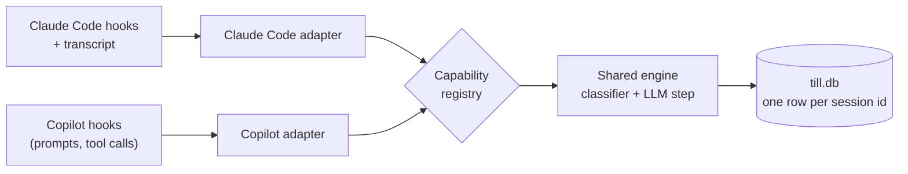
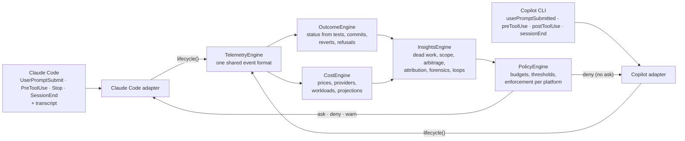

<p align="right"><a href="../README.md">← Back to README</a> · <a href="README.md">All docs</a></p>

# Architecture (for contributors)

The OPEX/CAPEX logic is written **once**, in a shared engine. Claude Code and Copilot each have a small **adapter** that turns that assistant's hook messages into a common format and says what the assistant can and can't report. The engine never assumes a feature exists: it asks the adapter first, then does the best it can with what's there.



- **Shared engine** (`agentarium/engine/`): the scoring rules, the optional AI-model check, and the database. Both assistants go through exactly the same code.
- **Adapters** (`agentarium/adapters/`): translation only, no scoring. Each one lists its capabilities (transcript, token counts, tool events, billing and so on) as `native`, `partial` or `none`.
- **If something is missing**, the engine copes: no transcript means it uses the prompt and tool events it stored; an unknown assistant, or an adapter that fails to load, still gets its prompts logged by session id, and the other assistant is unaffected.
- **Billing stays separate**: Claude Code tokens are priced (`engine/pricing.ts`); Copilot premium requests are never turned into tokens or money.
- **VS Code is a third adapter** (`adapters/vscode.ts`), built on the Copilot one: Claude Code's hook names and output shapes, Copilot's tools and bill. Scripts that need a Claude Code transcript ask `premiumBilled(source)` in the registry rather than checking for `copilot` by name, so Copilot CLI and VS Code are treated alike. The GitHub Copilot app is built on Copilot CLI and runs the same plugin hooks, so it has no adapter of its own: `copilot-app` is an alias for `copilot` in the registry.
- **Value helpers read behaviour, not totals**: `engine/trace.ts` turns a transcript into steps (each tool call with its input and result) and turns (each request with its usage and cost). bang-for-buck, sherlock, groundhog, haggle and taste-test all work on that, so a new transcript format means one new parser, not seven.
- **Guards share the engine too**: diet's rules (`engine/diet.ts`) and budget's limits (`engine/budget.ts`) are written once; each adapter says how to deny a tool call, block a prompt or show a notice on its platform (or that it can't).
- **So does a result rewrite**: colander's rules (`engine/colander.ts`) decide what to keep of a command's output; each adapter reads the output (`toolOutput`) and says how to hand back a replacement (`replaceOutput`: `updatedToolOutput` on Claude Code, `modifiedResult` on Copilot CLI, `null` on VS Code, which can't). Only the adapter knows how much of a result its platform passes on (`shellResultLimit`), so savings are never counted past it.

## The intelligence engine

Above the engine modules sit five shared services (`agentarium/services/`). Every helper is built from them, so no feature has a Claude version and a Copilot version:



| Stage | Service | What it owns |
|---|---|---|
| **Observe** | `TelemetryEngine` (`services/telemetry.ts`) | The shared event (`session_start`, `prompt`, `tool_call`, `tool_result`, `turn_end`, `session_end`) with project, developer, tool kind, what a command was for, file path and success; per-session cost by agent / subagent and by model, with provider, latency and API errors. Never prompt text, file contents or command text. |
| **Understand** | `CostEngine` (`services/cost.ts`) | Model prices, display currency, which provider served a model, the offering catalogue (`data/providers.json` + `~/.agentarium/providers.json`), workload costs with or without cached-token prices, and team projections. |
| | `InsightsEngine` (`services/insights.ts`) | Waste and recommendations: dead work, scope creep, provider arbitrage, attribution, plus forensics (sherlock) and loops (groundhog). |
| **Optimise** | `PolicyEngine` (`services/policy.ts`) | Modes and thresholds from settings, budgets, and turning a decision (`allow`, `warn`, `context`, `ask`, `deny`, `block`, `interrupt`) into the platform's hook output. A platform that can't express an action falls back to the nearest one it can; a missing feature never makes a guard stricter. `activity()` reads every guard's event table back: what each one stopped, flagged and saved (the dashboard's "What agentarium did"). |
| **Prove** | `OutcomeEngine` (`services/outcome.ts`) | Task status and quality from observable signals: test, lint and build results, commits, PRs, commits reaching the main branch, reverts, refusals, interruptions, and hand marks. Token counts are never treated as evidence of success. |

`services/value.ts` runs all five over one session and writes the enriched ledger row (bang-for-buck calls it at every turn end). Adapters gained three translation methods for this: `lifecycle()` (the platform's event name → the shared one), `toolOk()` (did a finished call succeed) and `askTool()` (a confirm prompt, where the platform has one).

**Outcomes are measured, not inferred.** A Claude Code transcript and Copilot's hook events are each turned into one neutral list of activity (edits, checks with pass/fail, commits, PRs, reverts, deletions, refusals), and `OutcomeEngine.status()` judges both with the same rules. Work with no signal either way is `unverified`, not a success and not waste.

Everything is TypeScript. Node.js 22.18+ runs the `.ts` files directly (it strips the types itself), so there is no build step and nothing is compiled; SQLite comes from Node's built-in `node:sqlite`. There are no runtime packages at all: TypeScript and `@types/node` are dev dependencies, used only to type-check (`npm run typecheck`).

The older tools (statusline, pennywise, doggybag, coach) are still standalone scripts; the statusline must stay a single file because `--install` copies it to `~/.agentarium/statusline.mts` (and the plugin's `statusline.ts --sync` SessionStart hook refreshes that copy after each plugin update). The band (`hooks/band.tsx`) is a [mod](https://code.claude.com/docs/en/plugins/mods/interface) that draws the statusline's numbers (`statusline.ts --json`) above the prompt box in the desktop app, where there is no statusline. The pane (`hooks/pane.tsx`) draws the same numbers beside the chat, in tabs, with the advice in full. Copilot has no mods, so its numbers are drawn elsewhere from `statusline.ts --copilot --json`: a VS Code extension (`vscode/extension.js`) puts it in the status bar, and the dashboard server's `/copilot` page (`dashboard/copilot.html`) is a small window for the Copilot app. The extension is plain JavaScript because VS Code loads it with its own Electron build of Node.js, which can't be counted on to strip types; it only draws. A plugin has one hooks module, so `band.tsx` is it and calls the pane's `registerPane` and `startPane`; `hooks/lens.ts` holds the helpers both draw with (the cache timer, the budget's words, the pictures). Their tests (`tests/band.test.tsx`, `tests/pane.test.tsx`) run with `claude plugin test .`.

## Handy commands

```bash
node scripts/till.ts capabilities          # what each assistant supports
npm test                                   # run the tests (node:test; no installs needed)
npm install && npm run typecheck           # type-check with TypeScript (the only dev dependencies)
node scripts/update_prices.ts              # refresh data/model-prices.json
```

Tests run on every push and pull request against Node.js 22.18 (the oldest supported) and 24 on Linux and macOS, and every push is type-checked with `tsc` (`.github/workflows/tests.yml`).

## What's in the repo

```text
agentarium/
├── .claude-plugin/
│   ├── plugin.json                 Claude Code manifest
│   └── marketplace.json            lets the repo be added as a marketplace
├── hooks/hooks.json                Claude Code hooks (and the band module)
├── hooks/band.tsx                  the band: the statusline in the desktop app, above the prompt box (a mod)
├── hooks/pane.tsx                  the pane: the numbers and advice beside the chat, in tabs (part of the mod)
├── hooks/lens.ts                   what the band and the pane share: the cache timer, budget words, pictures
├── plugin.json                     Copilot CLI manifest
├── copilot-hooks.json              Copilot CLI hooks
├── vscode-hooks.json               VS Code agent hooks (`agentarium vscode` writes them into a workspace)
├── vscode/                         Copilot's numbers in VS Code's status bar: a small extension (plain JavaScript,
│                                   as VS Code loads it) that draws `statusline.ts --copilot --json`;
│                                   `agentarium vscode --status-bar` packs it as a .vsix and installs it
├── skills/
│   ├── coach/SKILL.md              prompt and cache review skill
│   ├── spend-report/SKILL.md       weekly spend report skill
│   ├── dashboard/SKILL.md          opens the dashboard (/agentarium:dashboard)
│   ├── statusline/SKILL.md         installs / removes the statusline, band on/off (/agentarium:statusline)
│   ├── bang-for-buck/ haggle/ sherlock/ waistline/ taste-test/ spring-clean/ groundhog/
│   │                               value, waste and quality skills (each a SKILL.md over its script)
│   ├── split-the-bill/ bazaar/ blinkers/ crystal-ball/ deadwood/
│   │                               intelligence-engine skills
│   ├── pack-light/ ballast/ waffle/ overhead, context-carry and output skills
│   ├── cold-snap/ parrot/ all-you-can-eat/
│   │                               cache-miss, repeated-instruction and plan-fit skills
│   ├── cache-buster/ too-many-cooks/ receipt/ dry-run/
│   │                               prefix-edit, subagent, branch-cost and install-cost skills
│   └── rate-my-prompt/ judge/      prompt score out of 10 (judge is its alias)
├── agentarium/
│   ├── engine/                     shared logic: classifier.ts, llm.ts, store.ts, session.ts, evidence.ts,
│   │                               pricing.ts, currency.ts, diet.ts, colander.ts (what to keep of a
│   │                               command's output), budget.ts, events.ts, and for the
│   │                               value helpers: trace.ts (what the agent did, from a transcript),
│   │                               outcomes.ts, ledger.ts, forensics.ts, loops.ts, contract.ts,
│   │                               ballast.ts (task switches, carry cost), verbosity.ts (output split),
│   │                               promptscore.ts (a prompt scored out of 10),
│   │                               coldcache.ts (cache rebuilds and causes), parrot.ts (repeated phrases),
│   │                               lessons.ts (the why and the how added to each notice),
│   │                               premium.ts (Copilot premium requests per prompt, by model),
│   │                               prefix.ts (the files at the start of every request, and a rebuild's price),
│   │                               holdup.ts (what a big prompt is: a log, data, a blob, a diff, code, a document or other text; and a prompt too broad to start on)
│   ├── services/                   the intelligence engine: cost.ts, telemetry.ts, outcome.ts, policy.ts,
│   │                               insights.ts, value.ts (all five over one session), index.ts
│   ├── platform/                   common adapter interface + capability registry
│   ├── adapters/                   claude_code.ts, copilot.ts, vscode.ts (translation only)
│   ├── config.ts                   shared settings
│   └── util.ts                     shared helpers
├── install.sh / install.ps1        one-line installers (download, then run scripts/cli.ts setup)
├── scripts/
│   ├── cli.ts                      the `agentarium` command: setup, update, uninstall, dashboard, report, vscode
│   ├── import.ts                   brings a tokenomics install's history and settings over (`agentarium import`)
│   ├── run.sh                      launcher every hook and skill uses: finds Node.js 22.18+ on any OS
│   ├── till.ts                     the OPEX/CAPEX hook runner (calls the engine)
│   ├── pennywise.ts                model router: complexity tiers; hook (subagent) or local proxy
│   ├── doggybag.ts                 packs a resume note into <project>/.doggybag before the cache expires or compaction
│   ├── diet.ts                     stops tool calls that would flood the context; learns output sizes post-tool
│   ├── colander.ts                 strains test, build and install output before the model reads it (post-tool hook);
│   │                               keeps the full output in ~/.agentarium/colander/ for a day; strain, report
│   ├── budget.ts                   daily / per-session spending limits
│   ├── holdup.ts                   pauses a prompt that pastes in a huge log, document or file, or asks for the whole repo (run by the controller)
│   ├── premium.ts                  Copilot's premium-request allowance guard (run by the controller)
│   ├── report.ts                   spend report (used by the spend-report skill)
│   ├── coach.ts                    transcript analyser used by the coach skill
│   ├── statusline.ts               the statusline for Claude Code and Copilot CLI (terminal); --json feeds the band,
│   │                               --copilot --json Copilot's numbers (VS Code's status bar, the Copilot window)
│   ├── dashboard.ts                local web server over the till database (--background): spend, OPEX / CAPEX
│   │                               and what agentarium did; /copilot is the small window for the Copilot app
│   │                               (`agentarium copilot --window`)
│   ├── bangforbuck.ts              cost per outcome; writes the ledger at each turn end
│   ├── haggle.ts                   task quotes and contracts (prompt, guard, settle, close hooks)
│   ├── sherlock.ts                 agent forensics: costed waste in a session
│   ├── waistline.ts                cost regression between periods or against a baseline (--ci)
│   ├── tastetest.ts                two runs of a task: cost vs quality, quality-adjusted saving
│   ├── springclean.ts              context hygiene audit of instruction files
│   ├── groundhog.ts                loop breaker (pre-tool hook) and session replay
│   ├── splitthebill.ts             cost attribution by project, developer, agent, category, model, provider, status
│   ├── bazaar.ts                   provider arbitrage: your workload priced across the market
│   ├── blinkers.ts                 scope guard (prompt + pre-edit hooks), session check, branch diff
│   ├── crystalball.ts              spend simulator for a team scenario
│   ├── deadwood.ts                 monthly report of spend on work that produced nothing
│   ├── packlight.ts                fixed overhead: baseline context, MCP servers and skills vs their use
│   ├── ballast.ts                  context carried between tasks (prompt hook) and session replay
│   ├── waffle.ts                   output spend: replies, tool input, thinking; long replies, recaps, rewrites
│   ├── coldsnap.ts                 prompt-cache rebuilds: breaks, model switches, prefix changes, 1-hour what-if
│   ├── parrot.ts                   repeated rules, corrections and prompts (prompt hook, hashes only) and report
│   ├── allyoucaneat.ts             plan fit: API-priced spend vs pay-as-you-go, Pro and Max
│   ├── fishingrod.ts               lists the lessons behind the notices and shows one in full
│   ├── cachebuster.ts              prefix-edit guard (pre-edit hook) and session replay
│   ├── toomanycooks.ts             subagent guard (pre-tool hook), SubagentStop cost record and report
│   ├── kettle.ts                   time left on the cache, as a terminal notification (Notification hook)
│   ├── receipt.ts                  what the current git branch cost, for a commit trailer or a pull request
│   ├── dryrun.ts                   a skill, plugin or MCP server priced before it is installed
│   ├── ratemyprompt.ts             a prompt scored out of 10 on five cost criteria (rate-my-prompt, judge)
│   ├── common.ts                   argument and transcript helpers those tools share
│   └── update_prices.ts            refreshes data/model-prices.json from Claude's pricing page
├── data/model-prices.json          Claude prices per model (Haiku 3.5 to Fable 5.2), updated weekly
├── data/providers.json             equivalent offerings across providers (bazaar, crystal-ball)
├── data/plans.json                 Claude subscription plans and list prices (all-you-can-eat)
├── dashboard/index.html            the dashboard page
├── tests/                          node:test suite (*.test.ts) and the installer check
├── package.json / tsconfig.json    dev dependencies (TypeScript, @types/node) and type-check settings
├── docs/                           guides (you are here)
├── CLAUDE.md                       Claude Code instructions (imports the shared rules below)
├── .github/copilot-instructions.md the shared rules for AI assistants: writing style, docs, code, architecture
└── .github/workflows/              tests, installer checks (macOS/Windows/Linux), weekly price refresh, version bumps, releases
```

## Adding a helper

1. Put shared logic in `agentarium/engine/` or, for anything about cost, events, outcomes, policy or insights, in the matching service in `agentarium/services/`, so both assistants use it. Never write a platform-specific copy.
2. Add a thin script in `scripts/` that reads the hook payload through the adapter, decides with the services, and prints `PolicyEngine.enforce(adapter, action, message)`.
3. Register the hook in `hooks/hooks.json` (Claude Code) and, if Copilot can support it, `copilot-hooks.json` and `vscode-hooks.json`. Always call it through the launcher (`sh "${CLAUDE_PLUGIN_ROOT}/scripts/run.sh" <name>.ts ...`), never `node` directly: the launcher finds the right Node.js on every OS, including Windows.
4. Add a settings switch (`AGENTARIUM_<NAME>=off`) so people can opt out.
5. Log what it did to a `<name>_events` table so the spend report can show it.
6. Add tests, and document it in [the reference](reference.md) and [Skills, tools and hooks](skills-tools-and-hooks.md).


## Releasing

There's nothing to do by hand: **every pull request to `main` carries its own version, and merging it publishes the release** once the tests pass.

Users install from `main`. The marketplace entry (`.claude-plugin/marketplace.json`), `install.sh`, `install.ps1` and `agentarium update` all fetch it, and each merge is a release, so `main` is always the latest version.

- **The bump happens in the pull request.** [version.yml](../.github/workflows/version.yml) works out the next patch (0.0.1 → 0.0.2) and commits `Release v0.0.2` to your branch, raising `version` in both `.claude-plugin/plugin.json` and `plugin.json`. The version matters: Claude Code only sends plugin users an update when it changes.
- **Merging publishes it.** [release.yml](../.github/workflows/release.yml) runs the tests on `main`, tags `v0.0.2` and publishes the release with generated notes and the installers attached.
- **Minor or major release?** Raise `version` in both manifests in your pull request (e.g. to `0.1.0`). A version past `main` and the latest tag is kept as it is.
- **Two pull requests open at once** both take the same number. Update the second from `main` before merging and the check bumps it again; turn on "Require branches to be up to date" to enforce that. If one slips through, nothing is released for it and the next pull request moves past it.
- **Pull requests from forks** can't be pushed to, so the check fails with the version to set: run `node .github/scripts/next_version.ts --write 0.0.2`.
- **Price updates** from the weekly workflow bump the patch in their own commit and are released too.
- **Required checks?** Commits pushed with the default token start no workflows, so the bump commit gets no test run. Add a `RELEASE_TOKEN` secret that can push to the repo and the version workflow uses it instead.

---

<p align="center"><a href="configuration.md">← Configuration</a> · <a href="README.md">All docs</a></p>
