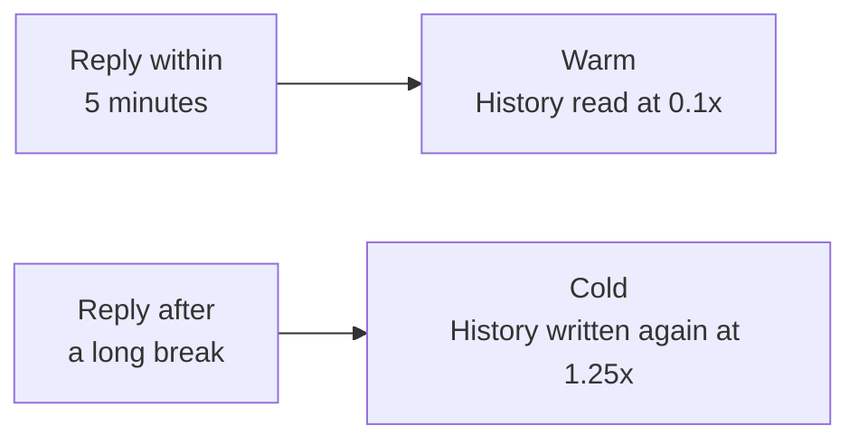

<p align="right"><a href="../README.md">← Back to README</a> · <a href="README.md">All docs</a></p>

# Cache is King

In a long session with an AI coding assistant, most of what you pay for is the conversation being read again. The prompt cache decides whether that re-reading costs full price or a tenth of it. Keep the cache warm and a 50-message session costs about £3; let it go cold at the wrong moments and the same session can cost several times that.

This guide covers:

1. **[How the cache works](#how-the-cache-works)**: what gets cached, for how long and what it costs.
2. **[Why it matters so much](#why-it-matters-so-much)**: a worked session, with and without it.
3. **[What breaks it](#what-breaks-it)**: the things that send it cold, most of them avoidable.
4. **[Tips and tricks](#tips-and-tricks)**: habits that keep it warm, and how tokenomics helps.

It builds on [How tokens work](how-tokens-work.md). If *input*, *output* and *context* are new to you, read Part 1 of that guide first (five minutes).

---

## How the cache works

### The problem it solves

The model has no memory between messages. Every time you send one, your assistant sends the **whole conversation again**: its instructions, the tool list, every file it has read, every command output and every reply. Message 50 carries messages 1 to 49 with it.

Reading all that from scratch each time would be slow and expensive. So the provider keeps the model's working state for the start of the prompt for a few minutes. If the next request begins with exactly the same text, it picks up from there instead of starting again. That saved state is the **prompt cache**.

### Three rules

**1. It matches from the start, byte for byte.** A request is laid out in a fixed order:

```
tools  ->  system prompt and instructions (CLAUDE.md)  ->  message 1  ->  message 2  ->  ...  ->  newest message
```

The cache matches as far as the text is identical to last time and stops at the first difference. Everything after that point is read at full price and written to the cache again. Change one character in `CLAUDE.md` and every message after it misses, because the instructions sit near the top.

**2. It doesn't last long.** An entry lives for **5 minutes** by default, or **1 hour** if the session asks for the longer cache. Every time it is read, the clock starts again, so a conversation with replies less than 5 minutes apart stays warm all day. The clock runs from the *start* of each request, so a reply that takes 4 minutes to write leaves you about 1 minute.

**3. It belongs to one model.** Each model keeps its own cache. Switch from Opus to Sonnet halfway through and Sonnet starts cold.

There is also a minimum size: prompts shorter than roughly 512 to 4,096 tokens (it depends on the model) are not cached at all. Coding assistants clear that on the first message, as their instructions and tool list alone are larger.

### What it costs

Prices are set relative to the model's normal input price:

| What happens | Price | When |
|---|---|---|
| **Cache read** | about **0.1x** (0.05x on Opus 5.5 and Sonnet 5.5, 0.025x on Fable 5.1 and 5.2) | The start of the prompt matched a live entry |
| **Cache write**, 5-minute cache | **1.25x** | New text is stored, or an expired entry is stored again |
| **Cache write**, 1-hour cache | **2x** | As above, with the longer lifetime |
| Uncached input | 1x | Text after the last cache point |
| Output | about 5x | What the model writes. Never cached |

Writing costs a little more than reading uncached, and reading costs a tenth. Text used twice on the 5-minute cache has already paid for itself: 1.25x + 0.1x = 1.35x, against 2x without the cache.



---

## Why it matters so much

### A worked session

Take a coding session of 50 messages on a model priced at **£4 per million input tokens**. It starts with 20,000 tokens of instructions and tools, and each message adds about 3,600 tokens (your prompt, the files read, the reply), so it ends at 200,000. On average each request carries 110,000 tokens of history.

| | Tokens re-read over the session | Price per million | Cost of re-reading |
|---|---:|---:|---:|
| No cache | 5,500,000 | £4.00 | **£22.00** |
| Warm cache all the way | 5,300,000 read + 200,000 written | £0.40 read, £5.00 write | **about £3.10** |

Same work, same answers, **about 86% less** on input. Output costs the same either way.

This is why the cache matters more as sessions get longer. Re-read input grows with the *square* of the session length ([How tokens work, 2.3](how-tokens-work.md#23-input-tokens)), so it soon dwarfs everything else in the bill. The cache doesn't change that shape, but it makes each re-read token ten times cheaper.

### The price of going cold

Now take the same session and step away for a coffee at message 35, with 150,000 tokens of history:

| Next message | History cost |
|---|---:|
| Within 5 minutes (read at 0.1x) | 150,000 x £0.40 per million = **6p** |
| After 10 minutes (written again at 1.25x) | 150,000 x £5.00 per million = **75p** |

One "carry on" after a break costs more than ten warm messages. Do that three times in a day across a few sessions and it adds up to pounds, for no extra work.

### Reading your own numbers

Every Claude response reports three kinds of input (see [How tokens work, 2.5](how-tokens-work.md#25-the-prompt-cache) for the field names):

- **Cache read** should be the biggest number by far, growing message by message.
- **Cache write** should stay small: just what the newest message added.
- **Uncached input** should be tiny.

When cache write is close to the whole conversation size on a message that isn't the first, the cache went cold there. That is the pattern **cold-snap** and **coach** look for.

---

## What breaks it

| Cause | Why it breaks | Avoidable? |
|---|---|---|
| **A break** longer than the cache lives | The entry expired | Usually: reply sooner, or stop cleanly |
| **Switching model** mid-conversation | Each model has its own cache | Yes: pick the model when you start a task |
| **Editing CLAUDE.md** (or a file it imports) | Instructions sit near the top, so everything after misses | Yes: edit between sessions |
| **Adding or removing an MCP server, plugin or skill** | The tool list is the very first thing in the prompt | Yes: change them between sessions |
| **Changing settings** that alter the prompt | Same as above | Yes |
| **Changing effort or thinking** mid-conversation | Both are part of the prompt | Mostly: pick a level per task |
| **Rewinding or editing an earlier message** | Everything after the edit is new text | Sometimes worth it, but know what it costs |
| **Compaction** (`/compact` or automatic) | The history is replaced by a summary, which must be written | Expected: the smaller context pays it back |

If you build on the API yourself, add the silent ones: a timestamp or user name in the system prompt, JSON with keys in a different order each time, or tools listed in a varying order. Each looks harmless and makes every request a miss.

---

## Tips and tricks

### 1. Keep momentum on big sessions

Each reply inside the window keeps the cache warm for free. If the assistant has stopped to ask you something, answer it before you switch tabs. **kettle** sends a notification when the assistant is waiting, with the deadline and what is at stake:

```text
kettle: 3:20 to reply before the cache goes cold (62,010 tokens, about £0.23 at risk)
```

The **statusline** and **band** show the same countdown as you work.

### 2. Stop cleanly instead of drifting off

If you are going to be longer than the cache lasts, coming back to a large, cold session means paying to store the whole thing again. A short note in a fresh session is far cheaper. **doggybag** packs a "where we got to" note into `.doggybag/` 60 seconds before the cache expires; `/clear` picks it back up. In the example above, a 3,000-token note costs pennies to start from, against 75p to reload the old session.

### 3. Pick the model at the start of a task

Don't flip between models within a conversation. If you want a different model for a different job, start a new session for it. **pennywise** already knows this: it keeps the current model while the cache is warm unless the saving from switching beats the cost of starting cold.

### 4. Make instruction and setup changes between sessions

Edits to `CLAUDE.md`, `.claude/settings.json`, `.mcp.json` or your skills all change the start of the prompt. Note the change you want, finish the task, then make it before the next session. **cache-buster** catches these edits mid-session, prices the rebuild and lets you decide (set `TOKENOMICS_CACHEBUSTER=ask` to confirm every time).

### 5. Keep the top of the prompt boring

Anything that changes often doesn't belong in `CLAUDE.md`: today's date, the current ticket, "this week we're working on". Put it in your first message instead, where it only affects what comes after it. A short, stable instructions file caches once and is read cheaply for the rest of the day.

### 6. Compact at a natural break, not mid-flow

Compaction rewrites the cache, so it always costs one rebuild. That is worth paying when the context is large and the old detail no longer matters. Do it between steps of a task rather than in the middle of one, and if you are about to step away anyway, let the cache go cold *and* start fresh from a doggybag in one go rather than paying for both.

### 7. Choose the cache length to suit how you work

The 5-minute cache is right if you work in steady bursts. If you often pause for 5 to 60 minutes (meetings, reviews, waiting on a build), the 1-hour cache can pay off despite its dearer writes. You don't need to guess: **cold-snap** works out, from your own sessions, how many breaks the 1-hour cache would have kept warm and whether that beats the extra write cost.

### 8. Put big one-off reads somewhere else

A 200,000-token log pasted into the main conversation is written to the cache once and then read on every message after it. Summarise it in a separate session, or ask the assistant to grep for the lines that matter, and only the summary rides along. [Saving tokens](saving-tokens.md) has the numbers.

### 9. If you build on the API

- Keep the system prompt frozen and put anything that changes later in the messages.
- Sort your tool list and serialise JSON in a fixed key order.
- On models that support it, add mid-conversation instructions as a `system` message in `messages` rather than editing the top-level system prompt.
- Check `cache_read_input_tokens`: if it stays at zero across repeated requests, something early in the prompt is changing.
- For traffic with gaps, pre-warm or keep the cache alive by re-sending the previous request with `max_tokens: 0` just before it expires: you pay a cache read and no output.

Anthropic's [prompt caching guide](https://platform.claude.com/docs/en/build-with-claude/prompt-caching) has the details.

---

## See where your cache went

| Helper | What it tells you |
|---|---|
| **[statusline](reference.md#statusline)** and **[band](reference.md#band)** | A live countdown to the cache going cold |
| **[kettle](reference.md#kettle)** | A notification when the assistant is waiting, with time left and money at risk |
| **[doggybag](reference.md#doggybag)** | Packs a note before the cache expires, so a fresh start is cheap |
| **[cache-buster](reference.md#cache-buster)** | Prices an instruction or setup edit before it rebuilds the cache |
| **[cold-snap](reference.md#cold-snap)** | Every rebuild in a session or week, its cause and what it cost |
| **[coach](reference.md#coach)** | Cache rebuilds alongside the other waste in a finished conversation |

```bash
tokenomics cold-snap              # the newest session in this folder
tokenomics cold-snap --days 7     # every session this week, coldest first
```

**On GitHub Copilot**, you pay per premium request, not per token, so the cache doesn't change what Copilot bills you. tokenomics never converts premium requests to tokens or money. The habits above still keep responses quick, and doggybag works there too.

---

<p align="center"><a href="how-tokens-work.md">← How tokens work</a> · <a href="README.md">All docs</a> · <a href="saving-tokens.md">Saving tokens →</a></p>
