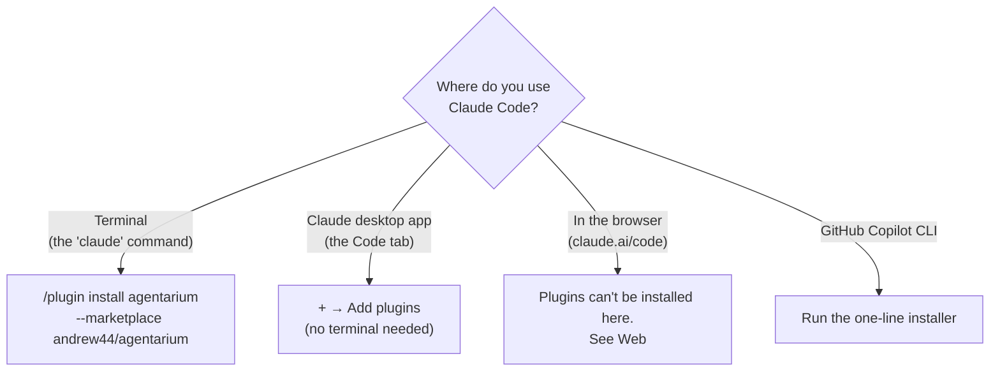

<p align="right"><a href="../README.md">← Back to README</a> · <a href="README.md">All docs</a></p>

# Installation

Everything you need to get agentarium running, from the one-minute install to team roll-outs and every assistant it supports.

**On this page**

- [Claude Code: install the plugin](#claude-code-install-the-plugin) (recommended)
- [The one-line installer](#the-one-line-installer) (Copilot CLI, no Node.js, or the `agentarium` command)
- [Install pieces individually](#install-pieces-individually)
- [Where do you use Claude Code?](#where-do-you-use-claude-code): terminal, desktop app, web
- [GitHub Copilot CLI](#github-copilot-cli)
- [The GitHub Copilot app](#the-github-copilot-app) (desktop)
- [Copilot in VS Code](#copilot-in-vs-code)
- [Requirements](#requirements)
- [Update, remove or check](#update-remove-or-check)
- [Moving from tokenomics](#moving-from-tokenomics)
- [Other ways to install](#other-ways-to-install-for-developers)
- [Troubleshooting](#troubleshooting)

---

## Claude Code: install the plugin

**This is the recommended way.** agentarium is a [Claude Code plugin](https://code.claude.com/docs/en/plugins): one install gives you every skill and hook, and Claude Code keeps it managed for you (switch it on or off, update or remove it from `/plugin`).

### In the terminal

Inside Claude Code (type `claude` in a terminal), paste:

```text
/plugin install agentarium --marketplace andrew44/agentarium
```

When the panel opens, choose **Install for you (user scope)** so it works in every project. If Claude says `Run /reload-plugins to apply`, closing the panel does that for you.

On Claude Code older than v2.1.275, use two lines instead:

```text
/plugin marketplace add andrew44/agentarium
/plugin install agentarium@agentarium
```

From a plain shell instead: `claude plugin install agentarium --marketplace andrew44/agentarium` (v2.1.292+), or on older versions `claude plugin marketplace add andrew44/agentarium && claude plugin install agentarium@agentarium`.

### In the desktop app (no terminal needed)

In the **Code** tab, start a **local** (or SSH) session, click **+** next to the prompt box → **Add plugins**, add the marketplace `andrew44/agentarium` and install **agentarium**. The desktop app and the terminal share the same settings, so it shows up in both.

### What you get

- **Skills:** `/agentarium:coach`, `/agentarium:spend-report`, `/agentarium:dashboard`, `/agentarium:statusline`. You don't need the slash: *"coach, review my prompts"* or *"open the agentarium dashboard"* works too.
- **Hooks:** `till`, `pennywise`, `diet`, `colander`, `budget` and `doggybag` (and the other guard-rails), running automatically. `/hooks` lists them.
- **The status line** switches itself on at the start of your next session, as long as you don't already have a status line, and updates itself with the plugin. Set `AGENTARIUM_STATUSLINE=ask` to be asked first, or `off` to leave it off. `/agentarium:statusline` installs, removes or changes it.
- **A row in the band** (desktop app and VS Code): the same line, in the strip directly above the prompt box, on from your next session whether or not the status line is installed. `/agentarium:statusline band off` hides it.

**Check it worked:** type `/` and look for `/agentarium:coach`.

**Needs Node.js 22.18+** on your computer (it runs agentarium's TypeScript directly; no packages, no build). The hooks use the `node` on your PATH when it's new enough. No Node.js, or an older one? Run the [one-line installer](#the-one-line-installer) once: it fetches a private copy that the plugin then uses.

### Keep it up to date

Claude Code auto-updates only its official marketplace. To get agentarium updates automatically, open `/plugin` → **Marketplaces** → **agentarium** and switch on **auto-update**. To update by hand: `/plugin` → **Installed** → **agentarium** → **Update now**, or `claude plugin update agentarium@agentarium` in a shell.

### For a team

Commit this to the repo's `.claude/settings.json`:

```json
{
  "extraKnownMarketplaces": {
    "agentarium": {
      "source": { "source": "github", "repo": "andrew44/agentarium" },
      "autoUpdate": true
    }
  },
  "enabledPlugins": { "agentarium@agentarium": true }
}
```

When a teammate trusts the folder, Claude Code adds the marketplace for them. Each teammate still installs the plugin once, with `/plugin install agentarium@agentarium` (choose **project scope**) or `claude plugin install agentarium@agentarium --scope project`.

---

## The one-line installer

For **GitHub Copilot CLI**, for computers **without Node.js**, or if you want the `agentarium` terminal command. One line, no git, no `npm install`. If it finds Claude Code it installs the same plugin as above.

**macOS / Linux** (in Terminal):

```bash
curl -fsSL https://raw.githubusercontent.com/andrew44/agentarium/main/install.sh | sh
```

**Windows** (in PowerShell):

```powershell
irm https://raw.githubusercontent.com/andrew44/agentarium/main/install.ps1 | iex
```

Then restart Claude Code or Copilot CLI. That's it.

**No Claude Code or Copilot CLI yet?** The installer adds agentarium to the assistants it finds, so install at least one first: [Claude Code](https://code.claude.com/docs/en/setup) or [GitHub Copilot CLI](https://docs.github.com/en/copilot/how-tos/use-copilot-agents/use-copilot-cli). Then run the line above again.

How to open a terminal: on a **Mac** press `Cmd + Space`, type `Terminal`, press Enter. On **Windows** click Start, type `PowerShell`, press Enter.

#### What the installer does

1. **Checks for Node.js 22.18+.** agentarium only uses Node's built-in modules. If there's no Node.js, or only an older one, it downloads a private copy of the official Node.js 24 LTS build (pinned, and checked against its SHA-256) into `~/.agentarium/runtime`: no admin rights, no pop-ups.
2. **Downloads agentarium** to `~/.agentarium/app` (a plain download, not a git clone).
3. **Adds the plugin** to every assistant it finds: Claude Code (`claude plugin install`, user scope) and/or GitHub Copilot CLI (`copilot plugin install`).
4. **Switches on the status line** for those assistants. If you already have a status line, it's left alone (replace it later with `agentarium statusline --install claude`).
5. **Adds an `agentarium` command** (in `~/.local/bin` on macOS/Linux, `~/.agentarium/bin` on Windows, put on your PATH for you).

It's safe to run again: it repairs and updates the app and changes nothing that's already right. It replaces only `~/.agentarium/app` (and only if that folder is agentarium's), swapping the new copy in so a run that stops half-way leaves the old one working; your recorded data, your settings and your `config.json` are never touched. The first time it changes a CLI's `settings.json` it keeps the file as it was in `settings.json.agentarium.bak`, and nothing replaces that copy later. Want to look before you run? Read [install.sh](../install.sh) and [install.ps1](../install.ps1).

**Options.** Skip parts with `sh -s -- --no-plugin` or `--no-statusline` (on Windows set `$env:AGENTARIUM_SETUP_ARGS = "--no-statusline"` first). To install from a fork, a tag or a branch, set `AGENTARIUM_REPO=your-org/agentarium` or `AGENTARIUM_REF=v0.0.1`. The default is `main`, which is always the latest release.

**Check it worked:** run `agentarium`. It shows which assistants it found and where the status line is installed. In Claude Code, type `/` and look for `/agentarium:coach`; `/hooks` lists the hooks.

#### The `agentarium` command

| Command | What it does |
|---|---|
| `agentarium` | What's installed and where your data is |
| `agentarium dashboard` | Opens the dashboard in your browser (`--demo` for sample data, `--stop` to stop it) |
| `agentarium report` | Spend report in the terminal (`--days 30`, `--json`) |
| `agentarium statusline ...` | Status line and band options: `--demo`, `--set-currency USD`, `--install both`, `--uninstall claude`, `--band-off` |
| `agentarium vscode [folder]` | Adds the VS Code agent hooks to a workspace (`.github/hooks/agentarium.json`); `--remove` takes them out, `--print` shows them, `--force` replaces a changed file. `--status-bar` puts Copilot's premium requests in VS Code's status bar (`--status-bar --remove` takes it out) |
| `agentarium copilot` | Copilot's premium requests: left this month, the pace and when they run out (`--json`); `--window` keeps them in a small window, for the GitHub Copilot app (`--window --stop` to stop it) |
| `agentarium update` | Downloads the latest version and updates the plugins and status line |
| `agentarium uninstall` | Removes the plugins, status line and command (keeps your data; `--purge` deletes it too) |
| `agentarium --version` | The version installed |
| `agentarium import` | Brings a tokenomics install's history and settings over (`--dry-run` first; see [Moving from tokenomics](#moving-from-tokenomics)) |
| `agentarium bang-for-buck`, `split-the-bill` ... | Runs a helper by name. Each also answers to its name as one word, the way its setting spells it (`bangforbuck`, `splitthebill`, `coldsnap` ...) |

> **Windows:** the commands below work as they are in PowerShell, as long as `node` is on your PATH (the installer's private copy isn't; use the `agentarium` command instead).

---

## Install pieces individually

Every helper works on its own. Pick what you want:

| I only want... | Install | Notes |
|---|---|---|
| **coach** (prompt review skill) | `npx skills@latest add andrew44/agentarium --skill coach` | Needs Node.js. Works in Claude Code and other assistants the `skills` CLI supports. Without the plugin it reviews the prompts it can see; with the plugin it also gets exact token and cache numbers. |
| **spend-report** (weekly spend skill) | `npx skills@latest add andrew44/agentarium --skill spend-report` | Reports on what **till** has recorded, so install the plugin too. |
| **Both skills** | `npx skills@latest add andrew44/agentarium` | Pick from the list (arrows to move, space to tick, Enter to confirm). Add `-g` to install globally, `--list` to preview. |
| **status line** only | `curl -fsSL https://raw.githubusercontent.com/andrew44/agentarium/main/install.sh \| sh -s -- --no-plugin` | Status line and the `agentarium` command, no hooks. Needs only Node.js. `agentarium statusline --uninstall claude` removes it. |
| **dashboard** | `agentarium dashboard`, or `/agentarium:dashboard` with the plugin | Read-only view of the till database. |
| **Just some of the hooks** | Install everything, then switch off the ones you don't want | See below. |

### Choosing which hooks run

The hooks (`till`, `pennywise`, `diet`, `colander`, `budget`, `doggybag` and the rest) ship together in the plugin and share one engine. To keep only the ones you want, switch the others off with a setting, in your shell profile or in Claude Code's `settings.json` under `"env"`:

| Hook | Switch it off | Or soften it |
|---|---|---|
| **pennywise** | `AGENTARIUM_PENNYWISE=off` | `block` asks you to switch with `/model` instead of routing; `warn` only shows a notice |
| **diet** | `AGENTARIUM_DIET=off` | `warn` shows a notice but never blocks |
| **colander** | `AGENTARIUM_COLANDER=off` | `# colander-off` on one command shows its whole output |
| **budget** | `AGENTARIUM_BUDGET_MODE=off` (or just don't set a limit) | `warn` |
| **doggybag** | `AGENTARIUM_DOGGYBAG=off` | `AGENTARIUM_DOGGYBAG_COLD=off` keeps it packing but stops the cold-prompt notice |
| **till** | Always on with the plugin: it's the data source for everything else. It never blocks or prints anything. | |

Example `~/.claude/settings.json`:

```json
{
  "env": {
    "AGENTARIUM_PENNYWISE": "warn",
    "AGENTARIUM_DIET": "off"
  }
}
```

All settings are listed in [Configuration](configuration.md).

<details>
<summary><b>"npx: command not found"?</b> You need Node.js first.</summary>

1. Go to [nodejs.org](https://nodejs.org), download the version marked **LTS**, and run the installer.
2. **Close and reopen** your terminal, then run the command again.

How to open a terminal: on a **Mac** press `Cmd + Space`, type `Terminal`, press Enter. On **Windows** click Start, type `PowerShell`, press Enter.
</details>

---

## Where do you use Claude Code?



### Terminal

[Install the plugin](#in-the-terminal) from inside Claude Code. That's it.

### Desktop app

Works in **local** and **SSH** sessions (not cloud sessions).

1. Open the desktop app, go to the **Code** tab and start a local session.
2. Click **+** next to the prompt box, then **Add plugins**. Add the marketplace `andrew44/agentarium` and install **agentarium**.
3. Use the same menu (**Plugins**, then **Manage plugins**) to switch it on or off later. Anything you install in the terminal shows up here too, and vice versa.

Just want the coach in the desktop app? `npx skills@latest add andrew44/agentarium --skill coach -g`.

### Web (claude.ai/code)

Plugins **can't be installed** in Claude Code on the web. You have two options:

- **Use the terminal or desktop app** for the full toolkit and tracking.
- **Add just the coach to your repo.** In your repo folder, run the command below, then commit the new `coach` folder it adds:

  ```bash
  npx skills@latest add andrew44/agentarium --skill coach --copy
  ```

  (`--copy` makes real files instead of shortcuts, which is what you want when committing.) On the web the coach may only be able to review the prompts it can see in the conversation.

Tracking on the web isn't useful: the data would be saved on a temporary cloud machine, not your computer.

---

## GitHub Copilot CLI

The [one-line installer](#the-one-line-installer) sets up Copilot CLI too: the plugin and the status line. To do it by hand instead:

```bash
copilot plugin install andrew44/agentarium          # from GitHub
copilot plugin install ./path/to/agentarium         # from a local folder
```

Then start `copilot`, check that `/plugin list` shows `agentarium`, and send a prompt. Add the status line with `agentarium statusline --install copilot`.

What works on Copilot:

| Helper | Copilot CLI |
|---|---|
| till | ✅ (labels from prompts and tool calls; no token counts) |
| diet | ✅ |
| colander | ✅ through `postToolUse` `modifiedResult`, successful commands only (documented; not yet confirmed on a real install) |
| doggybag | ✅ best effort |
| status line | ✅ (countdown is approximate) |
| dashboard | ✅ |
| pennywise, budget | ❌ Copilot ignores prompt-hook output |
| coach | ❌ no conversation file to read |

<details>
<summary><b>Copilot notes and known limits</b></summary>

- Copilot reads `plugin.json` and `copilot-hooks.json` at the plugin root (`userPromptSubmitted`, `preToolUse`, `postToolUse` and `sessionEnd` hooks).
- Copilot sends a session id with every hook, and till logs each session under it. If one is ever missing, till builds one from the working directory and date.
- Copilot sessions are labelled from the words in each prompt **and** the tools Copilot used (file edits lean CAPEX, observability tools and commands like `kubectl logs` lean OPEX). Same scoring as Claude Code.
- Copilot doesn't tell hooks how many tokens or premium requests a session used, so those columns stay empty (`usage_status = unavailable`). till never guesses a number for them. Prompts are counted, though: set `AGENTARIUM_COPILOT_ALLOWANCE` (your monthly premium requests) and the status line forecasts what's left this month and when it runs out ([details](reference.md#copilot-premium-requests)).
- The hook commands use relative paths (`scripts/run.sh`, `scripts\\till.ts`). If Copilot runs them from a different folder and you see "file not found" in `<db>.err`, change the path in `copilot-hooks.json` to an absolute one.
- Copilot's plugin format is still changing; check the current Copilot docs if the install fails.
</details>

## The GitHub Copilot app

The [GitHub Copilot app](https://docs.github.com/en/copilot/concepts/agents/github-copilot-app) (desktop, technical preview) is built on Copilot CLI and installs the same plugins, so agentarium needs nothing new there:

1. Open **Customize** in the app and add the marketplace `andrew44/agentarium`.
2. Install **agentarium** from the list.
3. Start a new session and send a prompt.

Skills and MCP servers set up for Copilot CLI show up in the app on their own, so if the plugin is already installed for the CLI, check **Customize** before adding it again.

- The hooks are the CLI's (`copilot-hooks.json`), so prompts and tool calls are recorded under the `copilot` platform, with the same helpers and limits as [Copilot CLI](#github-copilot-cli). Sessions from the app and the CLI share one premium-request allowance and one forecast.
- The app has no terminal and no mods, so there's no status line, band or pane. `agentarium copilot --window` opens [a small window](reference.md#copilot-in-vs-code-and-the-copilot-app) to keep beside the app: premium requests left this month, the pace and when they run out. `agentarium copilot --window --stop` closes its server.
- GitHub doesn't yet document the app's hook payloads separately from the CLI's. If a hook fails, look in `<db>.err`; if the app turns out to send a different shape, it gets an adapter of its own ([#28](https://github.com/andrew44/agentarium/issues/28)).

## Copilot in VS Code

VS Code runs agent hooks (a preview feature) from `.github/hooks/*.json` in the open workspace. After the [one-line installer](#the-one-line-installer):

```bash
cd ~/work/my-project
agentarium vscode            # writes .github/hooks/agentarium.json, pointing at your install
```

Start a new agent session in VS Code and send a prompt. Commit the file to give the whole team the hooks (each person still needs agentarium installed at the same path), or list it in `.git/info/exclude` to keep it to yourself. `agentarium vscode --remove` takes it out.

What runs there (the `vscode` adapter, `agentarium/adapters/vscode.ts`):

| Hook | Helpers |
|---|---|
| `UserPromptSubmit` | the controller: till records the prompt, premium pauses it once the month's allowance is used up, hold-up pauses a huge pasted log, document or file, or a prompt that asks for the whole repo, blinkers notes the task |
| `PreToolUse` | diet, groundhog, blinkers |
| `PostToolUse` | till records the tool call (colander doesn't run: VS Code's hooks can't replace a result) |
| `Stop` | till labels the session |

- VS Code sends Claude Code's event names and payload shape with Copilot's tool names (`read_file`, `replace_string_in_file`, `run_in_terminal`), and the adapter reads both.
- Like Copilot CLI, no hook payload carries tokens. VS Code's `transcript_path` points at its own chat log, whose format is undocumented, so it isn't read: sessions are labelled from prompts and tool events, and the transcript helpers (bang-for-buck, sherlock, haggle, doggybag) stay out of it.
- Prompts are recorded under the `vscode` platform and count against `AGENTARIUM_COPILOT_ALLOWANCE` together with Copilot CLI's, since both draw on one allowance. The model is only known when a payload names it; otherwise `AGENTARIUM_COPILOT_MULTIPLIER` applies.
- VS Code's hook format is in preview. If nothing is recorded, check agent hooks are on in VS Code's settings and look in `<db>.err`.

To see [premium requests left, and when they run out](reference.md#copilot-in-vs-code-and-the-copilot-app), in VS Code's status bar:

```bash
agentarium vscode --status-bar          # builds the extension and installs it with VS Code's `code` command
agentarium vscode --status-bar --remove # takes it out
```

Reload the window afterwards. If `code` isn't on your PATH, the command leaves `~/.agentarium/vscode/agentarium-status.vsix` for **Extensions: Install from VSIX...**. It is installed once per computer, not per workspace.

---

## Requirements

| You want... | You need |
|---|---|
| The plugin, status line or dashboard | **Node.js 22.18+**. It runs the TypeScript directly, with built-in modules only: no packages, no build step, ever. The installers get it for you if it's missing. |
| To work on agentarium itself | **TypeScript** and `@types/node` (dev dependencies: `npm install`, then `npm run typecheck`). Not needed to use it. |
| Skills via `npx skills` | Node.js |
| Any of it | [Claude Code](https://code.claude.com/docs/en/setup) and/or [GitHub Copilot CLI](https://docs.github.com/en/copilot/how-tos/use-copilot-agents/use-copilot-cli) |

---

## Update, remove or check

| I want to... | Do this |
|---|---|
| Check it's installed | In Claude Code, run `/plugin` and open the **Installed** tab, or run `claude plugin list` in a terminal. `/hooks` shows the hooks. |
| Update it | Switch on auto-update: `/plugin` → **Marketplaces** → **agentarium**. Or by hand: `/plugin` → **Installed** → **Update now**, or `claude plugin update agentarium@agentarium`. Used the one-liner? `agentarium update` also works. |
| Remove it | `/plugin uninstall agentarium@agentarium` (or `claude plugin uninstall agentarium@agentarium`). Used the one-liner? `agentarium uninstall` removes the plugins, status line and command and keeps your data (`--purge` deletes `~/.agentarium` too). |
| Update or remove the status line | It updates itself with the plugin (or `agentarium update`). `agentarium statusline --uninstall claude` or `/agentarium:statusline uninstall` removes it; `agentarium statusline --status` shows where it's installed. |
| Update or remove skills installed with `npx` | `npx skills update` or `npx skills remove coach`. `npx skills list` shows what's installed. |
| Install for a whole team | See [For a team](#for-a-team). |

## Moving from tokenomics

agentarium is what tokenomics became, renamed and started again at 0.0.1. Your history and settings come with you:

1. **Install agentarium** as above. With the one-line installer, `agentarium setup` brings tokenomics's history and settings over by itself the first time it runs.
2. **Bring the history over** otherwise: `agentarium import` (`--dry-run` shows what it would do first). Without the command, run the same thing from the plugin: `sh "<plugin folder>/scripts/run.sh" import.ts`; the first session start after installing prints that path for you.
3. **Remove tokenomics**: `/plugin uninstall tokenomics@tokenomics` (or `tokenomics uninstall` if you used its installer, without `--purge` if you want to keep its folder). With both installed, both run every hook, and every prompt is checked twice.

What comes over, into `~/.agentarium`, with tokenomics's own files left exactly as they are:

| From `~/.tokenomics` | To `~/.agentarium` |
|---|---|
| `spendlens.db`: every session, cost and guard event | `till.db`, as one consistent copy (safe while tokenomics is running). Only into an agentarium that has recorded nothing yet; `--force` replaces its history, keeping it as `till.db.bak`. |
| `config.json`: the profile, per-folder profiles and settings | merged into `config.json`, with `TOKENOMICS_` names as `AGENTARIUM_` ones; a value agentarium already has is kept |
| `statusline.json`, `router.json`, `providers.json`, `plans.json` and pennywise's learned thresholds and eval misses | merged the same way |
| `TOKENOMICS_*` settings in your shell or in Claude Code's `settings.json` `"env"` | `config.json` `"settings"`, where agentarium reads them (agentarium doesn't read `TOKENOMICS_` variables; an `AGENTARIUM_` one still wins over the file) |
| the status line, if it runs tokenomics's copy | agentarium's copy (also done by itself at the first session start) |

The names that changed: the plugin is `agentarium@agentarium` from `andrew44/agentarium`, the command is `agentarium`, settings start `AGENTARIUM_`, the data folder is `~/.agentarium`, **spendlens** is now **till** (its database `till.db`), the pane is `/agentarium-pane` and the VS Code hook file `.github/hooks/agentarium.json` (run `agentarium vscode` again in each workspace, and `agentarium vscode --status-bar` for the status bar item). A waistline baseline keeps working under its old file name; `--baseline` takes any path.

### Update isn't showing up

Claude Code only offers an update when its copy of the marketplace listing is fresh, so after a release the **Update now** button can stay greyed out. To force an upgrade:

1. **Refresh the marketplace.** `/plugin` → **Marketplaces** → **agentarium** → update the marketplace. In a shell: `claude plugin marketplace update agentarium`.
2. **Update the plugin.** `/plugin` → **Installed** → **agentarium** → **Update now**. In a shell: `claude plugin update agentarium@agentarium`. Used the one-liner? `agentarium update` does both steps.
3. **Restart Claude Code** (or start a new session) so the new version loads.

Still on the old version? Check which version is installed in `/plugin` → **Installed**, or with `claude plugin list`, and compare it with the [latest release](https://github.com/andrew44/agentarium/releases). If they still differ, [open an issue](https://github.com/andrew44/agentarium/issues).

---

## Other ways to install (for developers)

From a local folder:

```text
/plugin marketplace add ./path/to/agentarium
/plugin install agentarium@agentarium
```

Try it for one session without installing:

```bash
claude --plugin-dir ./path/to/agentarium
```

To host your own copy for a team, push the folder to your own Git repo and use `your-org/agentarium` in place of `andrew44/agentarium`. The repo doubles as a marketplace (`.claude-plugin/marketplace.json`). Its plugin entry names `andrew44/agentarium`, so change `repo` there to your own.

---

## Troubleshooting

| What you see | Try this |
|---|---|
| `agentarium: command not found` | Open a new terminal (the installer added it to your PATH). Or run `~/.local/bin/agentarium` directly. |
| The installer says Node.js is missing | It couldn't download its private copy. Install Node.js 22.18 or newer from [nodejs.org](https://nodejs.org) (Mac: or `brew install node`; Linux: your package manager, if it has 22.18+), then run the installer again. |
| No database file appears | Check Node.js is installed and new enough (`node --version` says v22.18 or later), then run `agentarium setup` once: it records which Node.js the hooks should use in `~/.agentarium/node`. If that file points at a Node.js you've since removed, the hooks find another by themselves. |
| Hooks don't seem to run (Claude Code) | Restart Claude Code, then run `/hooks`. Make sure the plugin is switched on in `/plugin`. |
| Sessions are missing, or labelled `unknown` | Look for `till.db.err` next to the database (`~/.agentarium/`). Errors go there, never on screen. |
| *Everything* is labelled `unknown` | Your prompts didn't match any keywords. Add terms to the pattern lists in `agentarium/engine/classifier.ts`, or switch on the [AI classifier](reference.md#optional-let-an-ai-model-decide). |
| The status line doesn't show | The status line is for the terminal: restart the assistant there. Run `agentarium statusline --status` to see which settings file it's in (another status line wins until you replace it), or re-run `/agentarium:statusline`. |
| agentarium's row doesn't show in the band | The band is the strip directly above the prompt box, in the desktop app and VS Code (VS Code also pins the line as the plugin's status line entry, under the prompt box). Start a new session after installing or updating the plugin, check `agentarium statusline --status` says the band row is on, and that the band isn't collapsed (`[-]`). |
| The pane doesn't show in the desktop app | Run `/agentarium-pane`: it opens the pane and, if the app isn't drawing it, says why (agentarium's row in the band above the prompt box has the same numbers meanwhile). A pane you closed by hand stays closed in later sessions until you run it. Start a new session after updating the plugin. |
| No pane or band row in the GitHub Copilot app | Neither can show there: a Claude Code mod draws them, and Copilot runs no mods. `agentarium copilot --window` opens a small window to keep beside the app. |
| Copilot's numbers don't show in VS Code's status bar | Run `agentarium vscode --status-bar` again and reload the window. Hover the item: if it says it couldn't read the numbers, check `agentarium statusline --status`. Right-click the status bar to check **agentarium: Copilot premium requests** isn't hidden. |
| Odd characters in the status line | Use `--ascii`, or set `NO_COLOR=1` for no colours. |

---

<p align="center"><a href="README.md">All docs</a> · <a href="reference.md">Helper reference →</a></p>
