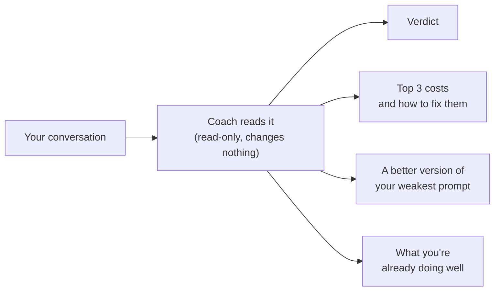
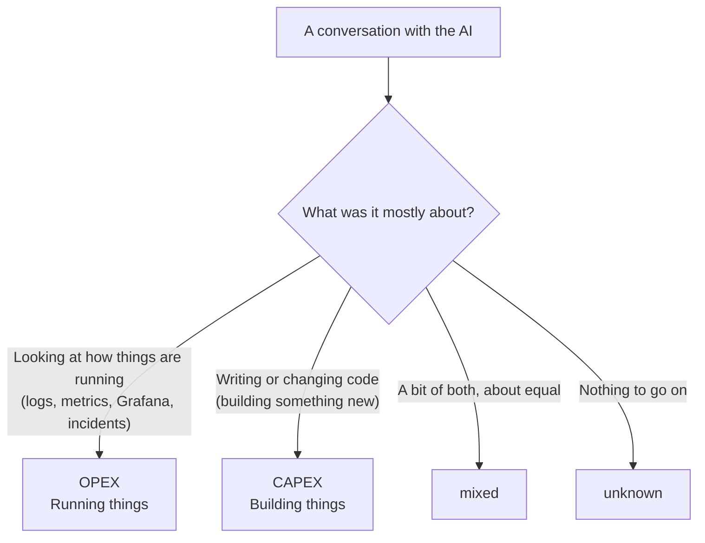
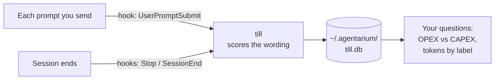
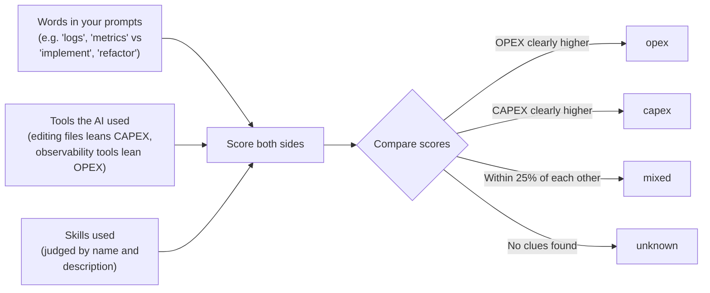
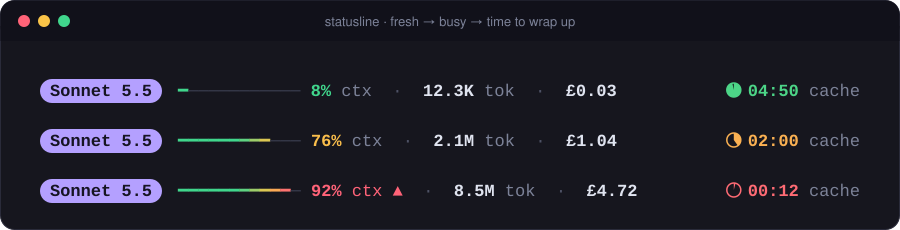
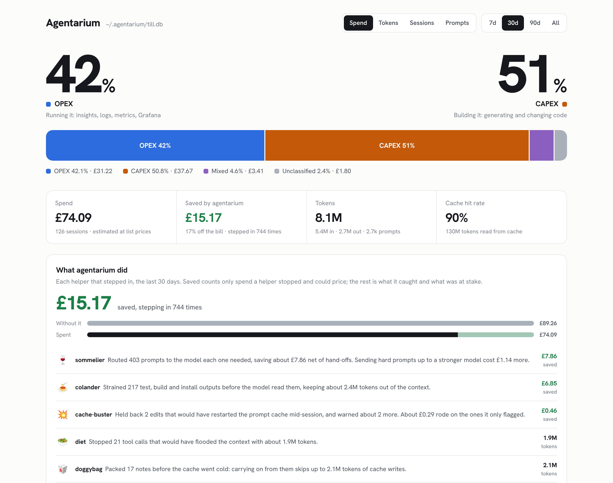

<p align="right"><a href="../README.md">← Back to README</a> · <a href="README.md">All docs</a></p>

# Helper reference

The full detail on every agentarium helper: what it does, how it decides, and what it records. For a shorter "which one do I need?" guide, see [Skills, tools and hooks](skills-tools-and-hooks.md).

| | Helper | Kind | Jump to |
|---|---|---|---|
| 🧑‍🏫 | **coach** | skill | [coach](#coach) |
| 📊 | **spend-report** | skill | [spend-report](#spend-report) |
| 🧮 | **till** | hook | [till](#till) |
| 🍷 | **sommelier** | hook + skill + tool | [sommelier](#sommelier) |
| 🎛️ | **the controller** | hook | [controller](#the-controller-one-decision-per-prompt) |
| 🥗 | **diet** | hook | [diet](#diet) |
| 🍝 | **colander** | hook + tool | [colander](#colander) |
| 💳 | **budget** | hook | [budget](#budget) |
| ✋ | **hold-up** | hook | [hold-up](#hold-up) |
| 🥡 | **doggybag** | hook | [doggybag](#doggybag) |
| 💷 | **bang-for-buck** | skill + hook | [bang-for-buck](#bang-for-buck) |
| 🤝 | **haggle** | skill + hook | [haggle](#haggle) |
| 🕵️ | **sherlock** | skill + hook | [sherlock](#sherlock) |
| 📏 | **waistline** | skill + hook + CI | [waistline](#waistline) |
| 👅 | **taste-test** | skill + tool | [taste-test](#taste-test) |
| 🧹 | **spring-clean** | skill + tool | [spring-clean](#spring-clean) |
| 🦫 | **groundhog** | hook + skill | [groundhog](#groundhog) |
| 🧾 | **split-the-bill** | skill + tool | [split-the-bill](#split-the-bill) |
| 🏪 | **bazaar** | skill + tool | [bazaar](#bazaar) |
| 🐴 | **blinkers** | hook + skill + tool | [blinkers](#blinkers) |
| 🔮 | **crystal-ball** | skill + tool | [crystal-ball](#crystal-ball) |
| 🪵 | **deadwood** | skill + tool | [deadwood](#deadwood) |
| 🧳 | **pack-light** | skill + tool | [pack-light](#pack-light) |
| ⚓ | **ballast** | hook + skill | [ballast](#ballast) |
| 🧇 | **waffle** | skill + tool | [waffle](#waffle) |
| 🥶 | **cold-snap** | skill + tool | [cold-snap](#cold-snap) |
| 🦜 | **parrot** | hook + skill + tool | [parrot](#parrot) |
| 🎣 | **fishingrod** | tool | [fishingrod](#fishingrod) |
| 🍽️ | **all-you-can-eat** | skill + tool | [all-you-can-eat](#all-you-can-eat) |
| 🔦 | **audit** | skill + tool | [audit](#audit) |
| 💥 | **cache-buster** | hook + skill + tool | [cache-buster](#cache-buster) |
| 🧑‍🍳 | **too-many-cooks** | hook + skill + tool | [too-many-cooks](#too-many-cooks) |
| 🫖 | **kettle** | hook | [kettle](#kettle) |
| 🏷️ | **receipt** | skill + tool | [receipt](#receipt) |
| 🧪 | **dry-run** | skill + tool | [dry-run](#dry-run) |
| ⚖️ | **rate-my-prompt** (alias **judge**) | skill + tool | [rate-my-prompt](#rate-my-prompt) |
| 🐙 | **Copilot premium requests** | tool | [Copilot allowance](#copilot-premium-requests) |
| 📟 | **status line**, **band** and **pane** | tool | [status line](#status-line) · [band](#band) · [pane](#pane) |
| 📈 | **dashboard** | tool | [dashboard](#dashboard) |
| 🗄️ | **your data** | | [Looking at your data](#looking-at-your-data) |

> Every cost agentarium shows is an estimate, not a bill. See the [disclaimer](../README.md#disclaimer).

---

## coach

Reads your conversation and tells you where tokens were wasted, with simple fixes. Read-only: it changes nothing.

Ask in Claude Code:

- *"coach, review my prompts"*
- *"why was that session expensive?"*
- or type `/agentarium:coach`



**What it looks for:**

| Common problem | In everyday words |
|---|---|
| Low cache hit ratio / cache rebuilds | The AI keeps re-reading things it could have remembered cheaply. |
| Vague or correction-heavy prompts | Unclear asks lead to wrong answers and costly do-overs. |
| Oversized context | Too much material loaded into the conversation. |
| Repeated file reads | The same file is opened again and again. |
| Mixed topics | One long chat covering several unrelated jobs. |

The coach needs a Claude Code conversation record, so Copilot sessions can't be reviewed.

For raw numbers, run the analyser directly: `node scripts/coach.ts [--session ID] [--json]`

---

## spend-report

Say **"spend report"** (or "where did my tokens go this week?") and the skill runs `scripts/report.ts` and summarises it:

- money spent (in your currency) and the OPEX/CAPEX split of that spend
- top projects and models
- the costliest sessions
- what sommelier, doggybag, diet and budget did
- three suggestions tied to your own numbers

Ask for any period: "this month", "today", "all time".

Run it yourself:

```bash
node scripts/report.ts                       # last 7 days, as Markdown
node scripts/report.ts --days 30 --json
node scripts/report.ts --currency EUR        # GBP, USD or EUR for this run
```

---

## till

Quietly labels each conversation as **OPEX** (running things) or **CAPEX** (building things) and saves it to a small database on your computer. It never blocks or slows your session, and it shows nothing on screen.

### What OPEX and CAPEX mean here



This lets a team answer questions like *"How much of our AI spend goes on building, and how much on keeping things running?"*

### When it runs



### What gets recorded for each session

- The **session id** and which assistant it was (`source`)
- The **label**: `opex`, `capex`, `mixed` or `unknown`
- The **scores** behind that label and the **number of prompts**
- Which **skills** were used, and whether each looks like OPEX or CAPEX
- **Token counts**: input, output, and prompt-cache reads and writes

Your prompts' text is **not** stored unless you switch that on (`AGENTARIUM_STORE_PROMPT=1`).

### How it decides



- At session end, the whole transcript is re-scored and tool calls are counted.
- **Prompts** score on both sides: OPEX for observability tools, live environments (prod, pods, CPU, 5xx), run-book verbs (restart, scale, roll back) and questions about what happened or what the numbers are; CAPEX for change requests (add, fix, rename, refactor...), broken code (failing tests, type errors, crashes), code nouns, UI words, and code-shaped text such as file paths, `camelCase` identifiers, error names and stack frames.
- Words that only look like OPEX are neutralised first: "log in", `console.log`, `git log`, "stack trace", "alert dialog", "dashboard page". Hook output, command output and system reminders inside a user turn are ignored.
- **Shell commands** count by what they run, never by the words in them: `kubectl logs`, `journalctl`, `docker logs`, `helm rollback` lean OPEX; tests, linters, builds, installs, `git commit`/`diff`/`rebase` lean CAPEX; `git log`, `ls` or `grep "metrics"` count for neither.
- **MCP tools** lean OPEX when their name points at observability or incidents (`datadog`, `pagerduty`, `search_logs`...), CAPEX for pull-request and commit tools.
- Each distinct skill that lands clearly on one side adds weight 6 to it, so one skill outweighs a few keyword hits. An ambiguous skill adds nothing.
- Example: "Analyses App Insights" → OPEX; "Create Unit Tests using NUnit" → CAPEX.
- A skill's description is read from its `SKILL.md` / command file on disk. Claude Code looks in the project's `.claude/`, `~/.claude/` and installed plugins, or otherwise in a skill listing found in the transcript. Copilot looks in the project's `.github/` and `.claude/` and in `~/.copilot/`.
- To adjust the scoring, edit `OPEX_PATTERNS` / `CAPEX_PATTERNS` in `agentarium/engine/classifier.ts` (and check the labelled prompts in `tests/fixtures_classifier.ts` still pass), or use `AGENTARIUM_SKILL_MAP` (see [Configuration](configuration.md)). One change applies to Claude Code and Copilot alike.

### Optional: let an AI model decide

Keywords miss prompts that use none of your words. Set `AGENTARIUM_LLM=1` and a model reads the session and decides; if the call fails or times out, the keyword label is used instead, so nothing is ever lost.

- It runs **once per session**, not per prompt. `Stop` fires every turn, so it only classifies the first time there; at `SessionEnd` (or Copilot's `sessionEnd`) it re-classifies if the session has changed. Identical input is never classified twice.
- The model sees the first 5 prompts (300 characters each), the **names and counts** of tools used (never their arguments or file contents), and the skills used with their descriptions.
- Text is redacted first (API keys, tokens, emails, long opaque strings), but **it still leaves your machine**. Point it at a local model if your prompts are sensitive.
- It works with any OpenAI-compatible endpoint: OpenAI, OpenRouter, or a local server such as Ollama or LM Studio.

| Column (`sessions` table) | Meaning |
|---|---|
| `label` | The label to use: the model's if it succeeded, otherwise the keyword label |
| `label_source` | `llm` or `keywords` |
| `llm_label`, `llm_confidence`, `llm_reason`, `llm_model` | The model's verdict (`opex`, `capex`, `mixed` or `unknown`), a 0 to 1 confidence, a one-sentence reason, and which model said it |

The keyword scores are always stored too, so you can compare the two. Failures are written to `till.db.err`; the hook still never blocks a session.

### Token columns

| Column (`sessions` table) | Meaning |
|---|---|
| `skills` | List of distinct skills used (Skill tool calls and `/slash` commands) |
| `skill_opex`, `skill_capex` | How many of those skills were judged OPEX / CAPEX |
| `skill_detail` | Per skill: `name`, judged `side`, `basis` (`map`, `name`, `description`, `name+description`, `none`) and the description used |
| `input_tokens`, `output_tokens` | Fresh input and generated tokens |
| `cache_creation_tokens`, `cache_read_tokens` | Prompt-cache writes and reads |
| `total_tokens` | Sum of the four above. Cache reads usually dominate, so use `input_tokens + output_tokens` for a leaner figure. |
| `billing_model` | What the assistant charges for: `anthropic_tokens` (Claude Code) or `copilot_premium_requests` (Copilot). Don't add the two together. |
| `usage_status` | `reported` when the assistant gave token counts, `unavailable` when it didn't (always the case for Copilot). Empty token columns mean "not known", not zero. |
| `evidence` | What the label is based on: `transcript` (the whole conversation) or `hook-events` (prompts and tool calls seen one at a time) |

Tokens are counted once per message. Work done by sub-agents in separate transcript files is not included. For Copilot, tool calls are also kept one row each in the `tool_events` table (tool name and kind only, never arguments).

---

## sommelier

**The flagship.** *The right wine for the dish.* A model router (`scripts/sommelier.ts`): every prompt gets a complexity score and goes to the model that suits it, so a hello-world never runs on the priciest model and an architecture question never gets stuck on the cheapest.

**How it scores.** Weighted signals, in the style of auto-routers such as LiteLLM's complexity router: prompt length, code blocks, simple-task phrases (*typo*, *rename*, *commit message*, *convert JSON*), technical terms, complex work (*refactor*, *debug*, *across the codebase*), reasoning words (*architecture*, *trade-offs*, *root cause*, *prove*, *security*), multi-step structure and stacked questions. The total lands in one of four tiers, each mapped to a model:

| Tier | Default model | Typical prompt |
|---|---|---|
| `SIMPLE` | Haiku | "create a hello world console app", "fix the typo in README" |
| `MEDIUM` | Sonnet | "add a /health endpoint to the flask api" |
| `COMPLEX` | Opus | "refactor the auth module across all services" |
| `REASONING` | Opus | "design the architecture for a distributed queue and compare the trade-offs" |

See exactly why a prompt landed where it did:

```text
$ agentarium router explain "create a hello world console app"
tier:    SIMPLE  (score -0.25)
model:   claude-haiku-5-5
signals: short -0.1, simple-task -0.35, build-verb +0.2
```

Change the map with `AGENTARIUM_ROUTER_TIERS="SIMPLE=haiku,MEDIUM=sonnet,COMPLEX=opus,REASONING=fable"` or `~/.agentarium/router.json` (`{"tiers": {...}, "thresholds": {"MEDIUM": 0.15, "COMPLEX": 0.5, "REASONING": 0.95}}`). Aliases resolve to the newest listed model of that family in `data/model-prices.json`; full model ids work too.

### Two ways to route

**1. Hook (default, nothing to set up).** Claude Code doesn't let a hook switch the session's model, so sommelier has your session hand the prompt, word for word, to a subagent on the tier's model (the Agent tool's `model` parameter) and relay the answer. The tool calls, file reads and output, most of a task's tokens, are billed at that model.

```text
sommelier: routing down to Haiku (SIMPLE, score -0.25, saves ~£0.07 after the hand-off) instead of Opus.
Start a prompt with 'keep-model:' to keep it on Opus.
```

It routes **down** to save money and **up** when a prompt is harder than your session's model (`AGENTARIUM_SOMMELIER_UP=off` to only ever route down). Because a subagent starts with a blank slate, the hook only hands over prompts that stand on their own: follow-ups like "yes, do it" or "fix that error" stay with your session.

**2. Proxy (a true per-request router, recommended once you're happy with the routing).** A local Anthropic-API proxy; every new turn is scored and the request goes upstream on the chosen model, with the whole conversation, no subagent and so no hand-off cost. One command sets it up:

```bash
agentarium router on              # start it in the background and point Claude Code at it (~/.claude/settings.json)
agentarium router on --project    # ...for this project only (.claude/settings.local.json)
agentarium router status          # is it running, which way are prompts routed, what it saved in 30 days
agentarium router off             # stop it and point Claude Code back at the API
```

`on` only touches the two keys it owns in `"env"` (`ANTHROPIC_BASE_URL`, `ANTHROPIC_MODEL=sommelier`), and `off` removes only those. A SessionStart hook (`sommelier.ts ensure`) restarts the proxy if Claude Code points at it and it isn't running, for example after a reboot. To run it by hand instead: `agentarium router serve`, then `ANTHROPIC_BASE_URL=http://127.0.0.1:8787 ANTHROPIC_MODEL=sommelier claude`.

- **Only `sommelier` (or `auto`) is routed.** Requests for any other model pass through untouched, including Claude Code's own small background calls. `AGENTARIUM_ROUTER_MODELS="*"` routes every main-model request instead.
- **Cache-aware.** Inside a tool loop the model never changes. A new turn can always move **up**; it only moves **down** when the prompt cache has gone cold or the context is small (`AGENTARIUM_ROUTER_STICKY_TOKENS`, default 20,000), because switching models means re-writing the context into the new model's cache.
- **Fallback.** If a routed request fails (overloaded, rate-limited, model not found), it is retried once on the fallback model (`AGENTARIUM_ROUTER_FALLBACK`, default the `COMPLEX` tier).
- Your API key or login passes straight through; the proxy listens on `127.0.0.1` only. `AGENTARIUM_ROUTER_UPSTREAM` points it at another Anthropic-compatible endpoint (a gateway, Bedrock/Vertex proxy).
- While `ANTHROPIC_BASE_URL` points at the proxy, the hook steps aside so prompts aren't routed twice.

### Spending to the budget

When you set a budget (`AGENTARIUM_BUDGET_DAILY`, `AGENTARIUM_BUDGET_SESSION` or `AGENTARIUM_BUDGET_MONTHLY`, see [budget](#budget)), sommelier works to keep you inside it rather than waiting for budget's pause at 100%. Once the tighter limit passes its warning share (`AGENTARIUM_BUDGET_WARN`, default 80%):

- **It routes down harder.** Every tier threshold rises by 0.35, so a routine prompt that would go to Sonnet goes to Haiku, and a complex one that would go to Opus goes to Sonnet.
- **It stops routing up.** A hard prompt stays on your session's model instead of moving to a pricier one.
- **It says so**, e.g. `routing down to Haiku (SIMPLE, score 0.35, today's budget 85% spent)`.

Forcing a model (`opus:`) and `keep-model:` still win. `AGENTARIUM_SOMMELIER_BUDGET=off` turns this off.

The routing proxy does the same. It scores against the raised thresholds, and never moves a conversation above the model it is already on (or the model the request asked for). The daily budget works as is; for the session budget the proxy reads the session from Claude Code's `X-Claude-Code-Session-Id` header (or the session in the request's `metadata.user_id`). The proxy's log gives the reason, e.g. `SIMPLE score 0.35, today's budget 85% spent; not routing up on a tight budget`.

### What it saved, net of the hand-off

A route in hook mode isn't free. Your session's own model still reads the conversation to hand the task over, and again to relay the answer. So every route is priced before it's taken (`estimateHandoff`, from list prices and a typical task's shape):

| | Estimate |
|---|---|
| **stay** | your model does the task: the context read at each of ~4 steps, plus the work |
| **hand-off** | your model reads the context twice (the Agent call, the relay) and writes two short turns |
| **routed** | the cheaper model does the work from its own fresh, small context |
| **saving** | stay − hand-off − routed |

A route **down** is only taken when the saving is positive. Opus to Haiku always pays. A small step down with little context (Fable to Opus, say) often doesn't, and stays put (`skipped-overhead` in the log; `AGENTARIUM_SOMMELIER_OVERHEAD=off` routes anyway). A route **up** is logged as what quality cost extra, never as a saving. The proxy has no hand-off: its saving is the price difference on the request, minus a cache re-write when the switch leaves a warm cache behind.

The savings show on the status line's forecast row and in the band (`£0.41 saved by sommelier`), in `agentarium router status`, and in the weekly spend report. They are estimates, not a bill.

**Measured, too.** A routed subagent's real usage is in the session transcript (its sidechain, or the per-agent file Claude Code keeps beside it). On your next prompt the hook reads it, prices each of the subagent's turns at its own model, and logs it beside the estimate (`measured_usd`, `measured_saved_usd`, and the task's shape: `m_steps`, `m_input`, `m_output`). `agentarium router status` shows both:

```text
30 days:  12 routes, saved ~£0.84 net of hand-offs
measured: 9 routed subagents: estimated ~£0.11, measured ~£0.14 (+27%); saving estimated ~£0.63, measured ~£0.60
```

Once 5 routes are measured, `learn` replaces the typical task shape the estimate starts from (4 steps, 15,000 tokens read, 1,500 written, 2 minutes) with the median of yours, so the next decision is priced on how your own tasks run. `AGENTARIUM_SOMMELIER_LEARN=off` goes back to the typical shape. Nothing but token counts and timestamps are read from the transcript.

**The cache, too.** The hook reads from the transcript whether your session's prompt cache is still warm (5 minutes since the last turn, or 1 hour once the session writes the 1-hour cache; `AGENTARIUM_CACHE_TTL` overrides it) and prices the hand-off with it:

- **Cold.** Staying means re-writing the whole context on the first step, at 1.25× the input price. Handing off pays the same re-write, because your model still reads the context to make the Agent call. So a cold cache raises both sides by the same amount, and the message's numbers say so, but it doesn't change whether a route pays.
- **Warm, with a task that outlasts the cache.** While the subagent works, your session's cache can expire, and then the relay re-writes the whole context, which staying never would. sommelier uses how long your routed tasks really take (from the measured routes) and adds that re-write when they outlast the cache. With a big context this is what stops a route down: `skipped-overhead`, with the reason `...and the task outlasts the 5-minute cache`.

Each route logs the cache it saw (`cache`: `warm` or `cold`).

### Backing off, and learning

- **"That didn't work."** If the last prompt was routed down (within 30 minutes) and the next one says it didn't land (*didn't work*, *still failing*, *tests fail*, *that's wrong*, *try again*), sommelier doesn't hand it over again: your session's model takes it (hook), or the proxy moves the conversation up one tier.
- **Or the evidence says so.** You don't have to say it. In hook mode, the next prompt after a route down also goes to your session's model when the routed work (the subagent's tool calls and the session's since) ended on a failing test, lint or build run, had its change reverted (`git checkout`, `restore`, `reset --hard`, `stash`) or refused, or groundhog caught the session looping. The rules are bang-for-buck's, so a red run followed by a green one is a pass. The proxy reads its own tool loop: on a routed-down conversation, the same checks failing twice in a row, a revert of its own change or a groundhog refusal moves it up one tier straight away, mid-loop, and only fresh evidence moves it again. Both log `escalated` with the evidence as the reason, and the hook's count as misses for learning.
- **Learning.** `agentarium router learn` runs at every session end (`--quiet`). It counts, per tier, the routes that held and the ones that missed (escalated, or kept on your model with `keep-model:` when sommelier would have routed down). With at least 8 routes in a tier, a miss rate above 20% lowers the threshold above it, so similar prompts route higher; a miss rate under 5% over 20+ routes raises it a little. Offsets stay within −0.3 and +0.2 and are written to `~/.agentarium/sommelier_learned.json`. They are learned **per project** too: a frontend repo and a distributed-systems repo need different thresholds, so each route is logged with the repository's name (never its path; `AGENTARIUM_PROJECT` overrides it), and a project with 8 routes of its own in a tier gets its own offset for that tier, even when it's 0 and the global one isn't. Until then it uses the global offsets. `router learn` lists the projects with their own thresholds, and `router explain` uses the ones for the folder you run it in. `router.json` and `AGENTARIUM_ROUTER_TIERS` still win; `AGENTARIUM_SOMMELIER_LEARN=off` ignores what it learned.
- **Outcomes.** `learn` also reads bang-for-buck's cost per *successful* result per model. When a cheaper family lands work as often (within 5 points, 5+ successes) for less per success, it suggests a tier swap, e.g. `COMPLEX=sonnet`; `learn --apply-tiers` applies it.
- **How good is it?** `agentarium router eval` scores the labelled prompts in `data/sommelier-eval.json` and prints the confusion table, with "routed too low" (the costly mistake) and "routed too high" counted separately; `--misses` lists them, `--learned` uses your learned thresholds. Today: 38 of 42 on the right tier, 2 too low. Add your own prompts to the file.
- **Your own evaluation set.** Every escalation, and every `keep-model:` on a prompt sommelier would have routed down, is kept as a labelled case in `~/.agentarium/sommelier_eval.json`, labelled one tier above where it landed. By default a case holds only the prompt's hash and its score, so `router eval --mine` checks your thresholds against your own misses without storing what you wrote. `AGENTARIUM_SOMMELIER_EVAL=text` also keeps the wording, so the scorer re-reads it (`--mine --export` prints those in `data/sommelier-eval.json`'s shape, to contribute). `off` keeps nothing.
- **Regressions fail CI.** `router eval --check` exits 1 when the labelled set routes worse than `--min-accuracy` (default 0.85) or puts more than `--max-under` (default 3) too low, and lists the misses. The tests workflow runs it on every push.

### Overrides and settings

- Start a prompt with `keep-model:` to keep it on your model, or `haiku:`, `sonnet:`, `opus:`, `fable:` to force one. Works in both modes.
- Slash commands are never routed.
- `AGENTARIUM_SOMMELIER=block` pauses a down-route instead and suggests `/model haiku` (send the same prompt again to run it anyway). `warn` shows that suggestion without pausing. `proxy` turns the hook off in favour of the proxy. `off` disables sommelier.
- Each decision is logged to the `sommelier_events` table (`routed`, `routed-up`, `proxy-routed`, `proxy-fallback`, `escalated`, `kept`, `skipped-overhead`, `blocked`, `warned`, `overridden`) with its estimated saving (`saved_usd`), context size, tier and score, and for a hook route the measured subagent cost once it's in. It shows up in the spend report.
- Signals and weights live in `SIGNALS` at the top of the script.
- The hook is Claude Code only (Copilot CLI ignores hook output on prompt submit).

---

## The controller: one decision per prompt

Every prompt in Claude Code goes through one hook, `controller.ts`, which runs the prompt-time helpers in one process, in this order:

| | Helper | Can pause the prompt? |
|---|---|:---:|
| 1 | till records the prompt | |
| 2 | budget: a limit reached | ✅ |
| 3 | hold-up: a huge pasted log, data dump, document or file, or a blatantly broad ask | ✅ (in `block` mode, the default) |
| 4 | sommelier picks the model (harder down on a tight budget) | ✅ (in `block` mode) |
| 5 | haggle prices the task | ✅ |
| 6 | ballast: a new task carrying the last one's context | ✅ (in `block` mode) |
| 7 | doggybag: a fresh start from the notes after the cache went cold | ✅ (in `block` mode) |
| 8 | blinkers notes what the task asked for | |
| 9 | parrot: an instruction you keep repeating | |

On Copilot CLI the controller runs its own steps, in one process for `userPromptSubmitted`: till records the prompt, premium pauses it once the month's premium requests are used up (see [Copilot premium requests](#copilot-premium-requests)), doggybag arms its cold-cache check and blinkers notes what the task asked for. `controller.ts explain copilot` prints them. VS Code runs the same without doggybag, and with [hold-up](#hold-up) after premium, since its prompt hook honours a pause.

The first helper to pause the prompt decides alone, and nothing after it runs. Otherwise every notice is joined into one message and every piece of context into one block. Each helper keeps its own switch; `AGENTARIUM_CONTROLLER_SKIP=parrot,blinkers` leaves some out entirely. A helper that fails is skipped and the others still run. Before, these were eight separate Node.js processes per prompt; now it's one (about a quarter of a second). `sh scripts/run.sh controller.ts explain` prints the order.

**How long each one takes.** The controller times every step of every prompt, loading included, since each prompt is a fresh process. It keeps the times in `controller_events`. `agentarium doctor` shows the last 200 prompts per assistant, slowest helper first, and flags one whose median is 150 ms or more (`AGENTARIUM_CONTROLLER_SLOW_MS`):

```text
  prompt time  claude-code: ~260 ms a prompt (p90 410 ms, last 200 prompts)
    parrot       160 ms  p90   240 ms   62%  ! slows every prompt: AGENTARIUM_CONTROLLER_SKIP=parrot leaves it out
    till          45 ms  p90    80 ms   17%
```

`controller.ts latency --json` gives the figures. `AGENTARIUM_CONTROLLER_TIMING=off` stops recording them.

---

## diet

Every token pulled into the conversation is paid for again on every later turn. **diet** (`scripts/diet.ts`) is a pre-tool hook (`PreToolUse` on `Read|Bash` in Claude Code, `preToolUse` in Copilot CLI) that refuses a small set of calls known to flood the context, and tells the AI how to ask for less. The AI then retries with a narrower call by itself:

| Stopped | Suggested instead |
|---|---|
| Reading a generated file whole: lockfiles, `*.min.js`, source maps, snapshots (over 64 KB) | `grep` for what you need, or read a range |
| `kubectl logs`, `docker logs`, `journalctl` with no limit | `--tail=200`, `--since=15m` |
| `git log` with no limit | `-n 20 --oneline` |
| `find /` or `find ~` with no `-maxdepth`; `ls -R`; `tree` with no `-L` | start from the project, `git ls-files`, `-L 2` |
| `cat` of a file over 64 KB | `grep -n`, `head`, `sed -n 'A,Bp'` |

- A command that already pipes (`| grep`, `| head`), redirects to a file, or limits itself is never touched, and a file that can't be found is never blocked.
- To let one command through, append `# diet-ok`.
- Each block is logged to `diet_events` with an estimate of the tokens kept out, which shows up in the spend report.
- Rules live in `agentarium/engine/diet.ts`, shared by both assistants.

**It learns what floods your projects.** A post-tool hook (`PostToolUse` on `Read|Bash`, `postToolUse` in Copilot CLI) records how much each call printed, filed under the program's name for a shell command (`terraform`, never its arguments) or the extension for a read (`read .json`), in `diet_sizes`. Only unfiltered runs count, so a program's typical size is what it prints when nobody asks for less. Once a program has run unfiltered at least 5 times and typically printed more than the size limit (`AGENTARIUM_DIET_MAX_KB`, 64 KB), diet treats it like the built-in rules (`big-by-habit`) and asks for a filter. `agentarium diet sizes` lists what each program and file type typically prints; `AGENTARIUM_DIET_LEARN=off` stops recording and learning.

---

## colander

*Why is the agent reading 400 passing tests?* A test run, build, lint or install that succeeds prints mostly lines nobody reads: one per passing test, progress bars, download and compile chatter, the same deprecation warning forty times. The model reads every one, and they stay in the context, re-read at every later step. **colander** (`scripts/colander.ts`) is a post-tool hook (`PostToolUse` on `Bash` in Claude Code, `postToolUse` in Copilot CLI) that drains them out before the model sees the result. This is what the model gets from this repository's own `npm test`:

```text
> test
> node --test --test-concurrency=1 "tests/*.test.ts"

TAP version 13
… 2,805 lines left out …
# tests 353
# suites 98
# pass 353
# fail 0
# cancelled 0
# skipped 0
# todo 0
# duration_ms 42047.55024

[colander: showed 13 of 2,818 lines (about 52 of 19,520 tokens), leaving out 451 lines of passing tests and 2,354 of
progress and runner output. The full output is in ~/.agentarium/colander/npm-20261125-225243-b42f05.log: grep it or
read part of it rather than running the command again.]
```

| Left out | Always kept |
|---|---|
| Passing tests (jest, vitest, mocha, `node --test`, pytest, go, cargo, rspec, dotnet, gradle), with the YAML TAP prints under each and the `describe` headings between them | The first line and the last |
| Progress bars, spinners and the lines a progress bar redrew | Every failure, with the 20 lines after it: the assertion, the diff, the first stack frames |
| Download, install and compile chatter (npm, pnpm, yarn, pip, cargo, go, maven, gradle, docker) | Warnings, deprecations, errors and skipped or pending tests |
| The third and later copies of the same line, numbers aside | Summaries: `Tests: 402 passed`, `=== 240 passed in 8.3s ===`, `test result: ok` |
| The ordinary middle of a log still longer than 60 lines | Its first 9 lines and its last 30 |

- **Nothing is lost.** The full output is saved first, in `~/.agentarium/colander/`, readable only by you and kept for a day (the newest 30 at most). The footer gives its path, so when the agent needs a line it greps the file instead of running a 40-second suite again. The same output is already in your assistant's own transcript, so this keeps nothing new about you, and none of it goes into the database.
- **Which commands.** Test runners, builds, type checkers, linters and package installs: `npm test`, `npm ci`, `npm run build` (and other scripts named for tests, builds, lint, checks or types), `pnpm`, `yarn`, `bun`, `npx jest`, `pytest`, `python -m pytest`, `uv run`, `tox`, `mypy`, `ruff`, `go test`, `cargo test` and `build`, `make`, `mvn`, `gradle`, `dotnet test`, `rspec`, `phpunit`, `pip install`, `docker build` and more (the list is in `agentarium/engine/colander.ts`). Never `cat`, `git diff`, `grep` or logs: that's content the agent asked to read. A command the agent already piped through a filter (`npm test | tail -40`) is left alone. Add your own scripts with `AGENTARIUM_COLANDER_COMMANDS=ci.sh,just`.
- **When it steps in.** Only when the output is over about 1,000 tokens and straining leaves out at least 30% of it. Anything smaller goes through untouched.
- **Successful commands only.** Claude Code sends a command that exits non-zero to `PostToolUseFailure`, which can add a note but can't replace the output, so a failing test run reaches the model whole. Copilot CLI replaces a successful result through `modifiedResult` (documented for command hooks; not yet confirmed on a real install). VS Code's hooks can't replace a result, so colander doesn't run there.
- **What it saves.** A token left out is never written to the cache and never re-read. Claude Code passes at most 30,000 characters of a Bash result to the model (`BASH_MAX_OUTPUT_LENGTH`), about 7,500 tokens, so colander counts each saving up to that and no further. On Opus 5.5, the run above comes to about £0.03 of cache write skipped, and about £0.03 more of re-reads if the session runs another 30 steps: roughly £0.06 a run, or £0.60 for a session with ten test runs. The dashboard and the spend report count the cache write as saved and the tokens as kept out; the re-reads aren't counted, since they depend on how long the session runs. On Copilot the saving is in tokens only, never money or premium requests.
- **Better than a cut.** When an output is too long, Claude Code keeps the start and the end and drops the middle, which is often where a failure is. colander keeps the failure and drops the noise around it.
- `agentarium colander` shows the week's strains by program (`--days 30`, `--json`). `npm test 2>&1 | agentarium colander strain` shows what the model would get from any output, and `--command "make ci"` says whether the hook would strain that command.
- Append `# colander-off` to a command to see all of it; `AGENTARIUM_COLANDER=off` stops colander; `AGENTARIUM_COLANDER_MAX_LINES` (60) sets how many lines it shows, failures aside.
- Claude Code asks before reading outside the project. To let the agent read the saved output without asking, add `"Read(~/.agentarium/colander/**)"` to `permissions.allow` in your settings.
- Each strain is logged in `colander_events`: the program's name and token counts, never the command or what it printed. Rules live in `agentarium/engine/colander.ts`, shared by both assistants.

---

## budget

Set a limit and **budget** (`scripts/budget.ts`, a `UserPromptSubmit` hook) keeps an eye on it. Limits are in your chosen [currency](configuration.md#currency) (pounds by default), so `20` means £20, $20 or €20:

```bash
export AGENTARIUM_BUDGET_DAILY=20      # per day, all sessions together
export AGENTARIUM_BUDGET_SESSION=5     # per session
```

Or give it a **monthly allowance** and let it work out each day's limit from what's left:

```bash
export AGENTARIUM_BUDGET_MONTHLY=500                         # per billing period
export AGENTARIUM_BUDGET_RESET_DAY=1                         # the day it resets (default 1)
export AGENTARIUM_BUDGET_WORKDAYS=mon-fri                    # default
export AGENTARIUM_BUDGET_DAYS_OFF=2026-12-24..2026-12-31     # holidays, dates or ranges
```

Today's limit is *(allowance − spent this period before today) ÷ working days left*, today included. So a month that starts with a fortnight off leaves about twice as much per day for the rest of it, and a heavy week leaves less for the days after. It is a ceiling, not a target. Today's limit holds still while you work (it only counts spend before today), and today always counts as a working day, even on a weekend. Once the allowance is spent, the limit is zero until it resets. Set `AGENTARIUM_BUDGET_DAILY` as well to cap any single day; the lower of the two applies. The status line, sommelier's budget squeeze and `budget.ts status` all use the same figure.

- At **80%** of a limit you get one notice.
- At **100%**, your next prompt is paused with what you've spent and some cheaper ways on (`/compact`, a smaller model, a fresh session).
- To carry on anyway, send the same prompt again or start it with `over-budget:`; you won't be paused again for that limit that day.
- `AGENTARIUM_BUDGET_MODE=warn` only ever shows notices.
- Check where you are with `node scripts/budget.ts status`.

Spend is worked out from the token counts till records at the end of each turn, priced per model like the status line (so it is at most one turn behind, and an estimate, not your invoice). Each increase is stored with its date, so a session that runs past midnight counts towards the right day. Copilot bills premium requests, which hooks can't see, so Copilot sessions never count towards a budget. Copilot also ignores prompt-hook output, so budget is Claude Code only.

---

## hold-up

*Should that be a file?* A prompt stays in the conversation for the rest of the session. Paste in a 3,000-line log and all of it is written to the cache with the prompt, then re-read at every later step, though the answer is usually in a few lines the agent could have found with `grep`. **hold-up** (`scripts/holdup.ts`, rules in `agentarium/engine/holdup.ts`) is a step in the [controller](#the-controller-one-decision-per-prompt) that sizes the prompt before it is sent and, from `AGENTARIUM_HOLDUP_MIN_TOKENS` (10,000 tokens, about 40 KB), pauses it once:

```text
hold-up: this prompt is about 66,024 tokens over 3,101 lines, mostly a pasted log. Sent, all of it joins the
conversation: about £0.25 to send, then £0.01 at every later step until you /clear (about £0.36 over a task like
your last ones, 12 steps). Save it to a file, or give the path of the log it came from, and say what you're after:
the agent can grep it and read only the lines that matter. Send the prompt again to go ahead as it is.
```

It says what most of the prompt is, by the share of its characters, and what to do instead:

| Kind | Looks like | Instead |
|---|---|---|
| `log` | timestamps, log levels at the start of a line, `level=` or `"level":` fields, stack frames | save it to a file, or name the log it came from, and say what you're after |
| `data` | JSON (pretty or on one line), CSV or TSV | save it to a file; the agent reads a sample or queries it with `jq` |
| `blob` | base64 or hex runs, such as a pasted `data:image/png;base64,...` | save it as a file; for an image, attach the image itself |
| `diff` | a unified diff (`@@ -12,3 +12,4 @@` hunks with `+`, `-` and context lines) | commit or stash it and name the branch, commit or files; the agent runs `git diff` on what matters |
| `code` | source code: lines ending in `{`, `}` or `;`, keywords such as `import`, `def` or `const`, comment blocks | give the path and the function or lines that matter |
| `doc` | prose or Markdown: a spec, a report, meeting notes, an email thread | save it to a file (or name the one it came from) and say which section or question matters |
| `paste` | anything else that big | give the path and say which part matters |

### Too broad

A prompt can also run up the bill by its scope. "Refactor the whole codebase" or "fix all the bugs", with nothing named to start from, sends the agent exploring, and every file it opens is re-read at every later step. hold-up pauses a prompt like that once, whatever its size:

```text
hold-up: this prompt asks for the whole codebase but names no file, function or error to start from and no check
that says it's done, so the agent explores: every file it opens joins the conversation and is re-read at every later
step. Name where to start and how you'll know it worked, or split it into steps you can check one at a time ("in
src/auth/, fix the failing login test; `npm test -- auth` should pass"). For the same change in every file, ask for
a script that makes it. Send the prompt again to go ahead as it is.
```

It only speaks up when all of these hold, so an ordinary follow-up goes straight through:

- the prompt sweeps the repo: "the whole codebase", "across the project", "every file", "all the components", "all the bugs", "clean up everything"
- with a verb that sets the agent to work (fix, review, refactor, explain, document and so on)
- it is short (400 characters or fewer: a longer prompt usually carries detail the rules can't see)
- it names no file path, symbol, line number or error, and sets no limit ("only ...", "leave the tests alone")
- it names no check that says it's done (tests, lint, build, typecheck) and doesn't point back at work already shown ("do the same across the whole codebase")

There is no price in this notice: what exploring costs depends on the repo, so it says what happens instead of guessing. It carries the `big-task` lesson. `AGENTARIUM_HOLDUP_BROAD=block`, `warn` or `off` sets it apart from pastes; unset, it follows `AGENTARIUM_HOLDUP`. Logged to `holdup_events` with kind `broad`; the dashboard counts it as a pause but not as tokens kept out.

### Settings and logging

- The price is the cache write on the session's model (5-minute or 1-hour, as the session uses), then a cache read for each later step; "a task like your last ones" is this session's requests per prompt so far.
- Send the same prompt again to go ahead: hold-up recognises it by a hash and lets it through. A changed prompt is checked afresh. Prompts starting with `/` are never checked.
- `AGENTARIUM_HOLDUP=block` (default), `warn` (a notice; the prompt goes ahead, so it only helps next time) or `off`. The `frugal` profile pauses from 5,000 tokens; `quality` only warns.
- Logged to `holdup_events`: the size, the kind, a hash of the prompt and the price, never the text. The dashboard counts the tokens kept out, net of pastes sent again.
- In VS Code, whose prompt hook honours a pause, it runs the same way and says what the paste does to the context, never what it costs: Copilot bills premium requests. Copilot CLI ignores prompt-hook output, so it has no hold-up step.

---

## doggybag

*Pack up the leftovers.* When the prompt cache goes cold, carrying on in the old session means paying to re-write the whole conversation into the cache again. **doggybag** (`scripts/doggybag.ts`) packs a small digest first, so you can carry on from that instead.

**Where it goes.** Into the project: `<project>/.doggybag/<session id>.md`, plus `.doggybag/latest.md` (always the newest). The folder carries its own `.gitignore` (`*`), so it is never committed whatever your repo's rules are. The newest 10 per project are kept. Set `AGENTARIUM_DOGGYBAG_DIR` to an absolute path to keep them all in one place instead.

**How it times it.** Hooks cannot run on a timer, so on every `Stop` (Claude Code) or `userPromptSubmitted` (Copilot) it starts a small background watcher. The watcher reads the cache clock from the transcript (5 minutes, or 1 hour if the session uses the 1-hour cache) and packs the doggybag 60 seconds before expiry. If you carry on working, the clock moves and the watcher waits for the new deadline. `SessionEnd` stops the watcher and packs one if there is not already a current one.

**Ready on your next prompt.** Come back after the cache has expired and type your next prompt: the `UserPromptSubmit` hook makes sure the doggybag is packed (even if the watcher died with a sleeping laptop) and tells you what the cold prompt will cost:

```text
doggybag: the prompt cache went cold 42 min ago, so this prompt re-writes about 180,000 tokens (about £0.71).
Cheaper: /clear and your doggybag (1,450 tokens, .doggybag/latest.md) loads automatically.
```

Type `/clear` (or start a new session in the folder) and the `SessionStart` hook loads the latest doggybag into the conversation for you; nothing to paste. `AGENTARIUM_DOGGYBAG_COLD=block` pauses that first cold prompt once (send it again to carry on anyway); `off` stays quiet. Small sessions (under 20,000 tokens of context) are never interrupted.

**What's in it.** Git branch and changes, tasks, your last few requests, the last reply, files edited, recent commands, an estimate of a full resume against the size of the note, and how to carry on. It is built from the transcript by plain code; **no model is called, so it costs no tokens**.

- `agentarium doggybag` (or `node scripts/doggybag.ts write`) packs one on demand for the folder's latest session.
- `AGENTARIUM_DOGGYBAG_INJECT=0` only tells you a doggybag exists instead of loading it.
- **Before compaction too.** `/compact` and auto-compact replace the conversation with a summary, and a summary drops file names and decisions. The `PreCompact` hook packs a doggybag first (`reason` `compact` or `auto-compact`), and the `SessionStart` hook that follows compaction loads it back as context, so nothing the summary left out is lost. It prints nothing at `PreCompact`: Claude Code would read it as compaction instructions.
- Each one is logged to the `doggybag_events` table.
- Copilot CLI support is best effort: its hook payload and transcript format are less documented, so the digest may be thinner.

---

## Value, waste and quality

Seven helpers that answer the questions a spend total can't. Three of them are agentarium's signature features: **bang-for-buck is the value meter**, **sherlock does agent forensics** and **taste-test is the quality gate** (`--gate` fails CI when a saving cost quality).

| Question | Helper | Kind |
|---|---|---|
| Is the AI actually delivering value for the money? | [bang-for-buck](#bang-for-buck) | skill + hook |
| Is this task worth spending £2 on? | [haggle](#haggle) | skill + hook |
| Where is the money disappearing? | [sherlock](#sherlock) | skill + hook |
| Am I getting worse value from AI than I was last month? | [waistline](#waistline) | skill + hook + CI tool |
| Can I prove that an optimisation hasn't damaged quality? | [taste-test](#taste-test) | skill + tool |
| What in my instructions costs money every request for nothing? | [spring-clean](#spring-clean) | skill + tool |
| Is the AI going round in circles? | [groundhog](#groundhog) | hook + skill |

They read Claude Code transcripts (the record of every tool call and its result), so most of them are Claude Code only; groundhog also catches identical repeated calls in Copilot CLI. Like everything else here they store numbers and tool names, never your prompts or code.

---

## bang-for-buck

*Cost per outcome.* Stop measuring tokens saved; measure what it costs to get useful work done. **bang-for-buck** (`scripts/bangforbuck.ts`) runs at the end of every turn (`Stop`, and `SessionEnd`) and writes one row per session to the `ledger` table: cost, tokens, tool calls, and the outcomes the agent actually achieved, read from what it did rather than what it said:

| Outcome | Counted when |
|---|---|
| bug fixed | the same test command went from failing to passing, or a fix-type request ended with the change committed or the tests green |
| completed feature | a build-type request ("add", "implement", ...) ended with code edited and then committed, a PR opened, or the tests green |
| passing test suite | a test run passed (npm/pnpm/yarn test, jest, vitest, pytest, go test, cargo test, node --test and more; consecutive passes count once) |
| commit / pull request | a successful `git commit`, `gh pr create` or PR tool call |
| successful agent task | a subagent came back without an error |

Ask *"is the AI worth the money?"* or run `agentarium bang-for-buck` for the last 30 days: cost per session that got something done, cost per feature, bug fix and passing suite (with the change against the period before), and, per model, **cost per session and cost per success side by side**. The cheapest model isn't the best value if it needs three goes: when those two disagree, the report says so. Sessions with nothing to show are totalled separately.

- `bangforbuck.ts session` shows what one session bought; `mark feature "csv export"` records an outcome the heuristics can't see; `ingest ~/.claude/projects` backfills the ledger from old transcripts.
- `AGENTARIUM_BANGFORBUCK=off` stops the recording.

---

## haggle

*Agree a price before work starts.* **haggle** (`scripts/haggle.ts`) quotes substantial tasks the moment you send them (`UserPromptSubmit`), tracks the spend as the work runs (`PreToolUse`), and stops the agent at an agreed maximum.

**The quote** is built from how the task is likely to run, learnt from your own ledger: typical turns per task scaled by how complex the prompt is (the same scoring sommelier uses), the context each request re-reads (cache reads), what each turn adds (tool results: cache writes) and what the model writes (output). The range is half to twice the turns. Once contracts have finished, quotes are calibrated by how far off earlier ones were.

```text
haggle: complex task, quoted £1.20 (likely £0.55–£2.90: input £0.40, tools £0.35, output £0.45). Cap £2.40. Set your own price with 'haggle £X: ...'.
```

**Contracts.**

- Automatic quotes (complex prompts, or any estimate over £0.50) tell you when the task passes its estimate and its cap, but never stop anything.
- Start a prompt with **`haggle £2:`** to agree a price yourself. That is a hard cap: when it's reached, the agent's next tool call is refused with an instruction to stop, report what's done and what's left, and ask you to approve more.
- Reply **`haggle +£1`** (or `approve` once it has stopped) to raise the cap; **`haggle off`** drops the contract.
- **The band counts it down.** While a contract is open, its cap is a budget for the band and the status line's forecast row: `£0.80 of £2.00 left this task · ~3 steps`, whenever it's tighter than your daily or session budget. When it won't last the next 10 steps and you're on Opus or above, the tip prices a cheaper model. A quote's cap counts too, even though only a price you set is enforced.
- `AGENTARIUM_HAGGLE=strict` enforces every quote's cap; `off` turns it all off. `AGENTARIUM_HAGGLE_MIN` (0.50) and `AGENTARIUM_HAGGLE_CAP_X` (2) tune when a contract starts and how much headroom it gets.

**"Is this task worth £2?"** `agentarium haggle quote "migrate the auth module to the new token API" --price 2` answers yes / probably / tight / unlikely, with the breakdown. `agentarium haggle status` lists recent contracts, quoted against actual.

---

## sherlock

*Find the hidden waste.* A forensic audit of what the agent actually did, step by step. **sherlock** (`scripts/sherlock.ts`) finds the steps that added cost but no information:

| Finding | What it means |
|---|---|
| repeated file read | the same file (same range) read again with no edit to it in between |
| redundant call | the same call with the same input and the same result, nothing edited in between |
| repeated search | a differently worded search that returned exactly what an earlier one did |
| unused result | a big tool result that nothing afterwards refers to (a heuristic: "probably unused") |
| overlapping subagents | two subagents briefed on largely the same job |
| unnecessary delegation | a subagent sent to do a one-step lookup a single Read or Grep would have done |

Each finding is costed: a wasted result is written into the cache once and re-read on every later request until the context is compacted, at that model's rates; a subagent also pays to load its own system prompt and tools. Ask *"where is the money disappearing?"* or run `agentarium sherlock` (`--session <id>` for another session). At `SessionEnd` it logs each session's estimated waste to `sherlock_events`, which the spend report totals. `AGENTARIUM_SHERLOCK=off` stops the logging.

---

## waistline

*AI cost regression testing.* Treat cost creep like a performance regression: catch it before it becomes normal. **waistline** (`scripts/waistline.ts`) compares equivalent work across two periods of the ledger, or against a saved baseline:

- median cost per session, cost per result, and per kind of task (feature, bug fix, ...)
- context consumption: average context per request and peak context
- tool calls per session, **new tools** with large output, and tools whose output grew
- **model changes**: more of the work on a different model, and its cost per turn

`agentarium waistline --days 30` compares the last 30 days with the 30 before (default 7). A measure up more than 15% (`--threshold`, or `AGENTARIUM_WAISTLINE_THRESHOLD`) is a regression; fewer than 3 sessions on either side is never called a trend. Once a day, at session start, it shows a one-line notice if last week's spend per session or per result rose past the threshold (`AGENTARIUM_WAISTLINE=off` to silence it).

**In CI.** Save a baseline once and commit it, then compare transcripts from your CI agent runs on every build:

```bash
node scripts/waistline.ts --save-baseline .agentarium-baseline.json --days 30
node scripts/waistline.ts --baseline .agentarium-baseline.json --transcripts ./agent-transcripts --ci
```

`--ci` exits 1 on a regression and appends the report to the GitHub Actions job summary.

---

## taste-test

*Never sacrifice quality for savings.* Compare two runs of the same task, a baseline and an optimised one (a cheaper model, a trimmed CLAUDE.md, a new prompt), and prove whether the saving survived. **taste-test** (`scripts/tastetest.ts`):

- **cost and tokens** from each side's transcript (or `--a-cost` / `--b-cost`);
- **quality** from evidence: your tests, linter and type checker run in each side's working copy (auto-detected from package.json, pyproject.toml, Cargo.toml, go.mod, or `--check "cmd"`), plus each transcript's own signals (did the last test run pass, how many tool calls failed);
- a **quality-adjusted saving**: 1 − (cost B / quality B) ÷ (cost A / quality A), and a verdict: *safe saving*, *cheaper but worse*, *false economy* (quality fell too far, or a check that passed for A broke for B), *paid more, got better*, *no saving* or *worse*.

```bash
git worktree add ../taste-a && git worktree add ../taste-b      # run the same task once in each
agentarium taste-test --a <session-a> --a-dir ../taste-a --b <session-b> --b-dir ../taste-b --save "haiku trial"
```

`--save` keeps the result; `agentarium taste-test history` lists them. **As a quality gate**, `--gate` exits 1 on *false economy*, *cheaper but worse* or *worse*, so a pipeline can refuse a cheaper setup that lost quality. `AGENTARIUM_TASTETEST_TIMEOUT` (600 seconds) bounds each check.

---

## spring-clean

*Context hygiene.* Instruction files are sent with every request of every session, so a stale line is paid for again and again. **spring-clean** (`scripts/springclean.ts`) audits `CLAUDE.md`, `.claude/CLAUDE.md`, `CLAUDE.local.md`, `~/.claude/CLAUDE.md`, `@imports`, `AGENTS.md`, `.github/copilot-instructions.md`, Cursor and Windsurf rules, nested instruction files and `.mcp.json` for:

| Finding | Example |
|---|---|
| oversized | a 4,000-token CLAUDE.md (over `AGENTARIUM_SPRINGCLEAN_MAX`, 1,500) |
| duplicate | the same rule in CLAUDE.md and AGENTS.md |
| outdated | a path that no longer exists, `npm run x` with no `x` script, a missing `make` target |
| bloat | a changelog section, a 40-line code example, a 30-row table |
| contradiction | "use npm" in one file, "use pnpm" in another; "always X" vs "never X" |
| startup | thousands of tokens before any work starts; many MCP servers project-wide |

It proposes a cleanup with the tokens it saves per request and an estimate per month, priced on your own sessions (or typical ones until there is history). Read-only; the skill applies only the edits you approve.

---

## groundhog

*Stop the AI living the same few minutes over and over.* **groundhog** (`scripts/groundhog.ts`) is a pre-tool hook (`PreToolUse` on every tool in Claude Code; `preToolUse` in Copilot CLI) that catches loops before they get expensive:

| Loop | Caught when |
|---|---|
| identical call | the 3rd call with exactly the same input, with nothing changed since (`AGENTARIUM_GROUNDHOG_REPEAT`) |
| failing command | the same command has failed 3 times in a row (`AGENTARIUM_GROUNDHOG_FAILS`), or twice with nothing edited in between |
| edit flip-flop | the same edit made or undone on a file for the 3rd time |
| no progress | 20 calls, most of them failing, no check passing, and the context still growing |

The first time, the call is refused with the evidence ("`npm test` has failed 3 times in a row, last error: ...") and an instruction to step back and change strategy. Then, by `AGENTARIUM_GROUNDHOG`:

- `block` (default): refuse twice more at most, then let it through and tell you;
- `interrupt`: refuse once, then end the turn so you can step in;
- `warn`: never refuse, just tell you; `off`.

Polling (`sleep`, `kubectl get`, background-task output) is never counted, and a shell command ending in `# groundhog-ok` is never stopped. Each catch is logged to `groundhog_events`. `agentarium groundhog` (or *"is it going round in circles?"*) replays a finished session and lists every loop it got into, with roughly what each cost. In Copilot CLI, which has no transcript, only identical calls in a row are caught.

---

## The intelligence engine

Five helpers that follow the money from the budget down to the result: who spent it, whether it could have been bought cheaper, whether it went on what was asked for, what it will cost next, and what produced nothing.

| Question | Helper | Kind | Claude Code | Copilot CLI |
|---|---|---|:---:|:---:|
| Who or what is consuming the budget? | [split-the-bill](#split-the-bill) | skill + tool | ✅ | counted, not priced |
| Where is the same capability cheapest? | [bazaar](#bazaar) | skill + tool | ✅ | ❌ |
| Is the agent doing more than I asked? | [blinkers](#blinkers) | hook + skill + tool | ✅ | ✅ |
| What will this cost before we adopt it? | [crystal-ball](#crystal-ball) | skill + tool | ✅ | ✅ |
| What did we pay for that produced nothing? | [deadwood](#deadwood) | skill + tool | ✅ | counted, not priced |

All five sit on the same shared services (see [Architecture](architecture.md#the-intelligence-engine)), and every success or failure they report comes from something observable (a test run, a commit, a revert, a refusal), never from token counts.

### How a session's status is decided

The OutcomeEngine gives every session one status, from what happened:

| Status | When |
|---|---|
| **succeeded** | tests pass after the last edit, the change was committed or a PR opened, the commit is on the main branch, or someone marked it accepted |
| **failed** | code was changed and the last test, lint or build run failed |
| **discarded** | the change was reverted (`git checkout --`, `git restore`, `git reset --hard`, `git stash`), the user refused it, or every file it created was deleted |
| **abandoned** | code was changed, then the user interrupted with nothing verified |
| **unverified** | code was changed with no signal either way (not counted as waste) |
| **no change** | nothing was edited: questions, research, reviews (not counted as waste) |

`deadwood mark accepted|discarded|abandoned|failed --session <id>` overrides it when you know better. Copilot sessions get a status too, from their hook events (edits, and what each shell command was for), by the same rules.

---

## split-the-bill

*Cost attribution.* AI spend in the terms engineering managers and finance teams use. **split-the-bill** (`scripts/splitthebill.ts`) splits the ledger by:

| Dimension | From |
|---|---|
| project | the repository (or folder) the session ran in; `AGENTARIUM_PROJECT` to name it yourself |
| developer | `AGENTARIUM_DEVELOPER`, else the computer's user name (never an email address) |
| agent and subagent | the main agent and each subagent type (`Explore`, `general-purpose`, ...): a session's cost is split by what each agent actually spent |
| task category | feature, bug fix, refactor, tests, docs, ops, research, from the request (only the category is kept) |
| model and provider | each model's share of the session, and who served it (Anthropic API, Bedrock, Vertex, from the model id or `CLAUDE_CODE_USE_BEDROCK` / `CLAUDE_CODE_USE_VERTEX`) |
| status | succeeded vs failed, discarded, abandoned, unverified, no change |
| work type | OPEX (run) vs CAPEX (build), from till |

Each table shows sessions, spend, share, how many succeeded, **cost per success**, dead spend and the change against the period before.

```bash
agentarium split-the-bill --month 2026-11                  # every dimension
agentarium split-the-bill --by project,developer --days 30 # just these
agentarium split-the-bill --csv --month 2026-11 > ai-spend.csv   # one row per session, for finance
agentarium split-the-bill --db alice.db --db bob.db        # a team view from several people's databases
```

Copilot sessions are counted (sessions, prompts, which are premium requests, and their status) but never priced.

---

## bazaar

*Provider arbitrage.* Not just Haiku instead of Opus: the cheapest equivalent capability across the provider market. **bazaar** (`scripts/bazaar.ts`) takes the work you actually did, split by how it was billed (fresh input, cache writes, cache reads, output, per model), and prices exactly that workload on every offering in the catalogue: the same model on another cloud, and comparable models from other providers. Cached-token prices apply where an offering lists them; where it doesn't, cache reads are charged as fresh input.

Then it filters and ranks on value, not price:

| Factor | From |
|---|---|
| quality | a benchmark score (0-100) you add to the catalogue, or the success rate your own sessions measured on that model |
| latency | the catalogue, or the median seconds to a reply measured from your transcripts |
| availability | the catalogue, or 1 − API errors per request measured from your transcripts |
| tier | only the same tier or stronger (`--any-tier` to relax) |

The recommendation is the lowest **cost per successful task**, so a cheaper model that fails more often doesn't win.

```bash
agentarium bazaar --days 30 --min-quality 70 --max-latency 20
agentarium bazaar quote --input 50000 --output 5000 --cache 0.7 --model opus   # one task, every offering
agentarium bazaar list                                                         # the catalogue, priced
```

**The catalogue** is `data/providers.json`. Claude rows take their prices from `data/model-prices.json` (refreshed weekly) times `price_multiplier`; rows marked *indicative* are rough list prices to compare against, not quotes. Add your negotiated prices, other providers and benchmark scores in `~/.agentarium/providers.json` (a row with the same `id` replaces a shipped one; `"disabled": true` hides one):

```json
{"offerings": [
  {"id": "bedrock/sonnet-5.5", "price_multiplier": 0.85},
  {"id": "acme/coder-large", "provider": "acme", "model": "coder-large", "tier": "balanced",
   "input": 1.5, "output": 6, "cache_read": 0.15, "quality": 72, "latency_s": 6, "availability": 0.995}
]}
```

---

## blinkers

*Scope guard.* Scope creep costs twice: the tokens to write the extra change, and the time to review it. **blinkers** (`scripts/blinkers.ts`) keeps the agent on the job you asked for, without telling it to write less code. On every prompt it notes what was asked (only the files, names and kinds of work mentioned, never the text); before every edit it compares the change with that:

| Finding | Caught when |
|---|---|
| unrequested docs | a README / docs edit the task didn't ask for |
| unrequested tests | a new test file the task didn't ask for (the named file's own test is fine) |
| dependency change | `package.json`, lockfiles, `requirements.txt`, `Cargo.toml`, `go.mod` ... |
| config change | CI workflows, Dockerfiles, `tsconfig`, linter and formatter config |
| reformatting | an edit that only changes whitespace |
| rename | an edit that only renames one identifier, which the task didn't name |
| outside the task | a file away from every file, folder and name the task mentioned |
| too many files | more files than the task plausibly needs (`AGENTARIUM_BLINKERS_FILES`) |

Every later request widens the scope ("now update the docs" puts docs in scope), and "the whole codebase", "everywhere" or "clean up" turn off the area checks.

**Ask before expanding.** The first out-of-scope edit to a file is held: in Claude Code you get a confirm prompt with the reason; Copilot refuses the call and the agent has to ask you in chat. Each file is asked about once per session. `AGENTARIUM_BLINKERS=block` refuses instead of asking, `warn` only tells you, `off` stops it; "blinkers off" in a prompt switches it off for the session.

**After the fact.**

```bash
agentarium blinkers                                   # this folder's latest session: what went beyond the request, and its cost
agentarium blinkers diff --task "fix the login redirect" --base main --ci   # a branch against its task; --ci exits 1 on findings
```

Each decision is logged to `blinkers_events`, and each session's out-of-scope spend is kept in the ledger (`scope_usd`).

---

## crystal-ball

*Spend simulator.* A financial planning tool for AI adoption, rather than a usage monitor. **crystal-ball** (`scripts/crystalball.ts`) estimates monthly spend for a workflow before you adopt it, across every model and provider in the catalogue:

```bash
agentarium crystal-ball --devs 10 --tasks 20 --input 50000 --output 5000
```

```text
10 developers × 20 tasks a day × 21 days = 4,200 tasks a month, each reading 50,000 tokens (70% from the cache) and writing 5,000.

| Offering             | Tier     | Per task | Per developer / month | Team / month | Year      |
| anthropic/haiku-5.5  | fast     | £0.00    | £1.50                 | £15.09       | £181      |
| anthropic/sonnet-5.5 | balanced | £0.07    | £29                   | £290         | £3,486    |
| anthropic/opus-5.5   | frontier | £0.14    | £58                   | £581         | £6,971    |
```

- `--cache 0.7` is the share of input read from the prompt cache (agents usually reuse 60-90%; `0` = no caching). Input not read from the cache is written to it, as agents do.
- `--from-history` takes tasks a day, tokens per task and cache share from your own ledger; any option still overrides.
- `--mix "haiku=60,sonnet=35,opus=5"` prices a routed mix (as sommelier routes); `--growth 10 --months 12` adds month-by-month adoption growth.
- **What moves the bill**: every run shows the monthly effect of bigger tasks, more output, better caching, no caching and one more developer.
- `--tier`, `--provider`, `--model` narrow it; `--json` for a spreadsheet.

Copilot bills seats and premium requests, not tokens, so it isn't simulated.

---

## deadwood

*Dead work.* Not AI spend: wasted AI spend. **deadwood** (`scripts/deadwood.ts`) reports, for a month, what was spent on work that produced nothing:

| Dead work | What counts |
|---|---|
| failed implementations | the whole session, when it [ended failed](#how-a-sessions-status-is-decided) |
| work discarded | the whole session, when its change was reverted, refused or deleted |
| abandoned tasks | the whole session, when it was interrupted with nothing verified |
| repeated debugging | inside work that succeeded: the turns after the same check failed a second time, until it passed |
| unused generated files | files written and then deleted, or (in work that wasn't committed) never used again |

```bash
agentarium deadwood                       # this calendar month, against the one before
agentarium deadwood --month 2026-10 --merged   # --merged: how many committed sessions reached the main branch
agentarium deadwood session --session <id>     # one session's verdict
agentarium deadwood mark discarded --session <id>   # or accepted, abandoned, failed
```

The report gives dead spend and its share, the change from last month, dead work by kind, the biggest losses, and where it concentrates by project, model and task category. Questions and research are never waste, and **unverified** work (changed, no signal either way) is listed separately for you to mark rather than guessed at. Copilot sessions are judged by the same rules and counted in premium requests.

---

## pack-light

*Fixed overhead.* Before you type a word, every request already holds the system prompt, every connected MCP server's tool definitions, a line per installed skill and your instruction files, and that load is re-sent with every step of every session. **pack-light** (`scripts/packlight.ts`) measures it from your own Claude Code transcripts:

| It reports | How |
|---|---|
| baseline | each session's first request, less your first prompt: what you start with before any work. Median, largest, and the median **week by week**, so a cleanup shows up as a drop |
| overhead | the baseline re-read at every request (cache-read prices) plus one cache write per session, and its share of all spend; per month |
| MCP servers | every server in `~/.claude.json` (user and this project's local servers), the project's `.mcp.json`, enabled plugins and `~/.copilot/mcp-config.json`, with how often its tools (`mcp__<server>__...`) were called |
| skills | every skill in `~/.claude/skills`, the project's `.claude/skills` and enabled plugins, the tokens its name and description add to each request, and how often it ran (the `Skill` tool or a slash command) |
| saving | removing the unused skills, exactly (their description tokens x your requests); an MCP server's size can't be read without connecting to it, so the baseline before and after is the measure |

```bash
agentarium pack-light                  # the last 30 days
agentarium pack-light --days 7 --json
```

Read-only. Nothing is called unused when there are no sessions in the period. Instruction files are [spring-clean](#spring-clean)'s job.

---

## ballast

*Context carried between tasks.* Every step re-sends the whole conversation. Start a different task in the same chat and the last task comes along, re-read at every step of the new one. **ballast** (`scripts/ballast.ts`, rules in `agentarium/engine/ballast.ts`) is a prompt hook (`UserPromptSubmit`, Claude Code) that speaks up when the conversation is over `AGENTARIUM_BALLAST_MIN_TOKENS` (60,000) and:

| Rule | When |
|---|---|
| new task | the prompt has little in common with your recent prompts and the files the agent touched (4+ content words, at most 15% shared), or says so ("new task", "unrelated", "something else", "switching to") |
| heavy | the context has grown past another multiple of the threshold (60k, 120k, 180k ...) |

Each rule speaks once per size band per session, with the cost of re-reading the context per step and for a task like your last ones, and the way out: `/clear` (the [doggybag](#doggybag) note keeps where you got to) or `/compact <what to keep>`. Prompts starting with `/` are never checked, and a cold cache is left to doggybag. `AGENTARIUM_BALLAST=warn` (default, a notice), `block` (pause that prompt once; send it again to go ahead) or `off`. Each notice is logged to `ballast_events`.

`agentarium ballast` (or *"should I have cleared?"*) replays a session: every task switch that carried a heavy context, and what re-reading it cost until it was compacted, cleared or the session ended. Copilot CLI reports no token counts, so it has no ballast hook.

---

## waffle

*Output spend.* Output tokens cost five times input tokens and are never cached. **waffle** (`scripts/waffle.ts`, rules in `agentarium/engine/verbosity.ts`) splits a session's output three ways, estimated from the transcript: the **replies** you read, the **tool input** the agent wrote (edits, new files, commands) and **thinking** (the rest of the billed output). Then it costs the avoidable part:

| Finding | What counts |
|---|---|
| long replies | final replies over `AGENTARIUM_WAFFLE_LONG` tokens (500, about 375 words); the excess is counted |
| recaps | replies that end a task by restating it ("## Summary", "Here's what I changed") |
| whole-file rewrites | `Write` over a file that already existed (1,500+ characters), where an `Edit` would send only the changed lines |

Each comes with its fix: a one-line brevity rule for CLAUDE.md or a terse output style, Edit over Write, and a lower effort when thinking is most of the output on routine work.

```bash
agentarium waffle                      # the newest session in this folder
agentarium waffle --days 7             # every session this week, wordiest first
```

---

## cold-snap

*Prompt-cache misses.* While the cache is warm, re-sending the conversation costs a tenth of the input price. Each time it goes cold, the whole context is written to the cache again at 1.25x the input price (2x for the 1-hour cache). **cold-snap** (`scripts/coldsnap.ts`, rules in `agentarium/engine/coldcache.ts`) finds every rebuild in a session: a main-thread request, not the first, whose cache write is 10,000+ tokens and more than half its context. Each gets a cause:

| Cause | When | The fix |
|---|---|---|
| break | the gap since the last request was longer than the cache lives (5 minutes; 1 hour when the session writes the 1-hour cache; or `AGENTARIUM_CACHE_TTL`) | `/clear` after a break and let the [doggybag](#doggybag) note bring you back, or wrap up before you step away |
| model switch | the model changed mid-conversation (each model has its own cache) | pick the model when you start a task; the sommelier router keeps it while the cache is warm |
| prefix change | none of the above: something early in the context changed (CLAUDE.md, an MCP server, plugin or skill, settings, an edited or rewound message) | make those changes between sessions |
| compaction | the context shrank by more than 40% (`/compact` or auto-compact) | none: expected, and never counted as avoidable |

A rebuild's cost is its premium over a warm read: tokens x (write price - read price). For sessions on the 5-minute cache, cold-snap also works out what the 1-hour cache would have done: the breaks of 5 to 60 minutes it would have kept warm, less the dearer writes on every cache write.

```bash
agentarium cold-snap                    # the newest session in this folder
agentarium cold-snap --days 7           # every session this week, coldest first
```

Read-only. [coach](#coach) lists a session's rebuilds too; cold-snap costs them, groups them by cause and covers a whole period.

---

## parrot

*What you keep repeating.* A rule typed in a prompt lasts one session; the same rule in CLAUDE.md lasts for all of them. **parrot** (`scripts/parrot.ts`, rules in `agentarium/engine/parrot.ts`) looks for three kinds of repeat:

| Kind | What counts | The fix |
|---|---|---|
| rule | a sentence that sets a standing rule: "always ...", "never ...", "don't ...", "make sure ...", "use X instead of Y" | one line in CLAUDE.md |
| correction | a prompt that opens by correcting the agent: "no, ...", "that's wrong", "you forgot ...", "I said ..." | one line in CLAUDE.md, worded as the rule |
| whole prompt | the same prompt (6+ words) sent again | a slash command in `.claude/commands/` |

Phrases are compared after lower-casing and dropping punctuation and filler ("please", "ok"), so "Please, always use `pnpm`!" and "always use pnpm" are the same.

**The hook** (`UserPromptSubmit`, Claude Code) records a 16-character hash of each phrase against the project (a hash of its folder), never the text, in `parrot_events`. When a phrase reaches `AGENTARIUM_PARROT_MIN` different sessions (3), it says so once, with the fix; if the rule is already in the project's CLAUDE.md or AGENTS.md, it says that instead (the file may not be loading, or the line is lost in a long file). `AGENTARIUM_PARROT=off` turns it off.

**The report** reads your local transcripts (nothing is stored): every repeat across sessions with its fix, how many prompts were corrections, and what the corrected work had cost (the main-thread spend between the previous prompt and the correction).

```bash
agentarium parrot                      # every project, the last 30 days
agentarium parrot report --here --min 2 --days 90
```

---

## fishingrod

*The why behind each notice.* A notice that only says a prompt is expensive fixes one prompt. **fishingrod** (lessons in `agentarium/engine/lessons.ts`, command `scripts/fishingrod.ts`) adds the why and the how to the prompt-time notices:

| Lesson | Added to | What it explains |
|---|---|---|
| `new-task` | ballast, a task switch | every step re-sends the whole conversation, old task included; `/clear` or `/compact <what to keep>` |
| `heavy-context` | ballast, a long conversation | cost per step grows with length (150,000 tokens is about 15 times 10,000); compact at break points |
| `cold-cache` | doggybag, a cold prompt | the cache lives 5 minutes (or an hour), then the conversation is re-written at 1.25 times input price |
| `repeated-rule` | parrot, a rule | each session starts blank; only CLAUDE.md loads every time |
| `correction` | parrot, a correction | a correction pays for the wrong work and the redo; say what "done" looks like up front |
| `repeated-prompt` | parrot, a whole prompt | a slash command with `$ARGUMENTS` sends the same words every time |
| `big-task` | haggle, a quote; hold-up, a broad ask | cost is mostly reading, and a broad prompt makes the agent explore; name the files, the change and the check |
| `model-down` | sommelier, routing down | the price gap between the two models (Opus is about 40 times Haiku per input token) and which jobs suit the smaller one |
| `model-up` | sommelier, routing up | one good answer from a stronger model costs less than three weak ones |
| `big-paste` | hold-up, a huge paste | a prompt stays in the conversation and is re-read at every later step; name the file and what you're after, send terminal output to a file first |
| `over-budget` | budget, 80% and 100% | where money usually goes, and `agentarium report` to see where today's went |
| `prefix-change` | cache-buster, an instruction-file edit | the cache keys on the start of each request; change it and the whole conversation is written again; edit at the end of a session |
| `subagent` | too-many-cooks, a subagent not worth sending | a subagent starts cold and re-reads what it needs; one per job, a Grep for a lookup |

Each lesson is shown in full the first `AGENTARIUM_FISHINGROD_TIMES` times it comes up (3), at most once per session, then as a one-line pointer: `(Why, and what to do next time: agentarium fishingrod new-task)`. A model you pick yourself with `haiku:` and the like gets no lesson. `AGENTARIUM_FISHINGROD=always` shows the full lesson every time; `off` shows neither. Each one shown is logged to `fishingrod_events` (the lesson's name, never the prompt).

```bash
agentarium fishingrod                  # every lesson, and how often each has come up
agentarium fishingrod cold-cache       # one in full (--json for the fields)
```

---

## all-you-can-eat

*Plan fit.* The same Claude Code work can be paid for per token or by subscription. till prices every session at API rates whichever you use, so your ledger already holds the pay-as-you-go price of your real work. **all-you-can-eat** (`scripts/allyoucaneat.ts`) sets it against each plan in `data/plans.json` (pay-as-you-go, Pro, Max 5x, Max 20x):

- **A typical month**: the average of your full months in the ledger (default the last 3, `--months N`), or this month projected to its end once 7 days are in.
- **On pay-as-you-go** (`--plan api`, or no plan): which subscriptions cost less than your typical month, and the most you'd save.
- **On a subscription** (`--plan pro|max5|max20`, or `AGENTARIUM_PLAN`): how many times over it paid for itself, or, if you used less than you pay for, what a lower plan or pay-as-you-go would have cost.
- **Bursts**: your heaviest 5 hours and heaviest week of API-priced work, the shape that runs into a subscription's usage limits.

```bash
agentarium all-you-can-eat --plan pro
agentarium all-you-can-eat --plan api --months 6 --json
```

Subscriptions have usage limits that reset every few hours and weekly, so a plan priced below your spend is a candidate, not a promise. Prices are list prices as last known: check claude.com/pricing, and add or override plans by id (a team seat, a negotiated price, `"disabled": true` to drop one) in `~/.agentarium/plans.json`. Claude Code only: Copilot bills premium requests.

---

## audit

`agentarium audit` (or the **audit** skill) runs every leak check in one go and puts the biggest money first: pack-light (the fixed load), waffle (output), cold-snap (cold caches), ballast (carried context), spring-clean (instruction files), deadwood (work that produced nothing), groundhog (loops), parrot (repeated instructions) and waistline (cost per task trending). Sections with nothing to report fold into one line at the end. `--days 30`, `--only pack-light,cold-snap`, `--json`, `--currency USD`. Read-only. Each section is still its own command and skill for the deep dive.

---

## cache-buster

*Will this edit make the cache start again?* The prompt cache keys on the start of each request: CLAUDE.md and CLAUDE.local.md (in the project, the folders above it and `~/.claude`), the files they import with `@path`, settings (`.claude/settings.json`, `settings.local.json`), the MCP server list (`.mcp.json`, `~/.claude.json`) and the skill, command and agent listings (`.claude/skills`, `commands`, `agents`). Change one mid-session and the next request that picks the change up writes the whole conversation to the cache again: the "prefix change" [cold-snap](#cold-snap) finds afterwards. **cache-buster** (`scripts/cachebuster.ts`, rules in `agentarium/engine/prefix.ts`) is a `PreToolUse` hook on `Edit|Write|MultiEdit|NotebookEdit` that catches it before the edit:

```text
cache-buster: CLAUDE.md is part of the instructions, which sits at the start of every request. Changing it mid-session
means the next request that picks it up writes the whole conversation (62,010 tokens) to the cache again: about £0.23
more than a warm read. If this task doesn't need it now, make the edit at the end of the session.
```

- The price is the session's last context size at the cache-write rate, less a warm read, at its model's rates.
- Each file is raised once per session, and never for a context under `AGENTARIUM_CACHEBUSTER_MIN_TOKENS` (10,000).
- `AGENTARIUM_CACHEBUSTER=warn` (default) tells you; `ask` asks you to confirm; `block` refuses, and the agent leaves the change as a note; `off`. The `frugal` profile asks.
- `agentarium cache-buster` replays this folder's latest session and lists every such edit, priced (`--json`, `--session`, `--transcript`).
- Logged to `cachebuster_events` (the path and the price, never the content). Claude Code only: Copilot bills premium requests, not cache writes.

---

## too-many-cooks

*Is this subagent worth sending?* A subagent starts cold: it loads its own system prompt and tools and re-reads whatever it needs. [sherlock](#sherlock) costs the overlapping and needless ones after the session; **too-many-cooks** (`scripts/toomanycooks.ts`) is a `PreToolUse` hook on `Agent|Task` that catches them as they are sent. Its rules are sherlock's (`agentarium/engine/forensics.ts`):

| Rule | When |
|---|---|
| `overlap` | the brief shares at least half its words with a subagent already sent in this session |
| `lookup` | a short brief for one lookup (find, list, where is ...) that a single Read or Grep would do |
| `fan_out` | more subagents since your last prompt than `AGENTARIUM_TOOMANYCOOKS_FANOUT` (5) |

Each finding is priced at what your subagents have really cost: a `SubagentStop` hook reads each finished subagent's own transcript and logs its requests, tokens and cost to `toomanycooks_agents`. Until 3 have been measured, it uses the start-up estimate (12,000 tokens of system prompt and tools at the cache-write rate).

- `AGENTARIUM_TOOMANYCOOKS=warn` (default), `ask`, `block` (the agent does the work itself or uses the earlier result) or `off`. The `frugal` profile blocks. Each rule speaks once per session.
- `agentarium too-many-cooks` reports what subagents cost by type and what was caught (`--days 30`, `--json`).
- Briefs are compared in memory and never stored; findings go to `toomanycooks_events`. Claude Code only.

---

## kettle

*How long have I got?* When Claude Code stops and waits for you (it has finished, or it needs a permission), the cache keeps counting down. **kettle** (`scripts/kettle.ts`) is a `Notification` hook (`idle_prompt`, `permission_prompt`, `agent_needs_input`) that puts the deadline and the money into a notification:

```text
kettle: 3:20 to reply before the cache goes cold (62,010 tokens, about £0.23 at risk)
```

- Claude Code ignores a notification hook's `systemMessage`, so kettle sends a terminal notification (OSC 9 and OSC 777), which iTerm2, Windows Terminal, kitty, WezTerm and Ghostty show; other terminals ignore it.
- `AGENTARIUM_KETTLE=desktop` also sends a system notification (`osascript` on macOS, `notify-send` on Linux); `off` stops it.
- Once per request, and never for a context under `AGENTARIUM_KETTLE_MIN_TOKENS` (20,000) or a cache that has already gone cold. The cache lifetime is read from the session (5 minutes, or an hour), or `AGENTARIUM_CACHE_TTL`.
- Logged to `kettle_events`. If you won't make it back in time, [doggybag](#doggybag) has packed a note: `/clear` when you return.

---

## receipt

*What did this branch cost?* Claude Code tags every transcript line with the git branch it was on, so **receipt** (`scripts/receipt.ts`) adds up exactly the requests made on the current branch in this repository: every session, subagents included, over the last 90 days (`--days N`):

```bash
agentarium receipt                                   # AI-Cost: £1.42 (3 sessions, 38 requests, 71% cache reads)
git commit --trailer "$(agentarium receipt --trailer)"
agentarium receipt --markdown                         # a short table for the pull request description
agentarium receipt --branch feat/login --json
```

When sommelier routed prompts in those sessions, the line says how many and what it saved. Numbers only: no prompt, file or command text. With `--trailer` and nothing to report it prints nothing and exits 1, so git doesn't get an empty trailer. Costs are at API prices; on a subscription they show the value of the work, not money spent. Claude Code only.

---

## dry-run

*What will this cost before I install it?* Everything installed adds to the fixed load every request carries ([pack-light](#pack-light) measures it afterwards). **dry-run** (`scripts/dryrun.ts`) prices an addition first:

```bash
agentarium dry-run skill path/to/skill               # its line in the skill listing, and what each use loads
agentarium dry-run plugin path/to/plugin             # every skill, command and agent in it
agentarium dry-run mcp --tools tools.json            # a saved tools/list result
agentarium dry-run mcp -- npx -y some-mcp-server     # start it, list its tools, stop it
```

```text
dry-run: the github MCP server (41 tools) adds about 9,800 tokens to every request.
About £14.20 a month at your pace (2,130 requests in 41 sessions over the last 30 days).
```

The monthly figure uses pack-light's rate: each token is re-read at every request (cache-read price) and written once a session, over your recent sessions (`--days 30`). A skill's listing line is its name and description; its body loads only when it is used. An MCP server's tools are measured as Claude Code sends them (name, description and input schema). `mcp --` runs the command you give it for at most 20 seconds, as Claude Code would. Read-only. Install between sessions: mid-session, the change makes the cache start again.

---

## rate-my-prompt

*Will this prompt be expensive?* A vague prompt costs more than its own tokens: the agent searches for the code, guesses what done means, wanders into extra work and writes long replies. **rate-my-prompt** (`scripts/ratemyprompt.ts`, rules in `agentarium/engine/promptscore.ts`) scores a prompt out of 10, to one decimal place, on five criteria worth 2 points each:

| Criterion | Up for | Down for |
|---|---|---|
| Points at the code | a file path, a named symbol, a line number, the error | nothing to go on, so the agent searches |
| Says what done looks like | expected behaviour, expected vs actual, a check that passes ("`npm test` passes"); a plain question counts as its own finish line | no finish line, so a second round to find out |
| One bounded task | a limit ("only this function", "leave the tests alone") | "the whole codebase", "improve", "make it better", "also", more than three listed jobs |
| No padding | | pleasantries, repeated sentences, a fenced paste over 1,500 characters, a prompt over about 1,500 tokens |
| Asks for lean output | "diff only", "brief", "no summary" | "explain in detail", "the whole file", "summarise what you did", "think hard" on a short task |

```bash
agentarium rate-my-prompt "fix the login bug"       # or: agentarium judge "..."
agentarium judge --file prompt.txt --json           # '-' or a pipe reads stdin
agentarium judge --last                             # your last prompt in this folder's newest session
```

```text
rate-my-prompt: 5.2/10 (leaky: the agent will search, guess or over-explain)
```

The verdict bands: 8.5 and up is lean, 6.5 good, 4.5 leaky, below that costly. In Claude Code, *"rate my prompt: ..."* or `/judge` runs the skill, which adds a tighter rewrite (with `<placeholders>` where a detail is missing) and scores that too. Plain rules over the text: the same prompt always gets the same score, and no model is called. Read-only: the prompt is never stored. On Copilot CLI, use the tool.

---

## Copilot premium requests

Copilot CLI bills premium requests against a monthly allowance, not tokens, and its hooks don't report the model. Tell agentarium your allowance and the status line's second row becomes a forecast, the way the band shows a budget:

```text
↳ 120 of 300 premium requests left this month  ·  ~8.8/day  ·  ~263 by month end  ·  next 10 prompts use 10
```

When the pace would use it all up before the month ends, the row says on which day (`runs out ~27 Nov at this pace`). `agentarium copilot` prints the same as a table (`--json` for the figures).

- `AGENTARIUM_COPILOT_ALLOWANCE`: your monthly premium requests (e.g. 300 on Pro, 1,500 on Pro+). Nothing shows until it is set.
- `AGENTARIUM_COPILOT_MULTIPLIERS`: premium requests per prompt for each model, e.g. `claude-haiku-4.5=0.33,gpt-4.1=0,claude-opus=10` (a key matches any model id containing it; the longest key wins). GitHub sets these per plan and changes them, so agentarium ships no table: copy yours from GitHub's billing docs.
- `AGENTARIUM_COPILOT_MULTIPLIER`: the multiplier for any other model, and for prompts whose model isn't known (default 1).
- **Each prompt at its own model.** Copilot's hooks don't say which model a prompt ran on, so till reads it, best effort, from Copilot's own files: the newest model in `~/.copilot/session-state/<session>/events.jsonl`, else `"model"` in `~/.copilot/config.json` (`AGENTARIUM_COPILOT_HOME` moves both). Only the model id is read. Each prompt is recorded with its model and multiplier (`telemetry_events.model`, `.premium`), the month adds them up, and "next 10 prompts use" is priced at the latest prompt's multiplier. Those files aren't a documented format, so when they don't name a model, the prompt counts at `AGENTARIUM_COPILOT_MULTIPLIER`.
- **Copilot Fusion.** Fusion is a router in the model picker, not a model: it sends each task to a model of its choosing and bills that model at its usual rate. When the pick is Fusion (any id containing `fusion`, e.g. `copilot-fusion-high`), the prompt is recorded with the model Fusion last ran a request on as `model`, and the Fusion id as `telemetry_events.router`, so it counts at the routed model's multiplier. The status line's model pill reads `Copilot Fusion → gpt-5` and `agentarium copilot` adds a `routing` line. Two limits: the hook fires before the turn is routed, so a prompt is counted at the model of the turn before it, and Fusion High and Max can call several models per task, of which only the newest is counted. Before anything is routed, the prompt counts at the multiplier for the Fusion id itself (add a `fusion=` key to `AGENTARIUM_COPILOT_MULTIPLIERS` to set it).
- Counted from the Copilot prompts till records, by calendar month. An estimate; GitHub's billing page is the source of truth.

**The premium guard** (`scripts/premium.ts`, run by the controller on Copilot) is budget's counterpart for premium requests. Once the month's requests are used up, it pauses the next prompt and says so; send the same prompt again to carry on, and it won't ask again that session. Copilot ignores prompt-hook output today (the adapter reports no `prompt_decision` capability), so for now the guard records `would-pause` once a session in `premium_events` and stays quiet. When Copilot honours the output, only the adapter changes. `AGENTARIUM_PREMIUM=warn` shows a notice instead of a pause; `off` turns it off.

---

## status line

One live line: model, how full the conversation is, tokens, cost and a countdown to when the prompt cache goes cold. It shows in these places:

| | Where | What it is | Manage it |
|---|---|---|---|
| **status line** | The bottom of Claude Code or GitHub Copilot CLI **in a terminal** | The CLI's own status line: a `statusLine` entry in its `settings.json` | `/agentarium:statusline` installs or removes it, per CLI |
| **[band](#band)** | The **Claude desktop app** and **VS Code**, directly above the prompt box | agentarium's row in the band, the strip where each mod draws a row (neither draws the status line) | On with the plugin; `/agentarium:statusline band off` hides it |
| **[Copilot](#copilot-in-vs-code-and-the-copilot-app)** | **VS Code's status bar**, or a **small window** beside the GitHub Copilot app | Copilot's premium requests: left this month, the pace and when they run out | `agentarium vscode --status-bar`, `agentarium copilot --window` |

Both show the same line, worked out by the same script (`scripts/statusline.ts`). The band adds the [outlook](#the-outlook-whats-coming-and-what-to-do) under it: what the next steps will cost and the one change that saves most.

<p align="center"></p>

| Part | What it tells you |
|---|---|
| `Sonnet 5.5` | The model, in a coloured pill. |
| `━━━━━━━━━╸── 76% ctx` | How full the conversation is. The bar warms along its length: **green**, **amber from 75%**, **red from 90%**, where `ctx ▲` turns red too. When it is nearly full, start a fresh conversation. |
| `8.5M tok` | Total tokens used so far, in short form (`950`, `12.3K`, `8.5M`). |
| `£1.37` | What the session has cost, in your currency. A `~` in front (`~£1.37`) means it is an estimate. |
| `◕ 04:12 cache` | A countdown to when the prompt cache expires. While it runs, repeated context is cheap. The pie clock empties as it runs down (`● ◕ ◑ ◔`), fading from **green** through **amber** to **red**. `○ cache cold` means the cache has gone cold, and `--:--` means nothing has been cached yet. |

### Install the status line

Node.js 22.18+, nothing else. With the plugin, in Claude Code:

```text
/agentarium:statusline                 # or: /agentarium:statusline both   (Claude Code + Copilot CLI)
/agentarium:statusline uninstall       # to remove
```

The plugin switches it on for you at the start of your next session (so does the [one-line installer](installation.md#the-one-line-installer)), as long as no other status line is set (`AGENTARIUM_STATUSLINE=ask` makes it ask first, `off` leaves it off). The plugin keeps the installed copy up to date at each session start. A status line that still runs tokenomics's copy counts as an older install of this one: the first session start moves it to agentarium's and says, once, what else is left of the move ([Moving from tokenomics](installation.md#moving-from-tokenomics)). From a terminal:

```bash
agentarium statusline --install claude     # or: copilot, both
agentarium statusline --uninstall claude   # to remove
agentarium statusline --status             # where is it installed, and is the band on?
```

**Light or dark.** The status line follows your computer's setting by default. To force one, put `{"theme": "dark"}` (or `"light"`) in `~/.agentarium/statusline.json`. Preview every state with `agentarium statusline --demo --theme light`. For very plain terminals use `--ascii` or set `NO_COLOR=1`.

**Currency and prices:** see [Configuration](configuration.md#currency).

<details>
<summary><b>Good to know about the status line's countdown</b></summary>

- It counts from the last request that used the cache. The cache lasts 5 minutes, or 1 hour if your session uses the 1-hour cache. Override with `"cache_ttl"` (seconds).
- Claude Code redraws the status line every second (this needs a recent version; on older ones it updates after each message).
- Copilot CLI doesn't say how often it redraws or when its cache expires, so there the countdown is approximate and may only move when Copilot redraws.
- For a smoothly ticking countdown in any assistant, run `node scripts/statusline.ts --watch` in a spare terminal pane.
</details>

### band

The same figures in the **Claude desktop app** (the mobile app too) and **VS Code**, as agentarium's row in the **band**, the strip Claude Code keeps directly above the prompt box, laid out as a line of stats: each figure large, with a small caption under it, the context as a rounded bar with the status line's green-to-red colours, and the cache countdown as a ring that runs down. Captions turn amber or red when something needs you (`context · compact soon`, `cache going cold`), in the app's own theme colours. The apps don't draw the CLI's status line, so agentarium's [mod](https://code.claude.com/docs/en/plugins/mods/interface) draws this row itself (`hooks/band.tsx`).

- **On with the plugin.** It doesn't depend on the status line: the row shows even if your terminal has another status line, or none.
- **Exact.** It uses the same figures Claude Code gives the terminal's status line, so the cost has no `~`. The countdown ticks every second, and the numbers update as replies and tool results land.
- **VS Code** gets the row in its band too, and the same line pinned as the plugin's own status line entry, under the prompt box.
- **Where mods can't run** (an older Claude Code, or mods turned off), the desktop app and VS Code get the line as a short message after each reply instead, e.g. `✦ Opus 5.5  ·  ━━━━━━━╸──── 64% ctx  ·  1.7M tok  ·  ~£0.81  ·  ● 04:58 cache (cold at 12:37)`. It's a snapshot, so the countdown also tells you the clock time the cache goes cold.

#### The outlook: what's coming, and what to do

The line above says what the session *has* cost. The outlook, a second line in agentarium's row, says what it is *about to* cost, so you can change course before paying for it:

| Stat | What it tells you |
|---|---|
| **forecast** | What the next 10 steps will cost: the context re-read at the cache price each step, the context each step adds, and a typical reply, all from this session so far. The context grows as you go, so this rises faster than a straight line. |
| **budget** | What's left of the tightest of your daily and session [budgets](#budget) and the price agreed with [haggle](#haggle) for the task in hand, and about how many steps that buys at the current step cost (`£0.29 left` · `budget today · ~4 steps`, or `£0.80 of £2.00 left` · `budget this task · ~3 steps`). Turns amber below 10 steps or at 80%, red when it's spent. Hidden when no budget is set and no contract is open. |
| **at risk** | What a cold cache would add to the next prompt: the whole context written to the cache again instead of read. Coloured like the countdown. Once the cache has gone cold it reads `+£0.58` · `cache cold · next prompt`. |
| **→ saving** | The single change that saves most over the forecast, with its price: **reply within 01:40** (the cache is half gone), **/clear** (the cache is cold; [doggybag](#doggybag) keeps your notes), **/compact** (the context is 75% full or over 100k tokens) or **/model sonnet** (the budget won't last the forecast, and switching costs less than re-caching). Nothing shows when nothing saves at least a penny. |

All of it is arithmetic on the session's own figures and the prices in `data/model-prices.json`: no model call, nothing stored. The plugin's status line entry in VS Code and the after-reply message carry the same outlook as text, e.g. `next 10 ~£0.65  ·  £0.29 left  ·  → /compact saves ~£0.04`.

**In the terminal** the outlook is the status line's second row, under the line:

```text
✦ Opus 5.5  ·  ━━━━━━━╸──── 62% ctx  ·  1.7M tok  ·  £0.91  ·  ◑ 01:40 cache
↳ £0.65 next 10 steps  ·  £0.29 left today · ~4 steps  ·  £0.58 at risk if the cache goes cold  ·  → reply within 01:40 saves ~£0.58
```

The budget turns amber and an over-budget or cold cache red, as in the band. `agentarium statusline --outlook-off` (or `AGENTARIUM_OUTLOOK=off`) keeps the terminal to one line; `--outlook-on` brings the row back.

```text
/agentarium:statusline band off       # hide it (or: agentarium statusline --band-off)
/agentarium:statusline band on        # show it again
```

`AGENTARIUM_BAND=off` (or `on`) overrides the saved choice. agentarium's row turns on or off at the next reply.

#### Copilot in VS Code and the Copilot app

Copilot in VS Code and the GitHub Copilot app don't draw a status line or run mods, and their hooks carry no token counts, so there is no context gauge or cache timer to show. What they do have is a monthly premium-request allowance, so agentarium shows that, in VS Code's status bar and in a small window beside the Copilot app: the same numbers as `agentarium copilot` and the Copilot CLI status line's second row, from `statusline.ts --copilot --json`.

| Where | Set it up | What you see |
|---|---|---|
| **VS Code** (Copilot) | `agentarium vscode --status-bar`, then reload the window | A status bar item on the right: `40/300 premium left · runs out ~27 Nov`, amber when it won't last the month or 80% is gone, red once it's over. The tooltip has the pace, what the next 10 prompts use and today's prompts. Click it for the dashboard. |
| **The GitHub Copilot app** | `agentarium copilot --window` | A small window (Chrome or Edge without the browser around it, else a browser tab) to keep beside the app, refreshed every 5 seconds. |

- Without `AGENTARIUM_COPILOT_ALLOWANCE` it counts today's prompts and says how to get the forecast.
- The status bar item is a small extension (`vscode/`). `agentarium vscode --status-bar` packs it as `~/.agentarium/vscode/agentarium-status.vsix` and installs it with VS Code's `code` command; if that isn't on your PATH, run **Extensions: Install from VSIX...** and pick the file. `agentarium vscode --status-bar --remove` (or `agentarium uninstall`) takes it out.
- The window is served by the dashboard's local server (`/copilot`), so `agentarium copilot --window --stop` stops the dashboard too.
- `AGENTARIUM_BAND=off` and `--band-off` hide both, as they hide the band row.

### pane

The band's numbers, and what to do about them, in a **pane beside the transcript** (`hooks/pane.tsx`, a [mod pane](https://code.claude.com/docs/en/plugins/mods/interface#build-a-pane-with-tabs)). Three tabs, `1`, `2` and `3` once the pane has the keys:

| Tab | Shows |
|---|---|
| **Now** | The model, then a card each for spend, tokens, the context window (with a bar, green, amber from 75%, red from 90%) and the cache countdown (a bar that empties as the cache cools). |
| **Ahead** | The [outlook](#the-outlook-whats-coming-and-what-to-do): the next step's cost with a warm cache, the next 10 steps, the budget left with a bar for how much is used, what a cold cache adds and what sommelier has saved. |
| **Advice** | Every change worth making now, the most urgent first: red for `Compact now` (context 90% full), `Cache is cold` and `Over budget`; then the outlook's saving (`→ /compact saves ~£0.20`); then amber for `Context filling up`, `Keep the cache warm` and `Budget running low`. The tab's name counts the red ones (`Advice (2)`). Nothing to do reads `Nothing to change`. |

- **Opens by itself** in the Claude desktop and mobile apps, as soon as the app attaches to the session. Close it and it stays closed in later sessions; `/agentarium-pane` opens it again, in any surface, the terminal included.
- **Says why it isn't showing.** The app decides whether to draw a pane, and one that doesn't tell Claude Code how it lays panes out never draws it. Then `/agentarium-pane` replies `Agentarium pane opened, but nothing here draws it yet:` and the reason, and a pane that opened by itself and is still undrawn after 10 seconds gets one line in the transcript saying so. agentarium's row in the band has the same numbers meanwhile; `claude --debug` logs each open that waits.
- **Claude Code only.** Copilot runs no mods, so the GitHub Copilot app has no pane or band row: [`agentarium copilot --window`](#copilot-in-vs-code-and-the-copilot-app) is its small window instead.
- **Minimised** to a widget in the desktop app it shows a glance: spend, context, the cache countdown and the top piece of advice.
- **The same numbers** as the band and the status line, from `statusline.ts --json`: one source, so they never disagree. `AGENTARIUM_BAND=off` (or `--band-off`) turns them off for the pane too, and it says how to bring them back.
- **Advice is arithmetic**, not a model call: the context level, the cache countdown, the budget and the outlook's tip, each said once (a `/compact` tip stands in for `Compact now`).

---

## dashboard

A local web UI over the till database: a headline **% OPEX vs % CAPEX** split bar, what you spent and what agentarium saved, **what agentarium did**, daily trend, per-project split, skills used and recent sessions. Switch the measure between spend, tokens, sessions and prompts, and the range between 7d, 30d, 90d and all time. Light and dark mode follow your system. The header names the database with your home folder as `~` (`~/.agentarium/till.db`), so a screenshot doesn't show your username.

<picture>
  <source media="(prefers-color-scheme: dark)" srcset="assets/dashboard-dark.png">
  
</picture>

**Spend** is in your display currency (`AGENTARIUM_CURRENCY`, or the status line's saved choice), from the cost till records per day, so a long session's spend lands on the days it was spent. It covers token-billed sessions only: Copilot's premium requests are counted elsewhere and never priced. It opens on spend when there is any, and on tokens otherwise.

**What agentarium did** reads each helper's own event table back for the range and gives one line per helper that stepped in, biggest saving first:

| Counts as | What | From |
|---|---|---|
| **Saved** | Spend a helper stopped and could price: sommelier's routes net of the hand-off (the same figure as the status line and the weekly report), and the cache rebuild behind each edit cache-buster refused (`block` mode). Sending a hard prompt up is shown as what it cost, never subtracted. | `sommelier_events`, `cachebuster_events` |
| **At stake** | What a notice priced when carrying on was still an option: kettle's cache at risk, too-many-cooks' subagents, cache-buster's warnings, hold-up's pastes. | `kettle_events`, `toomanycooks_events`, `holdup_events` |
| **Tokens** | Kept out of the context (diet, and hold-up's pastes not sent again), carried into a new task (ballast), or what a `/clear` from a doggybag skips re-writing. | `diet_events`, `holdup_events`, `ballast_events`, `doggybag_events` |
| **Times** | Loops broken (groundhog), edits questioned (blinkers), prompts paused (budget, hold-up, Copilot premium), tasks quoted and held to their price (haggle), repeated instructions spotted (parrot). | the matching `<name>_events` table, `contracts` |

The headline compares what you spent with what you would have spent without the saved items. Everything is an estimate at list prices. The same figures are available to scripts as `PolicyEngine.activity(db, since)` in `agentarium/services/policy.ts`, and as `activity` in the page's `/api/data`.

```bash
agentarium dashboard                      # opens http://127.0.0.1:8765 (runs in the background)
agentarium dashboard --demo               # preview with seeded fake data
agentarium dashboard --stop               # stop it
agentarium dashboard --foreground --db /path/to/till.db --port 9000
```

Inside Claude Code, `/agentarium:dashboard` (or *"open the dashboard"*) does the same.

It reads the database read-only, listens on 127.0.0.1 only, and needs nothing beyond Node.js 22.18+. It uses `AGENTARIUM_DB` if set.

---

## Looking at your data

Everything lives in one SQLite file, `~/.agentarium/till.db`. Open it with any SQLite tool.

Your 10 most recent sessions:

```bash
sqlite3 ~/.agentarium/till.db \
  "select session_id, source, label, opex_score, capex_score, prompt_count from sessions order by updated_at desc limit 10;"
```

What each outcome cost, last 30 days (the bang-for-buck report does this properly):

```bash
sqlite3 ~/.agentarium/till.db "select primary_outcome, count(*), round(sum(cost_usd),2) from ledger where day >= date('now','-30 day') group by 1;"
```

How many sessions of each label:

```bash
sqlite3 ~/.agentarium/till.db "select label, count(*) from sessions group by label;"
```

Tokens used by each label:

```bash
sqlite3 ~/.agentarium/till.db "select label, count(*) sessions, sum(input_tokens+output_tokens) tokens from sessions group by label;"
```

| Table | What's in it |
|---|---|
| `sessions` | One row per session, including `cost_usd` and `model` for Claude Code |
| `prompt_events` | One row per prompt, with its scores |
| `tool_events` | Copilot tool calls (name and kind only) |
| `cost_events` | Dated spend increases |
| `ledger` | One row per Claude Code session for bang-for-buck, waistline and haggle: cost, tokens, tool calls (by name), outcomes |
| `outcome_marks` | Outcomes recorded by hand (`bangforbuck.ts mark`) |
| `contracts` | haggle's quotes, caps and what each task really cost |
| `tastetest_runs` | Saved taste tests |
| `sommelier_events`, `doggybag_events`, `diet_events`, `budget_events`, `sherlock_events`, `groundhog_events`, `waistline_events` | What each helper did |

---

<p align="center"><a href="installation.md">← Installation</a> · <a href="README.md">All docs</a> · <a href="configuration.md">Configuration →</a></p>
