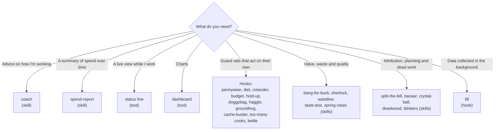
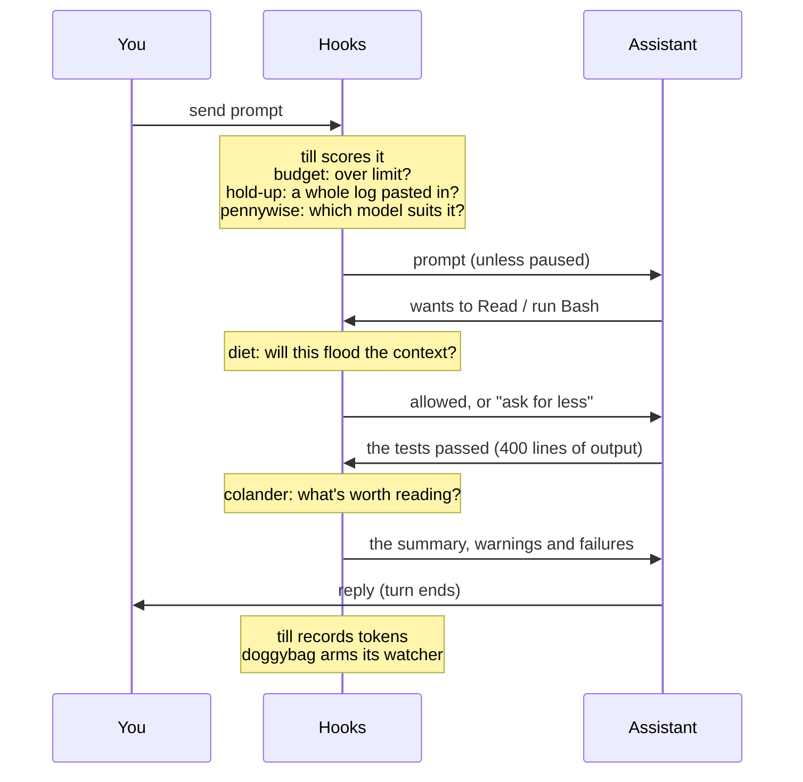

<p align="right"><a href="../README.md">← Back to README</a> · <a href="README.md">All docs</a></p>

# Skills, tools and hooks: what each one does and when to reach for it

agentarium is made of three kinds of helper. This page lists every one, says what it does, and, most usefully, **when to reach for it**.

| Kind | How it runs | You... |
|------|-------------|--------|
| **Skills** | The assistant runs them when you ask in plain words (or type the slash command). | ask for them. |
| **Hooks** | The assistant runs them automatically at set moments (a prompt is sent, a tool is about to run, a session ends). | do nothing. Tune or switch them off with settings. |
| **Tools** | Scripts you run yourself from a terminal. | run them when you want a number, a view or a change of setup. |

New to tokens, the prompt cache or why context costs money? Read [How tokens work](how-tokens-work.md) first, then [Saving tokens](saving-tokens.md) for habits that pair well with these helpers.

---

## At a glance: "I want to..."

| I want to... | Reach for | Kind |
|--------------|-----------|------|
| Know why a session was expensive, or get better at prompting | [coach](#coach) | Skill |
| See what I spent this week / month, and where | [spend-report](#spend-report) | Skill |
| Know how full the conversation is and what it has cost, right now | [status line](#status-line) | Tool |
| Know how long until the prompt cache goes cold | [status line](#status-line) | Tool |
| See OPEX vs CAPEX, spend trends and what agentarium saved as charts | [dashboard](#dashboard) | Tool |
| Check where I am against my spending limit | [budget status](#budget-1) | Tool |
| Stop myself overspending | [budget](#budget) | Hook |
| Send each prompt to the right model (cheap for trivial, strong for hard) | [pennywise](#pennywise) | Hook (or the [router proxy](#agentarium-router)) |
| Stop the AI pulling huge files or logs into the conversation | [diet](#diet) | Hook |
| Stop paying for passing tests, progress bars and install chatter every time a test run or build succeeds | [colander](#colander) | Hook (plus `agentarium colander`) |
| Pick up after a break where I left off, cheaply | [doggybag](#doggybag) | Hook (plus `agentarium doggybag`) |
| Know how much AI time went on building vs running things | [till](#till) + [dashboard](#dashboard) / [spend-report](#spend-report) | Hook + Tool / Skill |
| Get raw numbers for a script or spreadsheet | [coach.ts --json](#coachts), [report.ts --json](#reportts), or [sqlite3](reference.md#looking-at-your-data) | Tool |
| Refresh model prices | [update_prices.ts](#update_pricests) | Tool |
| Know whether the AI is delivering value for the money (cost per feature, bug fixed, passing suite) | [bang-for-buck](#bang-for-buck) | Skill (hook records it) |
| Know whether a task is worth £2 before it starts, and hold the agent to a price | [haggle](#haggle) | Skill + Hook |
| Find where the money is disappearing inside a session | [sherlock](#sherlock) | Skill |
| Know whether I'm getting worse value than last month, or fail CI on cost creep | [waistline](#waistline) | Skill + Tool |
| Prove an optimisation (cheaper model, trimmed instructions) hasn't damaged quality | [taste-test](#taste-test) | Skill + Tool |
| Clean up CLAUDE.md / AGENTS.md: duplicates, stale paths, contradictions | [spring-clean](#spring-clean) | Skill + Tool |
| Stop the AI going round in circles | [groundhog](#groundhog) | Hook (plus a skill to check a session) |
| Split the bill by project, developer, agent, model, provider or outcome, or give finance a CSV | [split-the-bill](#split-the-bill) | Skill + Tool |
| Find the cheapest provider for the same capability | [bazaar](#bazaar) | Skill + Tool |
| Keep the AI to what I asked for, and ask before it wanders | [blinkers](#blinkers) | Hook (plus a skill to check a session or branch) |
| Forecast what a team's AI adoption will cost before we start | [crystal-ball](#crystal-ball) | Skill + Tool |
| See what we spent on work that produced nothing this month | [deadwood](#deadwood) | Skill + Tool |
| Know what every request carries before I type, and which MCP servers and skills I never use | [pack-light](#pack-light) | Skill + Tool |
| Know when to `/clear` or `/compact` instead of dragging the last task along | [ballast](#ballast) | Hook (plus a skill to replay a session) |
| Get stopped before pasting a whole log, data dump or document the agent could read from the file, or asking for the whole repo at once | [hold-up](#hold-up) | Hook |
| Stop paying for long replies, recaps and whole-file rewrites | [waffle](#waffle) | Skill + Tool |
| Know why the prompt cache keeps going cold, and what each time cost | [cold-snap](#cold-snap) | Skill + Tool |
| Stop telling the AI the same thing every session | [parrot](#parrot) | Hook (plus a skill to find every repeat) |
| Learn why a prompt cost what it did, and what to do next time | [fishingrod](#fishingrod) | Built into the notices (plus a tool) |
| Know whether pay-as-you-go, Pro or Max suits how much I use | [all-you-can-eat](#all-you-can-eat) | Skill + Tool |
| Hear before an edit to CLAUDE.md, settings or a skill makes the cache start again | [cache-buster](#cache-buster) | Hook (plus a skill to check a session) |
| Stop subagents doing the same job twice, or being sent for one lookup | [too-many-cooks](#too-many-cooks) | Hook (plus a skill for what subagents cost) |
| Know, while I'm away, how long the cache stays warm | [kettle](#kettle) | Hook |
| Put what a branch cost into a commit or a pull request | [receipt](#receipt) | Skill + Tool |
| Know what a skill, plugin or MCP server will cost before I install it | [dry-run](#dry-run) | Skill + Tool |
| Score a prompt out of 10 for what it will cost, and tighten it | [rate-my-prompt](#rate-my-prompt) (alias judge) | Skill + Tool |



---

## Skills

Skills are instructions the assistant follows when you ask. They only run when you ask for them, so they cost tokens only then.

### coach

**What it does.** Reads the current conversation's transcript (read-only) and tells you, with numbers, where tokens were wasted: low cache hit ratio, cache rebuilds, oversized context, vague or correction-heavy prompts, repeated file reads, huge tool results, model switches, mixed topics. It rewrites your weakest prompt and points out what you are doing well.

**Reach for it when:**

- A session felt slow or expensive and you want to know why.
- The status line shows a big cost or a nearly full context and you're not sure what caused it.
- spend-report names one session as the costliest and you want the detail (give it the session id).
- You want to improve your prompting habits generally. Running it at the end of a long session is a good routine.

**Don't reach for it when:** you want spend across many sessions (use [spend-report](#spend-report)), or you're on Copilot CLI (there is no transcript to read).

**How:** say *"coach, review my prompts"*, *"why was that session expensive?"*, or type `/agentarium:coach`. Script behind it: [`coach.ts`](#coachts).

### spend-report

**What it does.** Turns the till database into a short report for a period (default the last 7 days): money spent in your currency, the OPEX/CAPEX split, top projects and models, the costliest sessions, what pennywise, doggybag, diet and budget did, and three ways to spend less tied to your own numbers.

**Reach for it when:**

- It's the end of the week (or month) and you want to know where the money went.
- Someone asks how much AI time goes on building vs running things.
- You want to check whether the guard-rail hooks are actually saving anything.
- You've hit a budget pause and want context ("am I always this high?").

**Don't reach for it when:** you want to look inside one session (use [coach](#coach)) or want charts (use the [dashboard](#dashboard)).

**How:** say *"spend report"*, *"where did my tokens go this week?"*, or name a period: *"spend report for this month in dollars"*. Script behind it: [`report.ts`](#reportts). Needs the plugin installed so till has been recording.

### bang-for-buck

**What it does.** Answers *"is the AI actually delivering value for the money?"* with the cost of useful work rather than tokens: cost per completed feature, bug fixed, passing test suite, commit, PR and successful agent task, each against the previous period, plus, per model, cost per session next to **cost per success** (the cheapest model is often not the best value). A hook fills the ledger at the end of every turn.

**Reach for it when:** someone asks whether the AI is worth it; you're choosing a default model; or you want a value number to track month to month rather than a spend number.

**How:** *"is the AI worth the money?"*, *"cost per feature this month"*, *"which model is best value?"*. Tool: `agentarium bang-for-buck`. Details: [bang-for-buck](reference.md#bang-for-buck).

### haggle

**What it does.** Answers *"is this task worth spending £2 on?"* before the work starts: a quote with input, output and tool costs from your own history, and a verdict against your price. Substantial prompts get a quote automatically; start a prompt with `haggle £2:` and the agent must stop and ask before going over.

**Reach for it when:** you're about to hand over a big task, a refactor or a migration, and want to know the bill first, or want a hard ceiling on it.

**How:** *"how much would it cost to migrate the auth module?"*, *"is this worth £2?"*. Tool: `agentarium haggle quote "..." --price 2`. Details: [haggle](reference.md#haggle).

### sherlock

**What it does.** Answers *"where is the money disappearing?"* with a forensic audit of what the agent did: files read twice, calls repeated for the same answer, searches rephrased into the same results, big outputs never used, subagents doing overlapping or one-step jobs. Each with its cost, why it was waste, and the fix.

**Reach for it when:** coach says a session was expensive and you want to know which *steps* were wasted, or bang-for-buck shows a costly session with nothing to show.

**How:** *"where did the money go in that session?"*, *"sherlock"*. Tool: `agentarium sherlock`. Details: [sherlock](reference.md#sherlock).

### waistline

**What it does.** Answers *"am I getting worse value than last month?"*: compares equivalent work across periods (cost per session, per result and per kind of task, context per request, tool calls, new tools, model changes) and names the cause of any creep. Also runs in CI against a committed baseline.

**Reach for it when:** the bill feels higher but nothing obvious changed; after adding an MCP server, a bigger CLAUDE.md or a new model; or to stop cost creep in an automated agent pipeline.

**How:** *"am I getting worse value than last month?"*. Tool: `agentarium waistline --days 30`; CI: `--baseline file --ci`. Details: [waistline](reference.md#waistline).

### taste-test

**What it does.** Answers *"can I prove the optimisation hasn't damaged quality?"*: compares two runs of the same task on cost and on evidence of quality (your tests, linter and type checker in each working copy, plus each transcript's signals) and gives a quality-adjusted saving with a verdict: safe saving, cheaper but worse, or false economy.

**Reach for it when:** trialling a cheaper model, a trimmed CLAUDE.md or a new prompt, before making it the default.

**How:** *"did the Haiku run do as well as the Opus one?"*. Tool: `agentarium taste-test --a <id> --a-dir ../a --b <id> --b-dir ../b`. Details: [taste-test](reference.md#taste-test).

### spring-clean

**What it does.** Audits the instructions that load with every session for duplicates across files, outdated paths and commands, oversized files, changelogs and long examples, contradictions and heavy startup context, and proposes a cleanup with what it saves per request and per month. Applies only the edits you approve.

**Reach for it when:** CLAUDE.md has grown for months, several tools each have their own instruction file, or waistline says context per request is creeping up.

**How:** *"spring-clean my CLAUDE.md"*. Tool: `agentarium spring-clean`. Details: [spring-clean](reference.md#spring-clean).

### groundhog

**What it does.** Checks a finished session for loops (the same call again, a command failing over and over, edits made and undone, tokens climbing with no progress) and what they cost. The [groundhog hook](#groundhog-1) catches them live.

**How:** *"is it going round in circles?"*. Tool: `agentarium groundhog`.

### cache-buster

**What it does.** Lists every edit in a session to the files at the start of each request (CLAUDE.md and its imports, settings, MCP servers, skills), priced as the cache rebuild each caused. The [cache-buster hook](#cache-buster-1) catches them before the edit.

**How:** *"did editing CLAUDE.md cost anything?"*. Tool: `agentarium cache-buster`. Details: [cache-buster](reference.md#cache-buster).

### too-many-cooks

**What it does.** What your subagents have cost, by type (measured from each one's own transcript), and how many the [too-many-cooks hook](#too-many-cooks-1) caught before they ran.

**How:** *"what do my subagents cost?"*. Tool: `agentarium too-many-cooks`. Details: [too-many-cooks](reference.md#too-many-cooks).

### receipt

**What it does.** Adds up every Claude Code request made on the current git branch (sessions and subagents) into one line for a commit trailer, or a short table for a pull request.

**Reach for it when:** you want reviewers, or yourself, to see what a change cost. **How:** *"what did this branch cost?"*. Tool: `agentarium receipt`, `git commit --trailer "$(agentarium receipt --trailer)"`. Details: [receipt](reference.md#receipt).

### dry-run

**What it does.** Prices a skill, plugin or MCP server before you install it: the tokens it adds to every request and what that comes to a month at your pace.

**Reach for it when:** you're about to add an MCP server or a plugin with many skills. **How:** *"what will this MCP server cost?"*. Tool: `agentarium dry-run mcp -- <command>`. Details: [dry-run](reference.md#dry-run).

### rate-my-prompt

**What it does.** Scores a prompt out of 10 on five cost criteria, 2 points each: points at the code, says what done looks like, one bounded task, no padding, asks for lean output. Gives the fix for each weak one and a tighter rewrite. `judge` is the same skill by a shorter name.

**Reach for it when:** a prompt is about to start a long task, or one keeps costing more turns than it should. **How:** *"rate my prompt: ..."* or `/judge`. Tool: `agentarium judge "prompt"`, `agentarium judge --last`. Details: [rate-my-prompt](reference.md#rate-my-prompt).

### split-the-bill

**What it does.** Answers *"who or what is consuming the budget?"*: spend by project, developer, agent and subagent, task category, model, provider, successful vs unsuccessful work, and OPEX vs CAPEX, each with cost per success and the change against the period before. `--csv` gives finance one row per session; `--db a.db --db b.db` combines a team's databases.

**Reach for it when:** a manager or finance asks where the money goes, you need a chargeback or showback, or one project or agent seems to cost more than it should.

**How:** *"split the bill by project for November"*, *"how much do subagents cost us?"*. Tool: `agentarium split-the-bill`. Details: [split-the-bill](reference.md#split-the-bill).

### bazaar

**What it does.** Answers *"where is the same capability cheapest?"*: prices the work you actually did (input, output and cached tokens, per model) on every equivalent offering across providers, filters by quality, latency and availability measured from your own sessions, and recommends the lowest cost per successful task.

**Reach for it when:** choosing between the Anthropic API, Bedrock and Vertex, comparing vendors, or renegotiating a contract.

**How:** *"which provider is best value for our work?"*. Tool: `agentarium bazaar` or `agentarium bazaar quote --input 50000 --output 5000`. Details: [bazaar](reference.md#bazaar).

### crystal-ball

**What it does.** Answers *"what will this cost?"* before you adopt an agentic workflow: developers × tasks a day × tokens per task, priced across every model and provider, with routed mixes, adoption growth and what moves the bill. `--from-history` starts from your own numbers.

**Reach for it when:** writing a budget, proposing a rollout, or comparing models for a team.

**How:** *"what would 10 developers doing 20 tasks a day cost?"*. Tool: `agentarium crystal-ball --devs 10 --tasks 20 --input 50000 --output 5000`. Details: [crystal-ball](reference.md#crystal-ball).

### deadwood

**What it does.** Answers *"what did we pay for that produced nothing?"*: a monthly report of spend on failed implementations, discarded or rejected work, abandoned tasks, repeated debugging and generated files never used, judged from tests, commits, reverts and refusals rather than token counts.

**Reach for it when:** it's month end, or bang-for-buck shows a lot of spend with nothing to show.

**How:** *"how much did we waste this month?"*. Tool: `agentarium deadwood`. Details: [deadwood](reference.md#deadwood).

### pack-light

**What it does.** Answers *"what does every request carry before I type?"*: measures each session's starting context from your transcripts (system prompt, MCP tools, skills, instructions), what re-reading it costs a month, and which configured MCP servers and installed skills you never used, with the saving from removing them.

**Reach for it when:** sessions start big, you've installed a lot of plugins or MCP servers, or once a quarter as housekeeping.

**How:** *"which MCP servers do I actually use?"*. Tool: `agentarium pack-light`. Details: [pack-light](reference.md#pack-light).

### waffle

**What it does.** Answers *"am I paying for words I don't read?"*: splits output into replies, tool input and thinking, and costs the long replies, end-of-task recaps and whole-file rewrites, with the CLAUDE.md line or setting that fixes each.

**Reach for it when:** replies feel long, or output is a big share of the spend report.

**How:** *"are the replies too long?"*. Tool: `agentarium waffle` (one session) or `agentarium waffle --days 7`. Details: [waffle](reference.md#waffle).

### cold-snap

**What it does.** Answers *"why did the cache go cold?"*: finds every time a conversation's prompt cache had to be written again (a break longer than the cache lives, a model switch, a changed CLAUDE.md or MCP server, a compaction), costs each against a warm read, and says whether the 1-hour cache would have paid off.

**Reach for it when:** the cache hit ratio in the spend report is low, or one turn cost far more than its neighbours.

**How:** *"why is my cache hit rate low?"*. Tool: `agentarium cold-snap` or `agentarium cold-snap --days 7`. Details: [cold-snap](reference.md#cold-snap).

### parrot (skill)

**What it does.** Answers *"what do I keep telling it?"*: the rules, corrections and whole prompts you've repeated across sessions, what the corrected work cost, and the CLAUDE.md line or slash command that says each one once. The [parrot hook](#parrot) points them out as they happen.

**How:** *"what should go in my CLAUDE.md?"*. Tool: `agentarium parrot` (add `report --here` for this project only). Details: [parrot](reference.md#parrot).

### all-you-can-eat

**What it does.** Answers *"am I on the right plan?"*: your typical month of Claude Code work priced at API rates, set against pay-as-you-go, Pro, Max 5x and Max 20x, with your heaviest 5 hours and week (where usage limits bite).

**Reach for it when:** you're choosing a plan, wondering whether Max is worth it, or reviewing a subscription you rarely use.

**How:** *"should I get Max?"*. Tool: `agentarium all-you-can-eat --plan pro`. Details: [all-you-can-eat](reference.md#all-you-can-eat).

### ballast (skill)

**What it does.** Replays a session to find where you switched to a new task while carrying a heavy context, and what re-reading the old context cost. The [ballast hook](#ballast) warns as it happens.

**How:** *"should I have cleared?"*. Tool: `agentarium ballast`.

### blinkers (skill)

**What it does.** Checks a finished session, or a branch against its task, for changes beyond the request (unrequested docs and tests, dependency and config changes, renames and reformatting, files outside the task) and what they cost. The [blinkers hook](#blinkers) catches them live.

**How:** *"did it do more than I asked?"*. Tool: `agentarium blinkers`, or `agentarium blinkers diff --task "..." --base main`.

---


## Hooks

Hooks run automatically once the plugin is installed. You don't call them; you decide whether to keep them on and how strict they are. Each guard-rail hook has a `block` / `warn` / `off` setting (see [Configuration](configuration.md)).

Where each hook fires:

| Moment | Claude Code event | Copilot CLI event | Hooks |
|--------|-------------------|-------------------|-------|
| Session starts (or `/clear`, or after compaction) | `SessionStart` | (none) | doggybag, waistline\* |
| You send a prompt | `UserPromptSubmit` | `userPromptSubmitted` | the controller, which runs till, budget\*, hold-up\*, pennywise\*, haggle\*, ballast\*, doggybag, blinkers and parrot\* in one process (Copilot, in one process too: till, premium\*, doggybag, blinkers) |
| A tool is about to run | `PreToolUse` (diet: `Read`, `Bash`; blinkers and cache-buster: edits; too-many-cooks: `Agent`; the rest: every tool) | `preToolUse` | diet, groundhog, haggle\*, blinkers, cache-buster\*, too-many-cooks\* |
| A tool has run | `PostToolUse` (diet: `Read`, `Bash`; colander: `Bash`) | `postToolUse` | diet (sizes), colander; till on Copilot |
| A subagent finishes | `SubagentStop` | (none) | too-many-cooks |
| The conversation is about to be compacted | `PreCompact` | (none) | doggybag |
| The assistant waits for you | `Notification` (idle, permission) | (none) | kettle |
| The assistant finishes a turn | `Stop` | (none) | till, doggybag, bang-for-buck, haggle |
| Session ends | `SessionEnd` | `sessionEnd` | till, doggybag, bang-for-buck\*, sherlock\*, haggle\* |

\* Claude Code only: Copilot ignores prompt-hook output, so it can't pause a prompt, and it has no transcript or token counts for the value and waste helpers to read.



### till

**What it does.** Labels each session **OPEX** (running things: logs, metrics, incidents), **CAPEX** (building things: writing or changing code), `mixed` or `unknown`, and saves one row per session to `~/.agentarium/till.db` with token counts and cost. It never blocks or shows anything. Every other reporting helper reads its data.

**Reach for it when:** you want any history at all. Keep it on; spend-report, the dashboard and budget rely on it. Reach for its settings when:

- Labels look wrong: map your own skills with `AGENTARIUM_SKILL_MAP`, or edit the keyword lists in `agentarium/engine/classifier.ts`.
- Keywords keep missing: set `AGENTARIUM_LLM=1` to let a model decide once per session (prompts leave your machine, redacted; point it at a local model if sensitive).
- A team wants one shared view: point `AGENTARIUM_DB` at a shared location.

**Script:** `scripts/till.ts` (`prompt`, `tool`, `finalize`, and `capabilities` to see what each assistant supports). Details: [What till saves](reference.md#till).

### pennywise

**What it does.** A model router. Scores each prompt from weighted signals (length, code, simple-task phrases, technical terms, complex work, reasoning words, multi-step structure) into one of four tiers, `SIMPLE` → Haiku, `MEDIUM` → Sonnet, `COMPLEX` → Opus, `REASONING` → Opus (you choose the map). As a hook it hands the prompt to a subagent on that model, routing down to save money and up when your model is out of its depth. It only routes down when the saving beats the cost of the hand-off, moves back up when an answer didn't land, and learns from both. As a background proxy (`agentarium router on`) it rewrites the model of every request instead, cache-aware, with fallback and no hand-off.

**Reach for it (keep it on) when:** you tend to leave one model selected all day, or a team is new to choosing models. Run the proxy when you want every turn routed with full context rather than handed to a subagent. Set it to `block` if you'd rather be asked to switch with `/model`, or `off` if you always pick models deliberately.

**To steer one prompt:** start it with `keep-model:`, or `haiku:` / `sonnet:` / `opus:` / `fable:` to force a model. Curious why a prompt went where it did? `agentarium router explain "<prompt>"`. Claude Code only. Details: [Using pennywise](reference.md#pennywise).

### diet

**What it does.** Before a `Read` or `Bash` call runs, refuses a small set of calls known to flood the context (whole lockfiles or minified files, unbounded `kubectl logs` / `git log` / `find /`, `cat` of a huge file) and tells the AI how to ask for less. The AI retries with a narrower call on its own. Each block is logged with an estimate of tokens kept out.

**Reach for it (keep it on) when:** you do a lot of ops or debugging work (logs, big repos), since one unbounded log dump is paid for again on every later turn. Raise `AGENTARIUM_DIET_MAX_KB` if it blocks files you genuinely need whole.

**It learns.** After each `Read` or `Bash` it records how much came back, by program name or file type only; a program that keeps printing more than the limit unfiltered gets asked for a filter too. `agentarium diet sizes` shows what it has learned.

**When you need the whole thing:** append `# diet-ok` to the command. Works in Claude Code and Copilot CLI. Details: [Using diet](reference.md#diet).

### colander

**What it does.** After a test run, build, lint or install succeeds, shows the AI the first and last lines, every warning and anything that failed, and leaves out the passing tests, progress bars, download chatter and repeated lines. A green 353-test run goes in as 13 lines instead of 2,818. The full output is saved first, and a footer gives its path, so the AI greps it when it needs a line instead of running the suite again.

**Reach for it (keep it on) when:** you or the agent run tests, builds or installs often, which is most coding. Everything the AI reads stays in the context and is re-read at every later step, so a noisy green run costs you again and again. Name your own scripts with `AGENTARIUM_COLANDER_COMMANDS` (e.g. `ci.sh,just`).

**To see what it does to some output:** `npm test 2>&1 | agentarium colander strain`. `agentarium colander` shows the week's strains by program.

**When you need the whole thing:** append `# colander-off` to the command. Claude Code and Copilot CLI, successful commands only (a failing one reaches the AI whole). Details: [Using colander](reference.md#colander).

### budget

**What it does.** Tracks spend against a daily and/or per-session limit in your currency. One notice at 80%; at 100% your next prompt is paused with cheaper ways forward (`/compact`, a smaller model, a fresh session).

**Reach for it when:** you're paying out of your own pocket, you have a monthly allowance to stretch, or you're trialling a new, pricier model. It does nothing until you set `AGENTARIUM_BUDGET_DAILY`, `AGENTARIUM_BUDGET_SESSION` and/or `AGENTARIUM_BUDGET_MONTHLY` (a monthly allowance spread over the working days left before it resets).

**When it pauses you:** send the same prompt again, or start it with `over-budget:`; you won't be paused again for that limit that day. Use `AGENTARIUM_BUDGET_MODE=warn` for notices only. Claude Code only (Copilot bills premium requests, which hooks can't see). Details: [Using budget](reference.md#budget).

### hold-up

**What it does.** Before a prompt of 10,000 tokens or more is sent (about 40 KB, or roughly 500 lines of log), pauses it once and says what most of it is (a log, a data dump, base64, a diff, source code, a document or other pasted text), what carrying it costs at every later step and what to do instead: save it to a file, or name the one it came from, and say what you're after, so the agent greps for the lines that matter. It also pauses a short prompt that is blatantly too broad, such as "refactor the whole codebase" or "fix all the bugs" with no file, function or error named, and asks where to start and how you'll know it's done.

**Reach for it (keep it on) when:** you copy logs, stack traces, JSON, test output or whole documents into prompts, or fire off one-line asks for the whole repo. Once sent, a paste stays in the conversation until you `/clear` or `/compact`.

**When it pauses you:** send the same prompt again to go ahead. `AGENTARIUM_HOLDUP=warn` for notices only (the paste still goes in), `AGENTARIUM_HOLDUP_MIN_TOKENS` to change the size, `AGENTARIUM_HOLDUP_BROAD=off` to leave broad prompts alone. Claude Code and VS Code (without the money); Copilot CLI ignores prompt-hook output. Details: [hold-up](reference.md#hold-up).

### doggybag

**What it does.** Just before the prompt cache expires, packs a short "where we got to" note into your project at `.doggybag/latest.md` (the folder ignores itself in git): branch and changes, tasks, your last requests, files edited, recent commands, and how to carry on. No model is called, so it costs nothing. If you come back after the cache went cold, your next prompt makes sure it's packed and tells you what carrying on cold would cost; `/clear` (or a new session in the folder) loads it automatically.

**Reach for it when:** you step away from a session for more than a few minutes and plan to come back. Instead of carrying on in the cold session (which re-writes the whole conversation into the cache), type `/clear` and keep going. Need one now? `agentarium doggybag`.

It also packs one before `/compact` or auto-compact and loads it back afterwards, so the file names and decisions a summary drops are still there.

**Turn it off** (`AGENTARIUM_DOGGYBAG=off`) if you never resume work across breaks. Copilot support is best effort. Details: [Using doggybag](reference.md#doggybag).

---

### groundhog

**What it does.** Before every tool call, checks whether the agent is going round in circles: the same call with the same input again with nothing changed, a command that keeps failing, an edit made and undone, or 20 calls of mostly errors with the context still growing. The first time, it refuses the call with the evidence and tells the agent to change strategy; by default it refuses at most twice and then lets it through and tells you (`interrupt` ends the turn instead).

**Reach for it (keep it on) when:** you let the agent work unattended, or on long debugging sessions where a stuck agent burns money fastest.

**When it's wrong:** append `# groundhog-ok` to a command; `AGENTARIUM_GROUNDHOG=warn` for notices only. In Copilot CLI it catches identical calls in a row. Details: [groundhog](reference.md#groundhog).

### cache-buster

**What it does.** Before an edit to CLAUDE.md (or a file it imports), settings, the MCP server list or a skill, says what the cache rebuild it causes will cost, once per file per session. `AGENTARIUM_CACHEBUSTER=ask` confirms first; `block` has the agent leave the change as a note. Claude Code only. Details: [cache-buster](reference.md#cache-buster).

### too-many-cooks

**What it does.** Before a subagent is sent, checks whether one is already on the same job, whether it's a single lookup or whether too many have gone out since your prompt, priced at what your subagents really cost. `warn` by default; `block` has the agent do the work itself. Claude Code only. Details: [too-many-cooks](reference.md#too-many-cooks).

### kettle

**What it does.** When Claude Code waits for you, a terminal notification says how long until the cache goes cold and what's at risk. `AGENTARIUM_KETTLE=desktop` adds a system notification. Claude Code only. Details: [kettle](reference.md#kettle).

### haggle (hook)

**What it does.** Quotes each substantial prompt as you send it and tracks the task's spend as it runs; tells you once it passes its estimate and its cap; if you set the price (`haggle £2: ...`, or `AGENTARIUM_HAGGLE=strict`) it stops the agent at the cap and has it ask you to approve more (`haggle +£1`). Claude Code only. Details: [haggle](reference.md#haggle).

### blinkers

**What it does.** Notes what each prompt asks for (only the files, names and kinds of work mentioned) and checks every edit before it happens. The first edit to a file that goes beyond the task (docs or tests nobody asked for, dependency or config changes, a rename or reformat, a file away from everything the task named) is held until you confirm: a confirm prompt in Claude Code, a refusal that makes the agent ask in Copilot CLI. Each file is asked about once per session.

**Reach for it (keep it on) when:** you want small, reviewable changes; an agent tends to "improve" things along the way.

**When it's in the way:** say *"blinkers off"* in a prompt, or set `AGENTARIUM_BLINKERS=warn` (or `off`). Details: [blinkers](reference.md#blinkers).

### ballast

**What it does.** When you send a prompt in a conversation over 60,000 tokens, checks whether it starts a different task (little in common with your recent prompts and the files touched, or "new task", "unrelated", "something else"). If so, it tells you once what the old context costs to re-read at every step and suggests `/clear` (doggybag keeps your notes) or `/compact`. It also notes each time the context grows past another 60,000. Claude Code only.

**When it's wrong:** ignore it; it won't repeat itself. `AGENTARIUM_BALLAST=off` turns it off, `block` pauses the prompt once instead. Details: [ballast](reference.md#ballast).

### parrot

**What it does.** Notes a hash (never the text) of each standing rule ("always use pnpm"), correction ("no, use the v2 client") and whole prompt you send. When the same one turns up in a third session in a project, it tells you once and suggests the line for CLAUDE.md or a slash command, so you can say it once instead of every session. Claude Code only.

**When it's wrong:** ignore it; it won't repeat itself. `AGENTARIUM_PARROT=off` turns it off; `AGENTARIUM_PARROT_MIN` changes how many sessions count. Details: [parrot](reference.md#parrot).

### fishingrod

**What it does.** Not a hook of its own: it adds a lesson to the notices from hold-up, ballast, parrot, haggle, pennywise, doggybag and budget. The first 3 times each kind of notice comes up, it says why that prompt costs what it does and what to type next time (with an example); after that, one line pointing to `agentarium fishingrod <lesson>`. Claude Code only, like those notices.

**When it's in the way:** `AGENTARIUM_FISHINGROD=off` drops the lessons and pointers; `AGENTARIUM_FISHINGROD_TIMES` changes how many times each is shown in full. Details: [fishingrod](reference.md#fishingrod).

### bang-for-buck, sherlock and waistline (hooks)

Quiet record-keepers for the skills above. **bang-for-buck** writes each session's cost and outcomes to the ledger at every turn end; **sherlock** logs each session's estimated waste at session end (shown in the spend report); **waistline** checks once a day at session start and shows one line if last week cost noticeably more per session or per result than the week before. Each has an `=off` switch (see [Configuration](configuration.md#value-waste-and-quality)).

---

## Tools

Scripts you run yourself. All need only Node.js 22.18+ (they're TypeScript, run directly) and live in `scripts/`. Run them from the repo (or plugin) folder.

### status line

`scripts/statusline.ts`: a live line at the bottom of Claude Code or Copilot CLI in a terminal, showing model, context fill, total tokens, cost and the cache countdown. In the Claude desktop app and VS Code the same line is agentarium's row in the **band** above the prompt box (`hooks/band.tsx`), and the **pane** beside the transcript (`hooks/pane.tsx`) shows it in tabs with the advice in full.

**Reach for it when:** you want to *see* cost as you go rather than find out afterwards. It's the best everyday early warning: start a fresh conversation when the context bar goes red, and finish your thought (or let doggybag pack a note) before the cache timer runs out.

| Command | Use it to |
|---------|-----------|
| `/agentarium:statusline` (plugin) or `agentarium statusline --install claude` (or `copilot`, `both`) | Install it (backs up your settings first). `--uninstall` removes it, `--status` says where it is. |
| `agentarium statusline --band-off` (`--band-on`) | Hide (or show) the band in the desktop app, and Copilot's status bar item and window. |
| `agentarium vscode --status-bar` | Put Copilot's numbers in VS Code's status bar: premium requests left and when they run out. |
| `agentarium copilot --window` | The same in a small window beside the GitHub Copilot app. |
| `/agentarium-pane` | Open the pane: Now, Ahead and Advice tabs beside the transcript. If the app isn't drawing it, it says why. |
| `agentarium statusline --outlook-off` (`--outlook-on`) | Hide (or show) the forecast row under the terminal status line. |
| `agentarium statusline --set-currency USD` | Choose £, $ or € for every cost agentarium shows. |
| `agentarium statusline --update-rate` | Fetch today's exchange rates. |
| `agentarium statusline --watch` | A smoothly ticking countdown in a spare terminal pane. |
| `agentarium statusline --demo --theme light` | Preview every state and colour. |

Details: [status line](reference.md#status-line), [band](reference.md#band) and [pane](reference.md#pane) reference.

### dashboard

`scripts/dashboard.ts`: a local web page over the till database with a % OPEX vs % CAPEX bar, spend and what agentarium saved, a line for each helper that stepped in, daily trend, per-project split, skills used and recent sessions.

**Reach for it when:** you want trends or a picture to share (a team review, a finance question, proof the guard-rails pay for themselves), rather than a written summary. `--demo` shows it with fake data before you have any of your own.

```
agentarium dashboard              # http://127.0.0.1:8765
agentarium dashboard --demo
```

Read-only, local only. Details: [dashboard reference](reference.md#dashboard).

### report.ts

`scripts/report.ts`: the engine behind [spend-report](#spend-report).

**Reach for it directly when:** you want the report without asking the assistant (no tokens spent), or want JSON for a script or spreadsheet.

```
node scripts/report.ts                     # last 7 days, Markdown
node scripts/report.ts --days 30 --json    # --days 0 for all time
node scripts/report.ts --currency EUR
```

### budget

`node scripts/budget.ts status` shows today's and this session's spend against your limits. **Reach for it** before a big piece of work, or after a budget notice, to see how much headroom is left.

### coach.ts

`scripts/coach.ts`: the analyser behind the [coach](#coach) skill.

**Reach for it directly when:** you want the raw flags and numbers without spending tokens on the assistant's write-up, or want to analyse an older session.

```
node scripts/coach.ts                     # newest transcript for this folder
node scripts/coach.ts --session <id> --json
node scripts/coach.ts --transcript path/to/file.jsonl
```

### agentarium router

`agentarium router on` runs pennywise as a routing proxy in the background and points Claude Code at it (`off` undoes it; `serve` runs it in the foreground). `status` shows what it saved, `explain "<prompt>"` the tier, score and signals for a prompt, `eval` how well it routes a labelled set, and `learn` what the routes that held and missed would change. **Reach for it** when you want every request routed with full context, or to tune the tiers.

### agentarium audit and agentarium profile

`agentarium audit` runs every leak check (pack-light, waffle, cold-snap, ballast, spring-clean, deadwood, groundhog, parrot, waistline) in one report, biggest money first. `agentarium profile frugal | balanced | quality` sets every switch with one word; `agentarium profile` shows what's in effect. `agentarium copilot` shows the Copilot premium-request allowance: left, pace, and when it runs out. `agentarium vscode` adds the VS Code agent hooks to a workspace ([details](installation.md#copilot-in-vs-code)).

### agentarium doggybag

`agentarium doggybag` (or `node scripts/doggybag.ts write`) packs a doggybag on demand. **Reach for it** when you're about to stop and want the note now rather than waiting for the cache timer.

### till.ts capabilities

`node scripts/till.ts capabilities` lists what each assistant can report (transcript, token counts, tool events, billing). **Reach for it** when a column is empty and you want to know whether that's expected for that assistant.

### Value, waste and quality tools

The scripts behind the seven value skills; run them directly for no-token answers or JSON (`--json` on each):

```
agentarium bang-for-buck --days 30                 # cost per outcome; also: session, mark <kind>, ingest <dir>
agentarium haggle quote "migrate auth" --price 2 # is it worth £2?   haggle status: quoted vs actual
agentarium sherlock --session <id>               # hidden waste in a session
agentarium waistline --days 30                   # cost regression; --save-baseline / --baseline F --ci
agentarium taste-test --a <id> --b <id> --a-dir ../a --b-dir ../b   # add --gate to fail CI on a quality loss
agentarium spring-clean --dir .                   # context hygiene audit
agentarium groundhog --session <id>              # loops in a finished session
```

### Intelligence engine tools

```
agentarium split-the-bill --month 2026-11          # spend by project, developer, agent, category, model, provider, status
agentarium split-the-bill --csv > ai-spend.csv     # one row per session, for finance; --db a.db --db b.db for a team
agentarium bazaar --min-quality 70               # best-value provider for your own workload; quote, list
agentarium blinkers diff --task "..." --base main --ci   # scope creep on a branch; blinkers: the latest session
agentarium crystal-ball --devs 10 --tasks 20 --input 50000 --output 5000   # monthly forecast; --from-history
agentarium deadwood --month 2026-11              # spend on work that produced nothing; session, mark <status>
agentarium pack-light --days 30                   # fixed load per request; MCP servers and skills you never use
agentarium ballast                               # task switches that carried a heavy context
agentarium waffle --days 7                       # output spend: long replies, recaps, whole-file rewrites
agentarium cold-snap --days 7                     # every cache rebuild, its cause and cost
agentarium parrot                                # rules, corrections and prompts you keep repeating
agentarium fishingrod [lesson]                   # the why behind each notice, and what to do next time
agentarium all-you-can-eat --plan pro               # pay-as-you-go or a subscription, from your own spend
```

The signature features also answer to what they do: `agentarium value-meter` (bang-for-buck), `agent-forensics` (sherlock), `quality-gate` (taste-test), and the new tools to `cost-attribution`, `provider-arbitrage`, `scope-guard`, `spend-simulator` and `dead-work`, and the newest to `fixed-overhead`, `context-carry`, `output-audit`, `cache-misses`, `repeated-instructions`, `plan-fit` and `lessons` (fishingrod).

### update_prices.ts

`scripts/update_prices.ts`: refreshes `data/model-prices.json` from Claude's pricing page. A GitHub Action already runs it every Monday.

**Reach for it when:** a new model has launched or prices changed and you don't want to wait for Monday, or (`--check`) to confirm the file is current. To override a single price instead, use `"prices"` in `~/.agentarium/statusline.json` (see [Prices](configuration.md#prices)).

```
node scripts/update_prices.ts            # fetch and update
node scripts/update_prices.ts --check    # exit 1 if out of date
```

---

## A sensible setup

- **Everyone:** install the plugin (till, diet, doggybag and pennywise run by default) and the [status line](#status-line).
- **Paying personally or on an allowance:** also set a [budget](#budget).
- **Weekly:** ask for a [spend-report](#spend-report).
- **After any session that surprised you:** ask the [coach](#coach), then [sherlock](#sherlock) for the wasted steps.
- **Monthly:** ask [bang-for-buck](#bang-for-buck) whether value is improving and [waistline](#waistline) whether costs are creeping; [spring-clean](#spring-clean) your instruction files.
- **Before a big task:** ask [haggle](#haggle) for a quote, or start the prompt with `haggle £X:`.
- **Before switching to a cheaper model or trimmed instructions for good:** run a [taste-test](#taste-test).
- **Teams:** share a database with `AGENTARIUM_DB` and look at the [dashboard](#dashboard) together.

See [Installation](installation.md) to get set up, [Configuration](configuration.md) for every setting, and [Installation → Troubleshooting](installation.md#troubleshooting) if something looks wrong.

---

<p align="center"><a href="saving-tokens.md">← Saving tokens</a> · <a href="README.md">All docs</a> · <a href="reference.md">Helper reference →</a></p>
